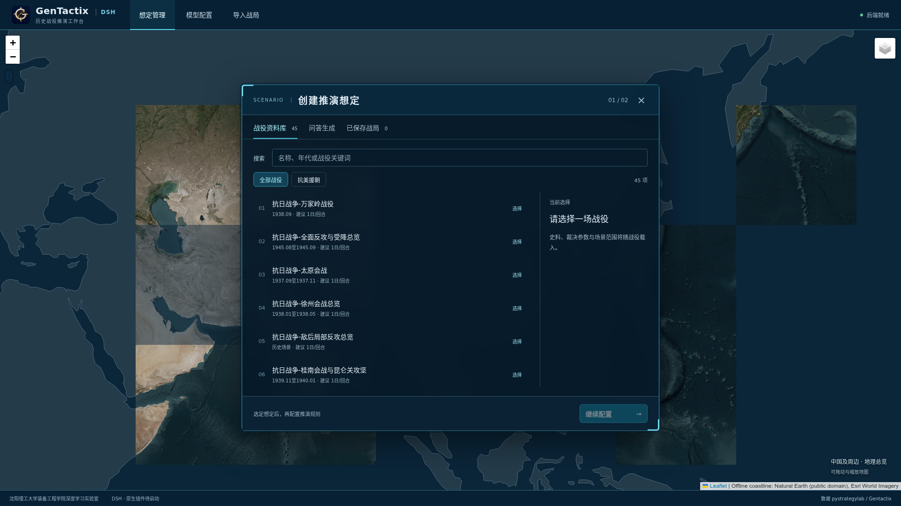
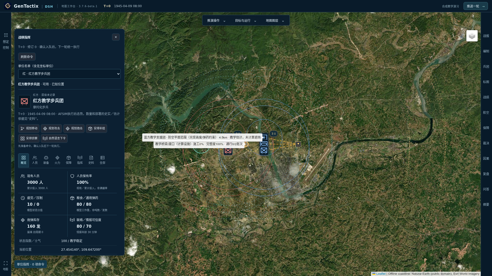

# GenTactix-DSH-AFSIM

[简体中文](README.md) · [Docker guide (Chinese)](docker/README.zh-CN.md) · [Testing](TESTING.md) · [Handoff](docs/开发移交与阶段交付-2026-11-06.md)

A map-based military-history teaching workbench. DSH retrieves sources, plans unit decisions and explains results. An optional AFSIM backend runs movement and registered teaching rules. Application checkpoints retain orders, personnel, equipment and inventories.

**3.7.6-beta.1 is a limited-scenario classroom beta.** The catalog contains 45 entries; complete historical campaigns and all mode combinations have not passed acceptance. See the [release record](docs/releases/v3.7.6-beta.1.md).



## Install and launch

Source: **[snow-wind-001/gentactix-dsh-afsim](https://github.com/snow-wind-001/gentactix-dsh-afsim)**.

**Request Docker files and image access by emailing [snowwind001@gmail.com](mailto:snowwind001@gmail.com).** Images are hosted at [snowwind001/gentactix-dsh-afsim](https://hub.docker.com/r/snowwind001/gentactix-dsh-afsim). Access is granted on application; anonymous pulls are not guaranteed. Log in with your approved Docker Hub account.

1. Install Docker Engine with Compose v2, or Docker Desktop with Linux containers on Windows. The image targets Linux amd64; actual Windows-host acceptance remains pending.
2. Download and extract the starter package from [Releases](https://github.com/snow-wind-001/gentactix-dsh-afsim/releases).
3. Double-click `Start-GenTactix.cmd` on Windows, or run `bash docker/start.sh` on Ubuntu. Open **http://localhost:8080**. `bash docker/install-menu.sh` adds an Ubuntu application-menu icon.
4. Use **Model settings** to set your API endpoint, model ID, key and reasoning effort, then test the connection. The LAN example defaults to `http://192.168.2.111:8081/v1`; change it for your network. Defaults are medium effort, 64K output and 256K context, subject to model support. No model weights or personal keys are included.

```bash
docker login
docker compose up -d
docker compose logs --tail=100
# Upgrade using the same project name and data volume
docker compose pull
docker compose up -d
# Stop without deleting data
docker compose stop
```

The default `3.7.6-beta.1-afsim` image includes the application, DSH SDK/runtime, the required AFSIM 2.9 command-line runtime and Wine. No separate AFSIM mount is required. Unneeded demos, training material and original book scans are excluded. The lighter `3.7.6-beta.1-core` omits AFSIM/Wine; select it with `docker compose -f docker-compose.yml -f docker-compose.core.yml up -d`.

The full image downloads about 619MB and extracts to 1.70GB; the first Wine prefix adds about 726MB. The core image downloads about 239MB.

A named volume preserves saves, trajectories, encrypted configuration and keys across upgrades. **Do not run `docker compose down -v`.** Fernet protects stored configuration; administrators with host or Docker access can still obtain the key. Back up and protect the whole volume. The default port is bound to loopback only. See the [Docker guide](docker/README.zh-CN.md) for permissions, upgrades and source builds.

## Features

- **Map workbench:** collapsible toolbars and side tabs, military symbols, unit trails, fields of fire, weapon ranges and supply overlays when the scenario provides the data.
- **Units and formations:** command hierarchies, task groups and constrained splitting/merging. The inspector covers personnel, classified equipment, firepower, supplies, command and sources, preserving unknowns and explicit estimates.
- **Visual and language commands:** select a unit and map destination/target, review a draft, then queue the order. Unit and global natural-language instructions also require confirmation. Inspect decisions and execution receipts.
- **Native DSH plugins:** persistent role sessions, domain MCP tools, events, budgets and cancellation. Bounded observations read checkpoints instead of repeatedly rewriting the entire world. A JSON protocol remains as a compatibility path.
- **Two engines:** standalone DSH, or DSH planning with AFSIM execution. Registered models cover ground combat, classified ammunition, air support, abstract air defense, logistics and selected crossing/engineering mechanisms. Combinations have separate acceptance limits.
- **Review and saves:** sourced reports, key decisions, turning points, trajectory attribution and branch comparisons; save/recovery and JSON import/export. Counterfactuals are model experiments rather than proven historical causal conclusions.



## Three purposes

| Purpose | Initial state and control | Engine |
| --- | --- | --- |
| Historical campaign retrospective analysis | Follow sourced events and order; unknowns remain unknown; read-only control | DSH or AFSIM |
| Historical battle simulation | Begin with named historical forces in a calculable local window; change orders and outcomes with estimates labeled | DSH or AFSIM |
| Synthetic teaching exercise | Derive a supported historical local state and edit forces, equipment, deployment and inventory; optional compatibility templates | DSH or AFSIM |

Choose campaign, purpose and engine, then generate/validate configuration. Changed deployment requires revalidation. Confirmed orders enter a queue; **Next turn** executes them. Source retrospectives advance through cited events. Model failures are rejected rather than presented as valid state.

## Campaign and scenario catalog

**45 source entries:** Changping 1, Long March 15, WWII China 20, Korean War 9. Linked cards document forces, events, citations and disputes, mainly in Chinese. Do not add the strengths or outcomes of overview and constituent entries. Catalog presence does not establish full historical initialization, terrain, effect calibration or campaign acceptance; the UI identifies supported windows and missing inputs.

### Ancient warfare: Changping (1 entry)

The Qin–Zhao struggle over Shangdang, centered on the decisive operations of 260 BCE, introduces defensive positions, deception, force separation and supply interdiction.

| Scenario | Period | Introduction and teaching topics |
| --- | --- | --- |
| [Changping](corpus/长平之战.md) | 262–260 BCE | Operations around modern Gaoping, Shanxi; explore command changes, pursuit, flanking and supply routes. The card distinguishes figures in the *Records of the Grand Historian* from modern debate; HP is not a historical headcount. |

### Long March (15 entries)

Organized by strategic movements and key nodes, covering the Central Red Army, Fourth Front Army, Second and Sixth Corps, and 25th Army on parallel tracks, plus consolidation after arrival in northern Shaanxi. These are not 15 consecutive battles fought by one force.

| ID and scenario | Catalog period | Introduction and teaching topics |
| --- | --- | --- |
| LM01 · [Xiang River campaign](corpus/红军长征-湘江战役-1934.11.25至1934.12.01.md) | 1934-11-25 – 1934-12-01 | Crossings and blocking actions around Quanzhou, Xing’an and Guanyang; explore baggage delays, crossing capacity and the time bought by covering forces. |
| LM02 · [Crossing the Wu River](corpus/红军长征-强渡乌江-1935.01.01至1935.01.06.md) | 1935-01-01 – 1935-01-06 | Operations at Jiangjiehe and other crossings; explore advance parties, bridge construction and the passage of follow-on formations. |
| LM03 · [Four crossings of the Chishui](corpus/红军长征-四渡赤水-1935.01.19至1935.03.22.md) | 1935-01-19 – 1935-03-22 | Maneuver through Tucheng, Zhaxi, Zunyi and Chishui crossings; explore intelligence, route changes and escape from encirclement. |
| LM04 · [Central Red Army crossing of the Jinsha](corpus/红军长征-中央红军巧渡金沙江-1935.05.03至1935.05.09.md) | 1935-05-03 – 1935-05-09 | The Central Red Army’s crossings around Jiaopingdu; explore boat capacity, crossing selection and concentration of the main force. |
| LM05 · [Dadu crossing and Luding Bridge](corpus/红军长征-强渡大渡河与飞夺泸定桥-1935.05.24至1935.05.29.md) | 1935-05-24 – 1935-05-29 | Linked actions at Anshunchang and Luding Bridge; explore ferry bottlenecks, split routes and the deadline for capturing a bridge. |
| LM06 · [Maogong link-up and mountain/grassland movements](corpus/红军长征-懋功会师与雪山草地转移-1935.06.12至1935.09.12.md) | 1935-06-12 – 1935-09-12 | The Dawei and Maogong link-ups followed by mountain and grassland movements; explore separate command chains, route disputes and noncombat losses. |
| LM07 · [Baozuo campaign](corpus/红军长征-包座战役-1935.08.29至1935.09.01.md) | 1935-08-29 – 1935-09-01 | Operations around Qiuji Temple, Dajin Temple and neighboring valleys; explore the allocation of forces between siege and interception of relief troops. |
| LM08 · [Lazikou battle](corpus/红军长征-腊子口战斗-1935.09.16至1935.09.17.md) | 1935-09-16 – 1935-09-17 | A narrow-pass assault combining frontal pressure with a cliff-flanking movement; explore terrain, concealed approach and coordination. |
| LM09 · [25th Red Army’s Long March](corpus/红军长征-红二十五军长征-1934.11.16至1935.09.16.md) | 1934-11-16 – 1935-09-16 | An independent campaign through Dushuzhen, Yujiahe, the Hubei–Henan–Shaanxi base area and northern Shaanxi; explore movement and base building. |
| LM10 · [Jialing River campaign](corpus/红军长征-嘉陵江战役-1935.03.28至1935.04.21.md) | 1935-03-28 – 1935-04-21 | The Fourth Front Army’s Jialing crossing and advance toward Jianmen Pass; explore multiple crossing points and bridgehead expansion. |
| LM11 · [Baizhang Pass campaign](corpus/红军长征-百丈关战役-1935.11.md) | 1935-11 | A turning point in the Fourth Front Army’s southward operations; explore an exposed advance, counterattacks and endurance; conflicting dates remain documented. |
| LM12 · [Wumeng Mountain maneuvers](corpus/红军长征-乌蒙山回旋战-1936.02.27至1936.03.28.md) | 1936-02-27 – 1936-03-28 | The Second and Sixth Corps’ maneuvers along the Guizhou–Yunnan border; explore route choices, imperfect intelligence and evasion. |
| LM13 · [Second and Sixth Corps’ Jinsha crossing](corpus/红军长征-红二六军团抢渡金沙江-1936.04.25至1936.04.28.md) | 1936-04-25 – 1936-04-28 | The Second and Sixth Corps cross near Shigu in 1936; explore crossing coordination and distinguish this operation from the Central Red Army’s 1935 crossing. |
| LM14 · [Zhiluozhen campaign](corpus/红军长征-直罗镇战役-1935.11.20至1935.11.24.md) | 1935-11-20 – 1935-11-24 | A consolidation battle after the Central Red Army reached northern Shaanxi; explore a valley ambush, encirclement and relief interception. |
| LM15 · [Ganzi to the three main forces’ link-ups](corpus/红军长征-甘孜会师至三大主力会师-1936.07.01至1936.10.22.md) | 1936-07-01 – 1936-10-22 | From concentration and reorganization at Ganzi to the Huining and Jiangtaibao link-ups; explore converging routes, support and timing. |

See the [Long March data guide](data/long_march/README.md) and [file index](data/long_march/INDEX.md). The 1935 Jiaopingdu and 1936 Shigu crossings have separate cards; Zhiluozhen is a post-arrival consolidation scenario.

### WWII China (20 entries)

Organized by strategic stage and theater: conventional fronts, operations behind Japanese lines, and the cross-border southwestern theater. The three Changsha campaigns have separate cards. Pingxingguan, Tai’erzhuang, Wanjialing, Hengyang and Cheqiao link to parent overviews. Local Chinese counteroffensives and Japanese strategic offensives could coexist in 1944; the year alone does not determine a scenario’s posture.

| ID and scenario (catalog period) | Introduction and teaching topics | Local rules |
| --- | --- | --- |
| AJ01 · [Shanghai campaign](corpus/抗日战争-淞沪会战-1937.08.13至1937.11.12.md)<br>1937-08-13 – 1937-11-12 | Shanghai’s urban districts, Wusong–Luodian and Hangzhou Bay; explore landing threats, reserve allocation and withdrawal timing. | Delay |
| AJ02 · [Taiyuan campaign](corpus/抗日战争-太原会战-1937.09至1937.11.md)<br>1937-09 – 1937-11 | Defense from Pingxingguan through Xinkou and Niangziguan to Taiyuan; explore coordination between the front and raids on rear communications. | Delay |
| AJ03 · [Pingxingguan ambush](corpus/抗日战争-平型关伏击战-1937.09.25.md)<br>1937-09-25 | The 115th Division’s road ambush at Qiaogou; explore concealment, column isolation and withdrawal, separately from the wider pass defense. | Assault |
| AJ04 · [Xuzhou campaign overview](corpus/抗日战争-徐州会战总览-1938.01至1938.05.md)<br>1938-01 – 1938-05 | A multi-direction campaign across northern Jiangsu, southern Shandong and the Xuzhou railway hub; explore linked fronts and withdrawal before encirclement. | Breakout |
| AJ05 · [Tai’erzhuang battle](corpus/抗日战争-台儿庄战役-1938.03.23至1938.04.07.md)<br>1938-03-23 – 1938-04-07 | Urban defense and attacks from outside Tai’erzhuang; explore how long defenders must hold for surrounding forces to act. | Assault |
| AJ06 · [Wuhan campaign](corpus/抗日战争-武汉会战-1938.06至1938.10.md)<br>1938-06 – 1938-10 | A broad delaying campaign along the Yangtze and across four provinces; explore forts, transport and strategic evacuation. | Delay |
| AJ07 · [Wanjialing battle](corpus/抗日战争-万家岭战役-1938.09下旬至1938.10.md)<br>1938-09 (late) – 1938-10 | A local mountain encirclement within the Wuhan campaign; explore containment, relief interception and the requirements for eliminating an encircled force. | Assault |
| AJ08 · [First Changsha campaign](corpus/抗日战争-第一次长沙会战-1939.09.14至1939.10.md)<br>1939-09-14 – 1939-10 | Three approaches through northern Hunan, southern Hubei and northern Jiangxi; explore successive defense, flank attacks and supply. | Delay |
| AJ09 · [Second Changsha campaign](corpus/抗日战争-第二次长沙会战-1941.09.07至1941.10.09.md)<br>1941-09-07 – 1941-10-09 | Operations from northern Hunan toward Changsha and Zhuzhou; explore reorganization and counterattack after a breached defense. | Breakout |
| AJ10 · [Third Changsha campaign](corpus/抗日战争-第三次长沙会战-1941.12.24至1942.01.16.md)<br>1941-12-24 – 1942-01-16 | Changsha’s defense and operations on the outer flanks; explore the timing of delay, city defense and encirclement. | Assault |
| AJ11 · [Southern Guangxi and Kunlun Pass](corpus/抗日战争-桂南会战与昆仑关攻坚-1939.11至1940.01.md)<br>1939-11 – 1940-01 | Southern Guangxi’s transport routes and the Kunlun Pass counteroffensive; explore mountain strongpoints, heights and reinforcement routes. | Assault |
| AJ12 · [Ichi-Go overview (Henan–Hunan–Guangxi)](corpus/抗日战争-豫湘桂战役总览-1944.04至1944.12.md)<br>1944-04 – 1944-12 | The Henan, Changsha–Hengyang and Guangxi phases of Operation Ichi-Go; explore command coordination, railways and effective strength. | Breakout |
| AJ13 · [Defense of Hengyang](corpus/抗日战争-衡阳保卫战-1944.06至1944.08.08.md)<br>1944-06 – 1944-08-08 | An isolated city defense within Ichi-Go; explore fortifications, stock depletion, relief expectations and withdrawal choices. | Delay |
| AJ14 · [Hundred Regiments Offensive](corpus/抗日战争-百团大战-1940.08.20至1941.01.24.md)<br>1940-08-20 – 1941-01-24 | Disruption of the Zhengtai and other transport routes, followed by counter-sweep operations; explore damage, repair and pressure on base areas. | Transport disruption |
| AJ15 · [Central Hebei May Day counter-sweep](corpus/抗日战争-冀中五一反扫荡-1942.05.01至1942.06.20.md)<br>1942-05-01 – 1942-06-20 | Movement and survival during the major sweep in central Hebei; explore concealment, organizational continuity and breakout. | Concealed survival |
| AJ16 · [1944 local counteroffensives overview](corpus/抗日战争-敌后局部反攻总览-1944.md)<br>1944 | Parallel local offensives across several base areas in 1944; explore target selection and concentration without double-counting annual totals. | Assault |
| AJ17 · [Cheqiao battle](corpus/抗日战争-车桥战役-1944.03.05至1944.03.06.md)<br>1944-03-05 – 1944-03-06 | Assault on Cheqiao and interception of relief forces near Lujiatan; explore strongpoint capture and links between base areas. | Assault |
| AJ18 · [Western Hunan campaign](corpus/抗日战争-湘西会战-1945.04.09至1945.06.07.md)<br>1945-04-09 – 1945-06-07 | Defense and counterattack between the Xuefeng Mountains and Zhijiang; explore mountain blocking actions, air support and Japanese logistics. | Air support and supply arrivals |
| AJ19 · [Northern Burma–western Yunnan overview](corpus/抗日战争-缅北滇西反攻总览-1943.10至1945.03.md)<br>1943-10 – 1945-03 | Parallel offensives in northern Burma and western Yunnan; explore cross-border coordination, strongpoints and restoration of international supply routes. | Air support and supply arrivals |
| AJ20 · [General counteroffensive and surrender reception](corpus/抗日战争-全面反攻与受降总览-1945.08至1945.09.md)<br>1945-08 – 1945-09 | Offensives and reception in August–September 1945; distinguish surrender announcements, ceasefires, disarmament and formal signing. | Ceasefire reception |

See the [WWII China data guide](data/anti_japanese_war/README.md) and [scenario/stage matrix](data/anti_japanese_war/INDEX.md) for sources and parent relationships. The [replayable exercise design](docs/可重放推演设计.md) describes objectives and settlement rules; the [per-scenario acceptance report](docs/局部推演规则与逐场验收-2026-10-22.md) records live results and limits. These are selected teaching entries, not a complete list of WWII China battles.

### Korean War (9 entries)

The catalog groups the first five maneuver campaigns and four later operations. The second campaign distinguishes western and eastern fronts; the 1951 summer–autumn defense is one entry. The 1953 summer counteroffensive includes Kumsong as a subphase: its alias selects the overall card, so specify the July phase in the scenario.

| Scenario | Catalog period | Introduction and teaching topics |
| --- | --- | --- |
| [First campaign](corpus/抗美援朝-第一次战役-1950.10.25至1950.11.05.md) | 1950-10-25 – 1950-11-05 | Encounter battles and counterattacks around Onjong, Unsan and Huangcaoling; explore concealed approach, dispersed forces and blocking actions. |
| [Second campaign](corpus/抗美援朝-第二次战役-1950.11.07至1950.12.24.md) | 1950-11-07 – 1950-12-24 | Counteroffensives on the Chongchon and Chosin fronts; explore deception, maneuver, supply distance and cold-related losses. |
| [Third campaign](corpus/抗美援朝-第三次战役-1950.12.31至1951.01.08.md) | 1950-12-31 – 1951-01-08 | Advance across the 38th parallel toward Seoul and the Han River; explore breakthrough tempo, pursuit and extended supply lines. |
| [Fourth campaign](corpus/抗美援朝-第四次战役-1951.01.25至1951.04.21.md) | 1951-01-25 – 1951-04-21 | Defense and counterattacks around the Han River, Hoengsong and Chipyong-ni; explore trading space for time and concentrating reinforcements. |
| [Fifth campaign](corpus/抗美援朝-第五次战役-1951.04.22至1951.06.10.md) | 1951-04-22 – 1951-06-10 | A phased offensive followed by withdrawal and blocking actions; explore culmination, stock depletion, communications and pursuit. |
| [Summer–autumn defense, 1951](corpus/抗美援朝-夏秋季防御战役-1951.08.18至1951.10.22.md) | 1951-08-18 – 1951-10-22 | Strongpoint defense under air interdiction in summer–autumn 1951; explore fortifications, antitank actions and supply pressure. |
| [Autumn tactical counterattacks, 1952](corpus/抗美援朝-秋季战术反击作战-1952.09.18至1952.10.31.md) | 1952-09-18 – 1952-10-31 | Limited attacks at multiple points in autumn 1952; explore artillery support, short assaults and the difference between capture and retention. |
| [Shangganling battle](corpus/抗美援朝-上甘岭战役-1952.10.14至1952.11.25.md) | 1952-10-14 – 1952-11-25 | Fighting for Hill 597.9 and the northern part of Hill 537.7; explore surface positions, tunnel survival, supply and repeated counterattacks. |
| [Summer counteroffensive including Kumsong](corpus/抗美援朝-夏季反击战役含金城战役-1953.05.13至1953.07.27.md) | 1953-05-13 – 1953-07-27 | The phased 1953 counteroffensive, including Kumsong in July; explore fire preparation, exploitation and the ceasefire deadline. |

The second campaign’s catalog start includes preparation; the western and eastern counteroffensives began on November 25 and 27 respectively. See the [Korean War source guide](docs/抗美援朝资料说明.md) for date variants, statistical scope and geographic references. The Korean War and Long March entries do not yet use the fixed local exercises above; cold injuries, layered tunnel control, negotiations and cross-campaign inheritance remain modeling topics in the source cards.

### Custom scenarios

Use the startup conversation to create a scenario, optionally linked to an existing card. An independent scenario has no pre-researched dedicated archive: supply forces, initial conditions, geography and objectives, and review model-generated content. See the [source-card format](corpus/README.md) and [adjudication guide](adjudication/README.md) to add catalog entries.

## Develop from source

Use Python 3.10+ and Node.js 22. Docker builds use checksum-pinned DSH rc5 wheels to keep SDK and runtime matched; see the [build guide](docker/README.zh-CN.md#从源码构建).

```bash
python3 -m venv .venv
python3 docker/fetch_sdk.py --directory .cache/docker-sdk
.venv/bin/pip install --find-links .cache/docker-sdk -r requirements.txt -r requirements-dsh.txt
.venv/bin/python -m uvicorn backend.main:app --host 127.0.0.1 --port 8700
# Another terminal
cd frontend
npm ci
npm run dev
```

| Path | Contents |
| --- | --- |
| `frontend/` | Vue map UI and Electron entry point |
| `backend/`, `gentactix/` | API, state, commands, retrieval, rules and adapters |
| `plugins/`, `tools/afsim/` | DSH domain tools and AFSIM execution |
| `corpus/`, `adjudication/`, `data/` | Historical sources, parameters and structured records |
| `docker/` | Build, launchers, menu icon, deployment and license notes |
| `verify_*.py`, `tools/qa/`, `docs/` | Regressions, live tests, designs and acceptance reports |

Legacy Streamlit `app.py` remains available and differs from the current workbench. Public Git excludes AFSIM binaries, personal configuration, keys, saves and book scans. Matched SDK/runtime wheels are fetched from checksummed release assets.

## Validation and limits

The frozen E43 engineering baseline passed **220 groups, 2580 checks, zero failures/skips**, plus nine real AFSIM runs for work and sustainment accounting. Delivery-image tests separately cover the frontend, API, persistence, native DSH tools and real AFSIM; see the [release record](docs/releases/v3.7.6-beta.1.md).

```bash
.venv/bin/python verify_all.py
npm --prefix frontend run typecheck
npm --prefix frontend run build
```

Full historical effectiveness, phase combinations, 48-hour stability and Windows-host acceptance remain pending. Unadmitted combinations, including full shared-engineering commits, remain closed. Local 22-unit and 79-unit scale tests do not certify every campaign. Some terrain, inventories and effects remain explicit estimates. Personnel, casualties, HP and total attrition are distinct. See [testing](TESTING.md), the [campaign plan](docs/会战级多层编制与分合兵改造规划-2026-10-31.md) and [handoff](docs/开发移交与阶段交付-2026-11-06.md).

## Development and acknowledgements

**Developed and maintained by the School of Equipment Engineering, Shenyang Ligong University.** Development team: Deep Learning Laboratory.

Extended from [pystrategylab/Gentactix](https://github.com/pystrategylab/Gentactix), with thanks to its author for releasing the project. Upstream copyright and the application [MIT license](LICENSE) are preserved; see [NOTICE](NOTICE.md). DSH is provided by [DeepSeek Harness](https://github.com/deepseek-ai/deepseek-harness). AFSIM integration references [qingzhoupro/afsim-skill](https://github.com/qingzhoupro/afsim-skill) and [Yookio-Z/AFSIM_MCP](https://github.com/Yookio-Z/AFSIM_MCP), retaining their licenses.

AFSIM is separately licensed, not covered by the application MIT license. Full images are supplied under the publisher's declared distribution authorization with original copyright and restriction markings preserved. Request Docker access by email.
