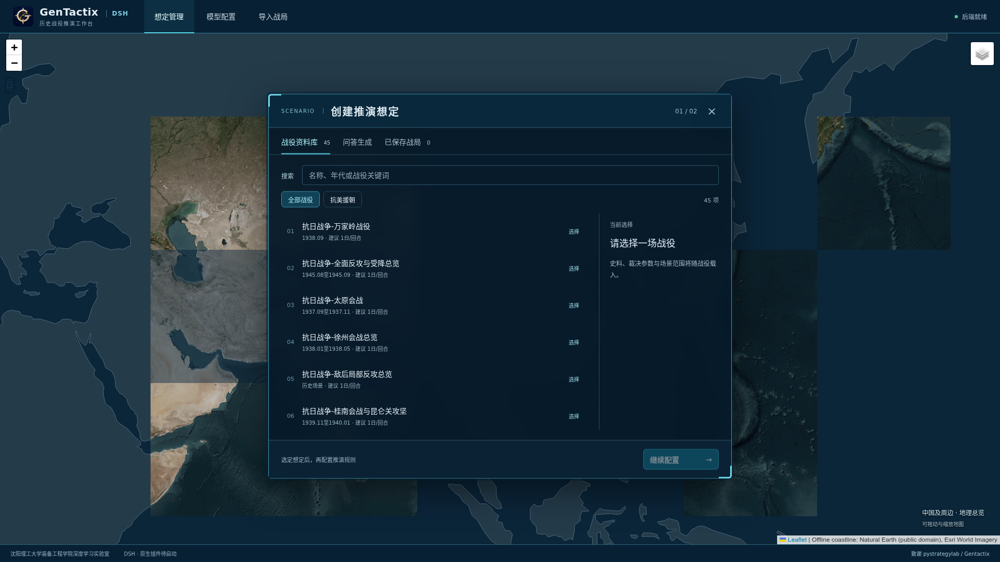
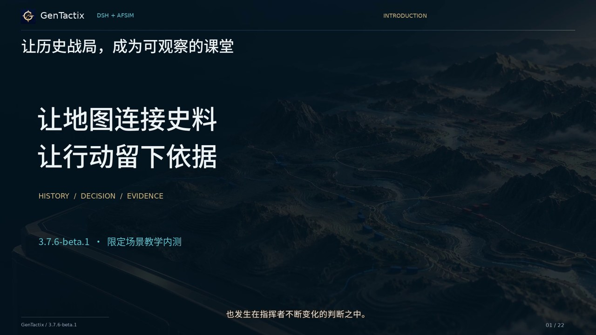
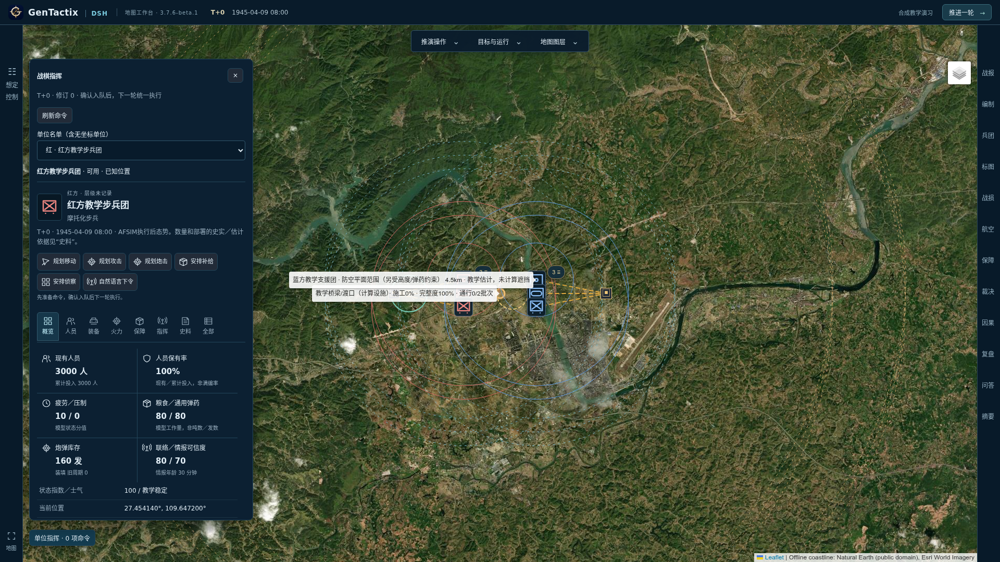

# GenTactix-DSH-AFSIM

[English](README.en.md) · [Docker 使用指南](docker/README.zh-CN.md) · [测试说明](TESTING.md) · [开发移交](docs/开发移交与阶段交付-2026-11-06.md)

面向军事历史教学的地图推演工作台。DSH 负责史料检索、单位决策与解释，AFSIM 可选承担运动及已注册教学规则计算；状态、命令、人员装备与库存账保存在应用检查点中。

当前交付：**3.7.6-beta.1，限定场景教学内测版**。包含45个资料条目，尚未完成全部历史会战及全部模式组合验收。已验证范围与剩余问题见[交付说明](docs/releases/v3.7.6-beta.1.md)。



## 软件介绍视频

[下载/播放15分钟介绍视频](https://github.com/snow-wind-001/gentactix-dsh-afsim/releases/download/v3.7.6-beta.1/GenTactix-DSH-AFSIM-3.7.6-beta.1-Introduction-1080p-15min.mp4)：1080p、中文女声、22章节，包含战役背景、实际界面、可视化/自然语言指挥及真实DSH与AFSIM结果。字幕、独立配音和编辑工程位于同一[Release](https://github.com/snow-wind-001/gentactix-dsh-afsim/releases/tag/v3.7.6-beta.1)；见[制作与验收记录](docs/15分钟软件介绍视频制作与验收-2026-11-06.md)。

[](https://github.com/snow-wind-001/gentactix-dsh-afsim/releases/download/v3.7.6-beta.1/GenTactix-DSH-AFSIM-3.7.6-beta.1-Introduction-1080p-15min.mp4)

## 安装与使用

代码仓库：**[snow-wind-001/gentactix-dsh-afsim](https://github.com/snow-wind-001/gentactix-dsh-afsim)**。

**Docker 文件请向 [snowwind001@gmail.com](mailto:snowwind001@gmail.com) 发送邮件申请。** 镜像仓库为 [snowwind001/gentactix-dsh-afsim](https://hub.docker.com/r/snowwind001/gentactix-dsh-afsim)，采用申请授权访问，不保证匿名拉取。授权后使用自己的 Docker Hub 账号登录。

1. 安装并启动 Docker Engine + Compose v2；Windows 使用 Docker Desktop 的 Linux 容器。当前镜像为 Linux amd64，Windows 实机尚未验收。
2. 从 [Releases](https://github.com/snow-wind-001/gentactix-dsh-afsim/releases) 下载启动包并解压。
3. Windows 双击 `Start-GenTactix.cmd`；Ubuntu 执行 `bash docker/start.sh`。浏览器将打开 **http://localhost:8080**。可用 `bash docker/install-menu.sh` 添加 Ubuntu 菜单图标。
4. 在“模型配置”中修改服务地址、模型ID、密钥与思考强度，保存并测试连接。默认示例是局域网 vLLM `http://192.168.2.111:8081/v1`，其他网络需要修改；兼容服务以实际连接测试为准。默认思考强度中、输出预算64K、上下文256K，不附带模型权重或个人密钥。

终端操作：

```bash
docker login
docker compose up -d
docker compose logs --tail=100
# 更新：保持相同项目名和数据卷
docker compose pull
docker compose up -d
# 停止并保留数据
docker compose stop
```

默认 `3.7.6-beta.1-afsim` 镜像包括应用、DSH SDK/runtime、AFSIM 2.9命令行运行集和Wine，教员无需另行挂载AFSIM。不含非运行必需的示例、培训材料及原始书籍扫描。`3.7.6-beta.1-core` 不含AFSIM/Wine，可用 `docker compose -f docker-compose.yml -f docker-compose.core.yml up -d` 选择。

完整镜像压缩下载约619MB、展开约1.70GB；首次Wine环境另需约726MB。轻量版压缩约239MB。

对局、轨迹、配置和密钥保存在命名卷中，升级复用。**不要执行 `docker compose down -v`**。配置经Fernet认证加密，密钥单独保存；拥有宿主或Docker管理权限者仍可访问，备份须保护整个数据卷。默认仅向本机开放8080端口。详细部署、权限、升级及源码构建见[Docker指南](docker/README.zh-CN.md)。

## 主要功能

- **地图工作台**：可折叠顶部工具与左右标签栏、军标、部队轨迹、射界/射程及补给图层；图层依赖当前场景实际数据。
- **单位与编制**：多层指挥树、临时任务群及有约束的分合兵；单位检查器集中展示人员、分类装备、火力、库存、指挥与史料依据，区分零值、未知和估计。
- **可视化与自然语言指挥**：选单位、点地图选目的地或目标，确认命令后执行；单位或全局自然语言先生成草稿。可查看决策依据、执行回执和实际结果。
- **DSH原生插件**：持久角色会话、领域MCP工具、运行事件、预算和取消；通过有界观察读取检查点，减少整世界重复送入模型。保留应用层JSON协议兼容路径。
- **双引擎**：DSH独立推演，或DSH规划、AFSIM执行。已注册模型覆盖地面交战、分类弹耗、航空支援、防空抽象、后勤与部分渡运/工程机制；每种组合有独立准入范围。
- **分析与保存**：来源检索、战报、关键决策与转折点、轨迹归因及分支对照，支持保存恢复和JSON导入导出。反事实结果属于模型实验，不等同于已证实的历史因果结论。



## 三种使用方式

| 方式 | 初态与操作 | 执行引擎 |
| --- | --- | --- |
| 历史战役回溯分析 | 按来源事件及顺序重现，缺载值保持未知，控制只读 | DSH或AFSIM |
| 历史战局推演 | 从具名历史部队和可计算局部窗口开始，允许改变命令与结果，估计另行标注 | DSH或AFSIM |
| 合成教学演习 | 以受支持的历史局部初态为基础，修改部队、装备、部署及库存；可显式选兼容教学模板 | DSH或AFSIM |

启动时先选战役、用途和引擎，再生成/验证配置。新增或修改部署须重新验证。进入地图后，命令确认只加入队列，点击“下一轮推演”才执行；回溯分析按来源推进。模型服务不可用时不会将错误输出冒充有效战局。

## 战役与场景目录

当前共 **45个资料条目**：长平1个、红军长征15个、抗日战争20个、抗美援朝9个。以下链接提供历史部队、过程、来源与争议；总览和子战斗不可重复累加人数或战果。**资料条目存在不等于完整历史初态、地形、效能与全部阶段已经验收**；配置界面会展示受支持窗口及缺项。

### 古代战争：长平之战（1个）

秦赵围绕上党的长期争夺，以公元前260年决战为核心，适合认识坚守、诱敌、分割与补给封锁。

| 场景 | 时间 | 简介与教学关注 |
| --- | --- | --- |
| [长平之战](corpus/长平之战.md) | 公元前262—前260年 | 山西高平一带的秦赵作战；讨论换将、追击、两翼断后与粮道。资料区分《史记》记载数和现代争议，HP不代表史载人数。 |

### 红军长征（15个）

以“战略转移阶段＋关键节点”组织，包含中央红军、红四方面军、红二与红六军团、红二十五军的并行战线，以及抵陕后的巩固场景。它们不是一支部队按表顺序经历的15场战斗。

| 编号与场景 | 资料时间范围 | 简介与教学关注 |
| --- | --- | --- |
| LM01 · [湘江战役](corpus/红军长征-湘江战役-1934.11.25至1934.12.01.md) | 1934.11.25至1934.12.01 | 渡江与阻击；新增新圩首日、光华铺上午具名局部配置，可经DSH/AFSIM验证；完整纵队与渡场过程尚缺。 |
| LM02 · [强渡乌江](corpus/红军长征-强渡乌江-1935.01.01至1935.01.06.md) | 1935.01.01至1935.01.06 | 江界河等多渡点行动；讨论先遣夺渡、工兵架桥与后续梯队通过的衔接。 |
| LM03 · [四渡赤水](corpus/红军长征-四渡赤水-1935.01.19至1935.03.22.md) | 1935.01.19至1935.03.22 | 土城、扎西、遵义及赤水河渡点间反复机动；讨论情报判断、路线调整与摆脱合围。 |
| LM04 · [中央红军巧渡金沙江](corpus/红军长征-中央红军巧渡金沙江-1935.05.03至1935.05.09.md) | 1935.05.03至1935.05.09 | 中央红军在皎平渡等地组织渡江；讨论船只运力、渡场选择与主力集中。 |
| LM05 · [强渡大渡河与飞夺泸定桥](corpus/红军长征-强渡大渡河与飞夺泸定桥-1935.05.24至1935.05.29.md) | 1935.05.24至1935.05.29 | 安顺场强渡与泸定桥夺桥两个相接节点；讨论渡运瓶颈、分路行动和夺桥时限。 |
| LM06 · [懋功会师与雪山草地转移](corpus/红军长征-懋功会师与雪山草地转移-1935.06.12至1935.09.12.md) | 1935.06.12至1935.09.12 | 达维、懋功会师及雪山草地转移；讨论并行指挥、路线分歧与非战斗消耗。 |
| LM07 · [包座战役](corpus/红军长征-包座战役-1935.08.29至1935.09.01.md) | 1935.08.29至1935.09.01 | 求吉寺、达金寺及附近河谷的围点打援；讨论围攻和阻援兵力的分配。 |
| LM08 · [腊子口战斗](corpus/红军长征-腊子口战斗-1935.09.16至1935.09.17.md) | 1935.09.16至1935.09.17 | 狭窄隘口的正面牵制与攀崖迂回；讨论地形约束、隐蔽接近和协同突击。 |
| LM09 · [红二十五军长征](corpus/红军长征-红二十五军长征-1934.11.16至1935.09.16.md) | 1934.11.16至1935.09.16 | 独树镇、庾家河、鄂豫陕根据地至陕北的独立战线；讨论转移、立足与北上。 |
| LM10 · [嘉陵江战役](corpus/红军长征-嘉陵江战役-1935.03.28至1935.04.21.md) | 1935.03.28至1935.04.21 | 红四方面军渡嘉陵江并向剑门关等地发展；讨论多点渡河与登陆场扩展。 |
| LM11 · [百丈关战役](corpus/红军长征-百丈关战役-1935.11.md) | 1935.11 | 红四方面军南下中的攻防转折；讨论突出战线、连续反击与续战能力，保留日期异文。 |
| LM12 · [乌蒙山回旋战](corpus/红军长征-乌蒙山回旋战-1936.02.27至1936.03.28.md) | 1936.02.27至1936.03.28 | 红二、六军团在黔滇边山地回旋；讨论路线选择、敌情误判和脱离追堵。 |
| LM13 · [红二六军团抢渡金沙江](corpus/红军长征-红二六军团抢渡金沙江-1936.04.25至1936.04.28.md) | 1936.04.25至1936.04.28 | 红二、六军团经石鼓及附近渡口北上；讨论分渡点调度，区别于1935年中央红军渡江。 |
| LM14 · [直罗镇战役](corpus/红军长征-直罗镇战役-1935.11.20至1935.11.24.md) | 1935.11.20至1935.11.24 | 中央红军到达陕北后的巩固作战；讨论诱敌、河谷合围与阻援，不改写其长征终点。 |
| LM15 · [甘孜会师至三大主力会师](corpus/红军长征-甘孜会师至三大主力会师-1936.07.01至1936.10.22.md) | 1936.07.01至1936.10.22 | 从甘孜集结、整编到会宁与将台堡会师；讨论多路北上、接应和会师时序。 |

详细索引与编辑表见[长征资料入口](data/long_march/README.md)和[文件索引](data/long_march/INDEX.md)。1935年中央红军皎平渡与1936年红二、六军团石鼓渡江分别建档；直罗镇是抵陕后的巩固场景。

### 抗日战争（20个）

以“战略阶段×战场空间”组织正面、敌后和西南跨境战场。三次长沙分别建档；平型关、台儿庄、万家岭、衡阳、车桥分别与其上级总览关联。1944年的局部反攻与日军战略进攻可以同时发生，不按年份自动推定战场态势。

| 编号与场景（资料时间范围） | 简介与教学关注 | 局部规则 |
| --- | --- | --- |
| AJ01 · [淞沪会战](corpus/抗日战争-淞沪会战-1937.08.13至1937.11.12.md)<br>1937.08.13至1937.11.12 | 上海市区、吴淞—罗店与杭州湾多向战场；讨论抗登陆部署、预备队使用和撤退时机。 | 迟滞防御 |
| AJ02 · [太原会战](corpus/抗日战争-太原会战-1937.09至1937.11.md)<br>1937.09至1937.11 | 平型关、忻口、娘子关至太原的防御；讨论正面牵制与侧后交通袭扰的配合。 | 迟滞防御 |
| AJ03 · [平型关伏击战](corpus/抗日战争-平型关伏击战-1937.09.25.md)<br>1937.09.25 | 第115师在乔沟公路的伏击；讨论隐蔽部署、纵队分割和撤出，不等同整个平型关防御。 | 目标攻坚 |
| AJ04 · [徐州会战总览](corpus/抗日战争-徐州会战总览-1938.01至1938.05.md)<br>1938.01至1938.05 | 苏北、鲁南与徐州铁路枢纽的多向会战；讨论战线联动、合围风险与主力转移。 | 突围转移 |
| AJ05 · [台儿庄战役](corpus/抗日战争-台儿庄战役-1938.03.23至1938.04.07.md)<br>1938.03.23至1938.04.07 | 台儿庄城镇坚守与外围反击；讨论守城持续时间和外围部队行动的衔接。 | 目标攻坚 |
| AJ06 · [武汉会战](corpus/抗日战争-武汉会战-1938.06至1938.10.md)<br>1938.06至1938.10 | 长江沿线及鄂豫皖赣广大地域的迟滞；讨论要塞、交通线与战略转移的关系。 | 迟滞防御 |
| AJ07 · [万家岭战役](corpus/抗日战争-万家岭战役-1938.09下旬至1938.10.md)<br>1938.09下旬至1938.10 | 武汉会战中的山地合围；讨论包围、阻援和完成歼灭所需的条件。 | 目标攻坚 |
| AJ08 · [第一次长沙会战](corpus/抗日战争-第一次长沙会战-1939.09.14至1939.10.md)<br>1939.09.14至1939.10 | 湘北、鄂南、赣北三向作战；讨论逐次抵抗、外线反击和进攻补给。 | 迟滞防御 |
| AJ09 · [第二次长沙会战](corpus/抗日战争-第二次长沙会战-1941.09.07至1941.10.09.md)<br>1941.09.07至1941.10.09 | 湘北至长沙、株洲方向的攻防；讨论防线被突破后的重组与反击。 | 突围转移 |
| AJ10 · [第三次长沙会战](corpus/抗日战争-第三次长沙会战-1941.12.24至1942.01.16.md)<br>1941.12.24至1942.01.16 | 长沙城防和外翼行动；讨论前沿迟滞、城防坚持与外围合围的时序。 | 目标攻坚 |
| AJ11 · [桂南会战与昆仑关攻坚](corpus/抗日战争-桂南会战与昆仑关攻坚-1939.11至1940.01.md)<br>1939.11至1940.01 | 桂南交通线与昆仑关反攻；讨论山地据点、周边制高点和增援通道。 | 目标攻坚 |
| AJ12 · [豫湘桂战役总览](corpus/抗日战争-豫湘桂战役总览-1944.04至1944.12.md)<br>1944.04至1944.12 | 河南、长衡、桂柳三段会战总览；讨论跨战区指挥、铁路交通和纸面兵力与有效战力的差别。 | 突围转移 |
| AJ13 · [衡阳保卫战](corpus/抗日战争-衡阳保卫战-1944.06至1944.08.08.md)<br>1944.06至1944.08.08 | 豫湘桂战役中的孤城防御；讨论工事、补给消耗、救援预期和撤退选择。 | 迟滞防御 |
| AJ14 · [百团大战](corpus/抗日战争-百团大战-1940.08.20至1941.01.24.md)<br>1940.08.20至1941.01.24 | 正太铁路等交通线破袭及后续反扫荡；讨论破坏、修复和根据地承压的关系。 | 交通破袭 |
| AJ15 · [冀中五一反扫荡](corpus/抗日战争-冀中五一反扫荡-1942.05.01至1942.06.20.md)<br>1942.05.01至1942.06.20 | 冀中平原大规模扫荡下的转移与存续；讨论隐蔽、组织保存及突围。 | 隐蔽存续 |
| AJ16 · [敌后局部反攻总览](corpus/抗日战争-敌后局部反攻总览-1944.md)<br>1944 | 1944年多个根据地的并行局部反攻；讨论据点选择和兵力集中，年度战果不重复汇总。 | 目标攻坚 |
| AJ17 · [车桥战役](corpus/抗日战争-车桥战役-1944.03.05至1944.03.06.md)<br>1944.03.05至1944.03.06 | 苏中车桥据点攻坚与芦家滩打援；讨论攻城、阻援与根据地联通。 | 目标攻坚 |
| AJ18 · [湘西会战](corpus/抗日战争-湘西会战-1945.04.09至1945.06.07.md)<br>1945.04.09至1945.06.07 | 雪峰山至芷江方向的防御反击；讨论山地阻击、航空支援和日军后勤压力。 | 航空支援与到货约束 |
| AJ19 · [缅北滇西反攻总览](corpus/抗日战争-缅北滇西反攻总览-1943.10至1945.03.md)<br>1943.10至1945.03 | 驻印军缅北与远征军滇西并行反攻；讨论跨境协同、攻坚和国际交通线恢复。 | 航空支援与到货约束 |
| AJ20 · [全面反攻与受降总览](corpus/抗日战争-全面反攻与受降总览-1945.08至1945.09.md)<br>1945.08至1945.09 | 1945年8—9月反攻与接收；讨论宣布投降、停火、缴械和正式签字的不同时间约束。 | 停火接收 |

详细数据、来源登记及父子关系见[抗日战争资料入口](data/anti_japanese_war/README.md)、[场景与阶段矩阵](data/anti_japanese_war/INDEX.md)。固定演习的目标与结算说明见[可重放推演设计](docs/可重放推演设计.md)；20场真实模型验收的结果及限制见[逐场验收报告](docs/局部推演规则与逐场验收-2026-10-22.md)。这些条目是已选教学场景，不是全部抗战战役名录。

### 抗美援朝（9个）

沿用前五次运动战战役及后续四个作战档案的目录框架。第二次战役区分东西两线，1951年夏秋防御合档，1953年夏季反击内含金城子阶段；“金城战役”简称指向总档，需要在想定中明确7月子阶段。

| 场景 | 资料时间范围 | 简介与教学关注 |
| --- | --- | --- |
| [第一次战役](corpus/抗美援朝-第一次战役-1950.10.25至1950.11.05.md) | 1950.10.25至1950.11.05 | 温井、云山及黄草岭的遭遇与反突击；讨论隐蔽接敌、分散来敌和局部阻击。 |
| [第二次战役](corpus/抗美援朝-第二次战役-1950.11.07至1950.12.24.md) | 1950.11.07至1950.12.24 | 清川江与长津湖两线反击；讨论诱敌、迂回、补给距离与严寒减员的不同影响。 |
| [第三次战役](corpus/抗美援朝-第三次战役-1950.12.31至1951.01.08.md) | 1950.12.31至1951.01.08 | 突破三八线并向汉城、汉江方向推进；讨论突破速度、追击与补给线延伸。 |
| [第四次战役](corpus/抗美援朝-第四次战役-1951.01.25至1951.04.21.md) | 1951.01.25至1951.04.21 | 汉江、横城与砥平里方向防御反击；讨论空间换时间、局部反击和增援集结。 |
| [第五次战役](corpus/抗美援朝-第五次战役-1951.04.22至1951.06.10.md) | 1951.04.22至1951.06.10 | 分阶段进攻、转移和阻击；讨论进攻顶点、粮弹耗尽、通信与追击风险。 |
| [夏秋季防御战役](corpus/抗美援朝-夏秋季防御战役-1951.08.18至1951.10.22.md) | 1951.08.18至1951.10.22 | 1951年夏秋要点攻防与空中遮断背景；讨论工事、反坦克和补给压力。 |
| [秋季战术反击作战](corpus/抗美援朝-秋季战术反击作战-1952.09.18至1952.10.31.md) | 1952.09.18至1952.10.31 | 多点有限目标进攻；讨论炮兵支援、短促突击与攻克后巩固的差别。 |
| [上甘岭战役](corpus/抗美援朝-上甘岭战役-1952.10.14至1952.11.25.md) | 1952.10.14至1952.11.25 | 597.9高地与537.7高地北山争夺；讨论表面阵地、坑道存续、补给及反复反击。 |
| [夏季反击战役含金城战役](corpus/抗美援朝-夏季反击战役含金城战役-1953.05.13至1953.07.27.md) | 1953.05.13至1953.07.27 | 1953年分阶段反击，内含7月金城作战；讨论火力准备、纵深发展与停火时限。 |

第二次战役的目录起点采用准备阶段口径，11月25日、27日分别是西线、东线反击发起日。日期差异、统计范围和地理参考见[抗美援朝资料说明](docs/抗美援朝资料说明.md)。本系列及长征系列已提供来源派生的局部配置；冻伤、坑道双层控制、谈判及跨战役继承等完整战役机制仍未实现。

### 自定义想定

启动页可通过问答创建想定，也可关联已有资料卡。独立想定没有预先考证的专属档案；需自行补充部队、初态、地理与目标，并核对模型生成内容。增加目录条目的方法见[史料格式](corpus/README.md)和[裁决参数说明](adjudication/README.md)。

## 源码开发

Python 3.10+、Node.js 22。Docker构建使用校验固定的DSH rc5 wheels，避免误装不匹配的SDK/runtime，见[构建说明](docker/README.zh-CN.md#从源码构建)。桌面开发：

```bash
python3 -m venv .venv
python3 docker/fetch_sdk.py --directory .cache/docker-sdk
.venv/bin/pip install --find-links .cache/docker-sdk -r requirements.txt -r requirements-dsh.txt
.venv/bin/python -m uvicorn backend.main:app --host 127.0.0.1 --port 8700
# 另一个终端
cd frontend
npm ci
npm run dev
```

| 目录 | 内容 |
| --- | --- |
| `frontend/` | Vue地图界面与Electron入口 |
| `backend/`、`gentactix/` | API、状态、指挥、检索、规则及适配器 |
| `plugins/`、`tools/afsim/` | DSH领域工具、AFSIM连接与执行 |
| `corpus/`、`adjudication/`、`data/` | 史料、裁决参数和结构化档案 |
| `docker/` | 构建、启动、菜单图标、部署指南与许可说明 |
| `verify_*.py`、`tools/qa/`、`docs/` | 回归、真实链路验证和设计/验收记录 |

旧Streamlit入口 `app.py` 保留，功能与当前地图工作台不同。公开Git不包含AFSIM二进制、个人配置、密钥、对局或书籍扫描；SDK/runtime通过固定校验的发布资产取得。

## 验证与限制

最近工程基线E43：**220组、2580项通过，0失败/跳过**；9次真实AFSIM验证施工劳动与保障账。此成绩对应冻结源码摘要，交付镜像另做前端、API、持久化、DSH原生工具与真实AFSIM验证，见[版本交付记录](docs/releases/v3.7.6-beta.1.md)。

```bash
.venv/bin/python verify_all.py
npm --prefix frontend run typecheck
npm --prefix frontend run build
```

完整会战的历史效能、跨阶段组合、48小时稳定性和Windows实机仍待验收；新增共享施工完整提交等未准入组合保持关闭。22单位局部流程与79单位规模测试不代表45场全部通过。地形、射界和兵力装备中仍有显式估计；人员、伤亡、HP、缴获与总减员不可混用。详见[测试说明](TESTING.md)、[总规划](docs/会战级多层编制与分合兵改造规划-2026-10-31.md)及[开发移交](docs/开发移交与阶段交付-2026-11-06.md)。

## 开发维护与致谢

**开发维护：沈阳理工大学装备工程学院。** 研发团队：深度学习实验室。

基于 [pystrategylab/Gentactix](https://github.com/pystrategylab/Gentactix) 扩展，感谢原作者开源。保留上游版权，应用代码采用[MIT许可证](LICENSE)，见[署名与组件说明](NOTICE.md)。DSH来自[DeepSeek Harness](https://github.com/deepseek-ai/deepseek-harness)。AFSIM辅助开发参考[qingzhoupro/afsim-skill](https://github.com/qingzhoupro/afsim-skill)和[Yookio-Z/AFSIM_MCP](https://github.com/Yookio-Z/AFSIM_MCP)，保留各自许可证。

AFSIM本体不适用应用MIT许可。完整镜像按发布方声明的分发授权提供，保留原包版权和限制标记；使用与转交须遵循相应授权。Docker访问请邮件申请。
