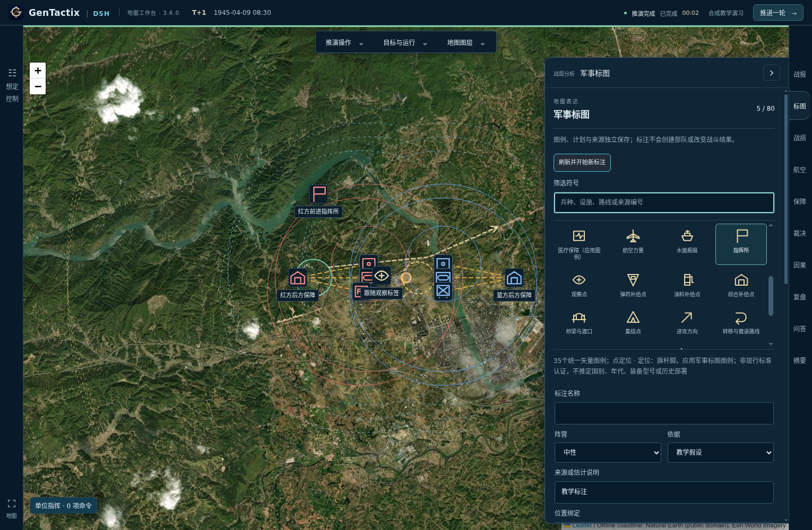

# 3.6.0 军事标图与DSH专用skill

本版已编译并替换本机AppImage、应用菜单及桌面入口，未上传GitHub。实际窗口为3.6.0，renderer、后端与构建载荷摘要一致，运行版本无须重启。9份原有对局、模型配置密文及Vault密钥校验均未改变。

## 图库分析与取用

用户本地`data/military-symbols-v2`共24,247个SVG：256个独立示例、234个组合区、23,544个自动笔画组和213页底稿。自动拆分笔画不是完整图例；原库也没有逐项确认语义、年代及地理定位点。部分描摹边缘与细线在地图缩小时不清晰，不适合直接批量替换单位军标。

本版使用35个项目矢量重绘图例，统一24单位画布、线宽及显式定位点，覆盖兵种、指挥与保障点、进攻/撤退/补给路线、边界及目标地域。前后端共享词表；兵种继续复用`unit_types`分类契约。显示覆盖不改变实际编制、装备或兵种。

256项原库元数据用于搜索出处，有本地素材时才按需读取单个SVG作为被动图片。未把原书扫描页、组合图及自动笔画组放进Git或安装包；素材说明没有授予原书商业再发行权。项目图例是教学表达，不声称通过军用标准或历史年代认证。颜色表示所选阵营，不由图形推断国籍或敌我。

## 使用方式

1. 在工作台右侧打开“军事标图”，按兵种、设施、路线或来源编号筛选图例。
2. 选择图例、名称、阵营及依据。点标注点击地图落位；路线与地域连续选点后点“完成选点”。支持撤回顶点、清空和Escape退出选点。
3. 来源记录、作战计划、教学假设分别标识；来源记录必须填写依据。保存后的标注可编辑、删除和显隐。
4. 可把点标注绑定已知单位，随当前单位位置显示。跟随标注用引线旁置，避免遮挡单位操作；指挥所使用旗杆脚定位。也可单独改变某单位的显示图例或恢复自动匹配。
5. 输入自然语言需求，DSH生成预览，点击确认后保存。位置只取地图选点或已有单位/保障/史料参考位置，模型不能自由猜坐标。

标图存入独立的`session.plotting_state`，不写权威`war_state`。保存校验战局摘要、回合和标图修订；过期草稿拒收。每局最多80个标注，每条路线/地域最多32个顶点。导出和恢复包含标注及单位显示覆盖。画出补给路线、边界或目标地域不会创建AFSIM道路、补给能力、作战目标或交战命令。

## DSH插件与维护

项目插件`plugins/dsh-military-plotting`沿用现有Cordis注册、DSH Native工具、角色预算、运行事件和取消机制。专用角色为`map-annotator`，只开放`read_military_plotting_skill`、`search_military_symbols`、`validate_military_plotting`；三个工具都须有真实执行事件，才接受模型草稿。维持high推理，配置预算仍为65,536，不新增PTC、模型传输或全局DSH配置。

维护入口是[项目skill](../../plugins/dsh-military-plotting/skills/military-plotting/SKILL.md)、`tools/build_military_symbols.py`及生成的两个JSON目录。修改图形、来源或规则后重跑生成、回归与前端/后端构建。完整状态与API说明见[接入设计](../军事标图接入设计.md)。

## 验证结果与范围

| 检查 | 结果 |
| --- | --- |
| 全量离线回归 | 43/43组、434个unittest、0跳过；含上下文退化检查 |
| 新增TDD回归 | 14项：目录/定位点、几何与战区、未知ID、过期草稿、来源、SVG隔离、原子保存、恢复及真实工具事件门控 |
| 前端与插件 | TypeScript、生产构建、插件语法及现有AFSIM插件检查通过；skill结构校验通过 |
| 源码与最终冻结载荷 | 各完成20项标图浏览器检查及9项连续性检查：点/线/地域、显隐删除、显示覆盖、原图参考、DSH草稿确认、窄屏、完整人工命令、真实AFSIM推进与跟随显示 |
| 真实DSH | 两轮独立生成约18.6秒、14.1秒，均实际执行skill、检索和校验工具；只生成草稿，未修改权威战局 |
| 回合与冷恢复 | 最终载荷真实推进1轮；5个标注及单位显示覆盖保留，静态点未被重写，跟随点随观察移动；独立进程重新读取导出状态通过 |
| 实际安装与包 | 真实窗口5项只读检查通过；AppImage/backend/renderer摘要一致，`.deb`版本与两个包校验通过，完整扫描库不在载荷内 |
| 数据保留 | 9份原对局及两份配置文件校验一致；本轮QA使用隔离目录 |

上述验证针对地图表达和状态连续性，不代表新增武器模型、地形遮蔽计算或完整历史初态。原图预览依赖可选本地素材；安装包自带的35个图例不依赖该库。在线卫星底图仍依赖网络。

## 产物与回滚

产物为`release/GenTactix-DSH-3.6.0-x86_64.AppImage`、`release/GenTactix-DSH-3.6.0-amd64.deb`和`release/SHA256SUMS-3.6.0.txt`。本机入口仍指向`~/.local/share/GenTactix-DSH/GenTactix-DSH.AppImage`。

替换前程序、入口及9份对局备份在`.cache/backups/installed-before-3.6.0-20261027-182320/`。回滚时把备份AppImage恢复可执行权限，再用项目安装工具安装；不需要覆盖现有存档。测试记录、真实工具证据、截图与安装身份保存在`.cache/qa/military-plotting/`，不随公开包发布。
