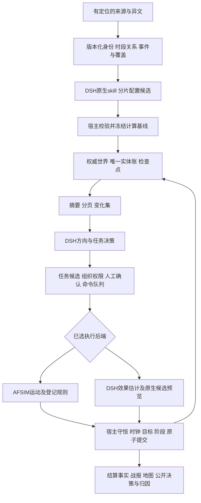

# 会战级多层编制与分合兵改造规划

## 2026-11-04 上线前完整验收批次

按[完整测试计划](AFSIM上线前完整测试与验收计划-2026-11-04.md)与[执行表](AFSIM上线前测试执行表-2026-11-04.csv)安排R00—R12：同日会战资料、时间细分、完整多兵团、分合兵跨阶段、地形保障、48小时仿真/墙钟长稳、故障运行边界、DSH/前端、干净安装及全45场270格。复用本文既有编号，不以排入计划代表测试通过。R01优先核实反事实能否检索决策后资料，原服务及对局保留。

> **人员粮秣分项（2026-11-03）**：[实现与失败边界](按人员耗粮与运输质量一致性验收-2026-11-03.md)。可选人数／质量粮秣、独立容量与运输耦合，16项TDD、最终166组／1967项通过。五个真实AFSIM案例及纯DSH首轮／同初态独立分支第二轮账目通过，原T2存在540.924秒收尾循环失败，未提交且不冒称永久修复；完整冷恢复和零写UI通过。33500人及配给率是QA估计，历史标定／有战损组合／270格仍未验。下一项先修DSH原生收尾，再扩大跨阶段与历史验收。未安装上传，现有配置与旧局保持。下方为此前时点。

> **真实从零生成与独立DSH分项（2026-11-03）**：[修复与实测](长征原生配置生成与纯DSH过程验收-2026-11-03.md)。新增6项TDD；最终同源码165组／1951项、0失败跳过。正常界面真实Native三阶段生成与两种步长独立DSH各两轮、冷恢复后实际复用原SDK会话通过；没有AFSIM过程调用。命令／时钟／人员设备和账连续，但按人数／质量耗粮、地形及解释仍有缺口，已列[改造顺序](会战粮秣质量与人员耗粮改造要求-2026-11-03.md)。33500人是估计，不是历史全军实力；270完整历史格仍未验。未上传安装，旧配置／对局保持。下方为此前时点。

> **长征多军转移分项（2026-11-03）**：[实现、实测与勘误](长征多军转移窗口与原生会话续推验收-2026-11-03.md)。已有局部单边转移被前次累计入口失败误判，现补会战窗口／目标图与原生空阻援脚本；右路军四军新窗口、3个非物理指挥参考，不虚构敌军。19项新回归通过，完整164组／1945项通过；末轮仅校正新目标说明后7组120项复测通过，不相加、不称一次最终同快照全绿。真实AFSIM对照5次、前端四轮至6目标结算、原两个SDK会话冷恢复续推及账目通过。原默认与旧局不改；270完整历史格仍未验。下一项为真实从零配置、纯DSH执行及环境／资源历史标定。下方为此前时点。

> **保障／装填反馈与覆盖复核（2026-11-03）**：[实现与验收](保障回执与装填批量反馈验收-2026-11-03.md)：保障完整回执／状态和装填共用现有校验方程，不修补或执行世界。新增14项、相关182项通过；最终163组／1926项全通过、0跳过，1306.49秒。原T8五候选／最终摘要复核一致，真实22单位T9及账目／来源／运动通过，24反馈与下一候选吻合、一次修订，耗时439.019秒，不宣称受控提速。冷恢复／10项只读界面通过，70源码11辅助73保护与旧局不变。新有据库存分句误报留复现；目录另确认最新48／59小模板、正式窗口仅万家岭6版本、两场会师转移缺合适过程语义。下一项优先后者与其他战役资料，270历史窗口不变，未安装上传。下方为此前时点。

> **候选精确计算批量反馈后续（2026-11-03）**：[实现与验收](候选精确计算批量反馈验收-2026-11-03.md)：原生失败回复按当前候选批量返回粮耗、库存、疲劳、位置和决策约束，复用既有函数，不自动修补。新增14项／相关158项通过；最终同源码162组／1912项全通过、0跳过，1263.34秒。旧T7重放13候选与最终摘要保持，首份反馈31项。真实22单位T8及账目／运动／来源通过，13项反馈与下一候选吻合，9任务20成员／1小时时钟连续。T8耗时462.365秒、修订4次，有一次无正文恢复，不宣称提速；下一项补共享时间保障与装填计算反馈。冷恢复／10项只读界面通过，67源码10辅助73保护及旧对局一致，270历史窗口不变，未安装上传。下方为此前时点。

> **完整存档与恢复后续（2026-11-03）**：[实现、实测与边界](单文件定义复用与完整存档恢复验收-2026-11-03.md)：保留完整轨迹的单文件定义复用使真实T6存档31.7→12.5MB，完整类型与摘要一致；前端实际导出／导入20项通过。新增18项及89项相关通过，全量初跑160／161组、1898项，唯一为旧测试直接读取V2内部字段；改走正式恢复后24项通过，原失败保留，不宣称一次全绿。真实22单位T7（401.151秒）及账目／来源／运动通过，9任务20成员和1小时时钟保留；V1／V2冷恢复与10项只读界面通过。反复粮耗／疲劳／位置修订仍耗时，下一项复用既有计算函数向DSH提供精确约束，再继续补给与长窗口。270历史窗口不变，未安装上传；下方为之前时点。

> **原生来源按需读取后续（2026-11-03）**：[实现与验收](原生过程来源按需读取与输入减负验收-2026-11-03.md)：来源V2使用已有详情工具，数值／身份／约束不裁剪，JSON模式自含全文。10项新增及65项相关通过；最终160组／1880项、0失败／跳过，1495.08秒。真实22单位T6及账目／来源／运动通过，基础提示少13.02%，耗时512.705秒，未证明提速。完整冷恢复与10项只读界面通过，原始QA失败保留。下一项基于31.7MB战局中的25MB轨迹核查重复冻结定义，保留完整导出／哈希／取数，再做补给和长窗口；270完整历史窗口不变，未安装上传。下方为此前时点。

> **跨分句库存核验后续（2026-11-03）**：[实现与验收](战报跨分句库存核验-2026-11-03.md)：真实T5有据“随队炮弹归零”误拒收已修，严格核实具名单位数值分句，库存类别保持独立。9项新增、141项相关通过；最终160组／1870项、0失败／0跳过，1292.44秒。真实公开链原全文当前宿主重放通过，原事件／世界未改写，不是新模型推演。4局冷恢复与29项只读界面通过；58源码／73保护不变。下一项为主过程输入减负，270完整历史窗口与性能验收仍开，未安装上传；以下为此前时点。

> **操作计时与失败恢复后续（2026-11-03）**：[实现、真实验证与边界](操作计时与失败恢复验收-2026-11-03.md)：跨刷新单调计时、终态冻结和已记录失败／取消立即落盘已修。14项新增、182项相关检查通过；最终同源码160组／1861项、0失败／0跳过，1172.79秒。真实问答、拒收及22单位T5（451.488秒）与冷恢复界面通过，9任务20成员继承；原7局／73保护文件不变。生成速度仍慢，炮弹92→0的有据短句仍被误拒收，已保存复现并列下一项TDD；未落盘强退恢复及只读对照终态仍有边界。270完整历史窗口不变，未安装上传；下方为此前时点。

> **原生候选与显式修订后续（2026-11-03）**：[实现和验收](原生候选结构与显式修订验收-2026-11-03.md)：共享参数合同、路径反馈及公开轨迹字段修订已接通。正常22单位T4提交，HTTP441.485秒，账目／来源／命令／1小时时钟与公开凭证复核通过，7局完整冷恢复；18项新增回归；原完整门禁158／159组、1847项，唯一诊断兼容性失败已修，随后6组90项通过，原门禁失败保留。真实协议的严格浮点复制失败保留、独立公开链复核另列，不能称全项通过。仍需处理首份生成耗时、刷新计时和库存表述筛查；270完整历史窗口不变，未安装上传。下方为之前时点。

> **原生单位输入与T4失败终态（2026-11-03）**：[实现、验收与失败](原生单位态势索引与上下文减负验收-2026-11-03.md)：完整身份索引保留到场状态，名单减少92.47%；157组／1829项离线通过，真实DSH核对79身份中的一项延后到场通过。**完整前端T4未通过**：24次效果预览全拒收、10次压缩，45分钟后步骤预算耗尽，世界仍精确T3。最终6份完整存档冷恢复、40源码／73保护核对通过；最高优先级转候选原生参数合同、具体字段反馈和受限修订，270完整历史窗口不变。未安装上传；下方为前期时点。

> **库存、Native候选分页与真实22单位T3（2026-11-03）**：[证据与范围](库存否定句与Native候选分页验收-2026-11-03.md)：正库存否定句误判已修，原生分页实际核对16＋6单位；正常前端T3提交、账目／来源／时钟及五局完整冷恢复通过。9任务20成员保留，14交付／6合法待命；具体原因覆盖缺陷追加TDD修复，49项相关检查通过。**最终v2完整离线156／156组、1820项、0失败／0跳过通过**，1108.63秒；38源码与73保护文件不变。实际回合仍约16分45秒，270完整历史窗口及补给／地形／标定不关闭；未安装上传。下方保留前期时点。

> **人员投影与JS凭证最终分项（2026-11-03）**：[最终证据与限制](人员保有率与战报疲劳一致性验收-2026-11-02.md)：新增比例跨JS哈希P0已修，最终154组／1798项、0失败／0跳过。完整22单位真实前端T2提交（HTTP967.720秒），人员装备账、来源、Native凭证及1小时推进核对，1440／900界面、四局完整冷恢复通过；首轮一小时失败及QA失败保留。新发现“均未耗尽”库存误判优先TDD；16条预览分页、补给策略、时延与刷新／取消提示仍开。仅本分项通过，战役仍active，270完整历史窗口不变；未安装上传。下方为前期时点。

> **真实JS传输P0后续（2026-11-03）**：[最新根因与复测](人员保有率与战报疲劳一致性验收-2026-11-02.md)：一小时22单位T2失败，新增比例100.0经JS变100使3份有效预览摘要哈希失配，8次战报候选全部拒收。真实Node往返先红、一行摘要规范化后76项通过；旧错误凭证不修补。正常取消保留完整T1，修复版三局精确冷恢复通过，新完整门禁与新正常分支T2复测中，不提前验收。270完整历史格及旧配置／史料不变，未安装上传。下方154／1796为修复前时点。

> **人员保有率与疲劳战报后续（2026-11-02）**：[修复、证据及后续检测](人员保有率与战报疲劳一致性验收-2026-11-02.md)完成只读人员账投影、指定疲劳断言拒收及v3摘要／v2旧凭证兼容；154组／1796项、0失败／0跳过，真实22单位界面和独立Native只读工具核验通过。正常分支T2仍运行，不能提前验收；19单位补给策略、16条预览截断、等待／刷新计时与完整历史标定仍开。原配置／两份原对局未变，未上传或替换安装版；270完整历史窗口不变。下方保留前次时点。

> **版本化运动反馈后续（2026-11-02）**：[修复与分项验收](版本化运动反馈与渡运一致性验收-2026-11-02.md)接通显式新窗口1.5.0，保留史料1.4.0与22数值先验。69项相关回归、153组／1783项完整离线通过；真实前端生成与22单位DSH首轮、同命令AFSIM对照及完整冷恢复通过，全部疲劳一致、最大位置差约1.55厘米。全后端等价未通过：19单位被动补给不同，另有HP投影及战报疲劳错误。下一步统一权威状态投影、已有补给策略和事实解释，再做长窗口；刷新计时及270完整历史窗口保持未验。旧默认、旧资料与原对局未迁移，未上传或替换安装版；下方为前次时点。

> **Native单位候选后续（2026-11-02）**：[原生候选与真实问题](Native单位结构化候选与运动反馈核查-2026-11-02.md)完成候选／轨迹凭证及整数往返修复；最终152组／1763项、0失败／0跳过。原22单位DSH第6轮真实前端重试提交，原会话、来源、账目及最终代码冷恢复通过；耗时约29分钟，不能称提速。程序蓝方目标完成建立在原运动疲劳P0之上，不通过物理／历史或公平后端对照；解释及刷新耗时P1仍开，270完整窗口不变。下方保留旧时点。

> **22单位连续会战后续（2026-11-02）**：[阶段验收](万家岭22单位连续会战与决策差异验收-2026-11-02.md)接通正常DSH阶段配置，修复合法接近回执及零距离循环。150组／1739项离线通过；完整22单位真实主线截至核查为AFSIM／DSH各3轮，继续运行但整场未结算。另有22单位双分支各8小时实际干预差异，不能据此关闭完整历史验收；公开单位说明出现已留证的敌距矛盾。270完整历史格不变，下方保留前次时点。

> **阶段数值资料与全目录复核（2026-11-02）**：[资料与验收](万家岭阶段数值口径与全目录资料复核-2026-11-02.md)增加分口径数值合同及万家岭1.4.0／新窗口和目标绑定。9项新增回归、150组／1734项完整离线检查通过；真实DSH5次问答／6次检索正确读全部6条，未改世界。新取27张原图尚未逐字转录或标定；[45场当前复核CSV](会战级资料逐场复核-2026-11-02.csv)仍显示大部分默认局部模板很小、单位开局实力缺载。270完整历史窗口不变，不能宣称整体会战完成；下方保留前次时点。

> **正式实体分合兵前端后续（2026-11-02）**：[实现与分项验收](实体分合兵前端与原生单位恢复验收-2026-11-02.md)接通真实预览、提交、原请求重试和当前身份选择；新增6项Native最终JSON恢复回归。两后端各实际推进至T3，中间冷恢复沿原会话，原任务交付1→2→3。最终构建主流程50项、后续重试／响应式18项、32分队只读22项及真实保存／合并25项、历史下级及余部27项通过。完整离线149组／1725项通过；原失败保留。45场／56版本结构可读，但本盘点的默认13组父子阶段候选均未证明下级覆盖完整，不能代替逐场历史标定；270完整历史窗口保持未验。下方保留前次时点。

> **装填计时与Native纠错后续（2026-11-02）**：[修复与验收](装填倒计时与Native纠错验收-2026-11-02.md)补齐被动秒级流逝、末发装填关系和明确字段反馈；新增6项回归，148组／1719项离线检查通过。最终源码真实复测3轮，装填连续且原任务取得2／3／4次交付并完成，完整冷恢复通过。前端秒级显示、构建及22项浏览器检查通过；原计时错误和QA人工接管失败保留。正式实体分合兵前端仍缺失，270完整历史窗口仍未验；下方保留前次时点。

> **分合兵跨阶段／真实状态审计（2026-11-02）**：[组合验收与新增缺口](分合兵跨阶段与当前身份映射验收-2026-11-02.md)补齐重试的当前身份映射及Native阶段投影；7项新回归，AFSIM7轮／DSH9轮完成三阶段、三次转换、原任务和双方向目标，最终冷恢复一致。离线148组／1713项通过；追加真实审计发现8处DSH被动冷却未递减，全功能未通过，优先修复。270完整历史窗口不变；下方为前次时点。

> **分合兵开放分支／Native身份继承（2026-11-02）**：[分支验收](分合兵开放分支与Native身份继承验收-2026-11-02.md)接通原语义身份、命令／任务与公开轨迹继承，独立创建运行会话；补齐来源批次隔离、重开局清理及普通Native上下文。新增10项回归通过；两后端机动及会话恢复、嵌套分支持续任务实际交付和三局完整冷恢复通过。最终147组／1706项离线检查通过，原失败和中止另存；转换后跨阶段、正式分合兵前端及270完整历史窗口仍待验。下方为前次分项时点。

> **正式编组事务／SDK恢复分项（2026-11-02）**：[正式编组事务与双后端恢复验收-2026-11-02](正式编组事务与双后端恢复验收-2026-11-02.md)接通正常API的原子提交、幂等重试与完整恢复。16项新增回归通过；有损合成副本两后端完成分兵T1／推进T2／合并T2／推进T3，最终源码完整冷恢复通过。另经Native Registry完成父级／两个新子单位及原会话恢复的5次真实决策；首次恢复的ID复制错误拒收并保留，改为宿主绑定本单位身份后通过。最终146组／1696项离线检查通过，原失败另存。正式前端、转换后跨阶段、开放分支及270完整历史窗口仍待验；下方保留前次时点记录。

> **旧保障与航空反馈后续（2026-11-02）**：[旧保障减员与航空资源反馈验收-2026-11-02](旧保障减员与航空资源反馈验收-2026-11-02.md)补齐旧模式非战斗减员必要上限、显式余量及实际提示调用，改进航空逐字段反馈并清除过期后端标识。17项新回归；已有损失后拆分、DSH／AFSIM交替及同地合并续推8帧、固定航空／受降和独立只读查询通过。旧预算仍按回合，未作历史标定；正式保存事务、转换后跨阶段、新单位会话、前端及270完整历史窗口继续未验。最终145组／1680项离线检查通过，完整日志及原失败见链接。

> **DSH必要效能约束分项（2026-11-02）**：[DSH火力效能上界与混合损失验收-2026-11-02](DSH火力效能上界与混合损失验收-2026-11-02.md)拒收原24发／239人候选，共享原生公式，区分地面／航空／受降。12项新回归、104项相关检查及真实12单位推进通过；最终143组／1663项门禁与两次真实只读复核通过。另确认旧模型非战斗减员P0和航空反馈P1，不能宣称所有损耗已受约束。270完整窗口及正式转换仍未关闭。

> **K05／K09实态执行分项（2026-11-02）**：[编组实态执行与火力粒度对照验收-2026-11-02](编组实态执行与火力粒度对照验收-2026-11-02.md)新增隔离的真实AFSIM／DSH执行路径，复用Native工具、编译和结果提交；修复拆分重复齐射额度及同足迹面积密度偏差，明确旧回执不代表当前编组。13项新回归和47项相关检查已通过；真实DSH炮击虽通过过程账却出现24发／239人效能偏差，已列P0、效果验收失败；最终142组／1651项离线门禁通过。正式原子提交、转换后跨阶段和前端仍未准入，270完整窗口保持未验。

> **K05命令与任务候选（2026-11-02）**：[本轮接续](编组命令与持续任务身份接续验收-2026-11-02.md)已实现明确的旧新命令／组织身份映射、人工意图、单位智能体配置及持续任务承担者接续；旧原生会话和决策回执保留，定义与计数不重置。三个已有真实T1状态、最终源码新进程冷复核和一个实际排队任务的Native两页查询有证据。尚未提交运行中分合；下一门禁为当前状态平台重建、原子提交及转换后跨阶段，不关闭K05或270历史窗口。

> **K05过程候选接续（2026-11-02）**：[本轮契约与证据](编组转换的身份与过程接续验收-2026-11-02.md)已接通三个身份校验点、参与／战役登记及等价目标观察。19项过程和1项预览新回归通过；三份已有真实T1状态的HTTP预览及实际Native双页问答通过，原局不变。尚未接通运行会话的命令／持续任务／平台事务，`runtime_admitted=false`；不能据候选完整校验关闭K05或270历史窗口。

> **K05唯一归属基础（2026-11-02）**：[证据与接续要求](运行中编组唯一归属与身份候选验收-2026-11-02.md)完成冻结根账的互斥人员／分类装备份额与事件重验，新增25项归属及2项预览回归；三份已有真实执行检查点与Native问答有分项证据。历史父级正例复用已有窗口覆盖契约，史料不改。候选身份参考已生成；中央冻结名单、参与／战役登记、命令／任务／目标及平台仍须共同迁移，实际分合与270完整历史窗口不关闭。

> **K05分配预览（2026-11-02）**：[当前实态契约与实测](有损实态分合兵预览与准入契约-2026-11-02.md)已实现受损人员／装备／库存的互斥分配提案，接通现有Native工具及HTTP只读分页，真实两后端和非零装备局均核账。补齐Native快照用途／重置代次，避免合成规则和命令ID失配。K05实际提交仍未实现；后续按唯一根账→命令／任务／目标→双后端→界面事务顺序推进，不能把提案当运行中物理分兵。完整历史270格不变。

> **K04交错验证（2026-11-02）**：[同世界跨阶段与撤销返场](同世界跨阶段与撤销返场验收-2026-11-02.md)完成真实Native9轮／DSH7轮：受击、部分移动、撤销、第三阶段场外等待、整世界／任务冷恢复及原任务续行。三状态提示修正；137组1542项、场外／返场前端92项通过，同一Native会话有一次原生压缩。固定身份连续性通过不等于K04整体或完整历史通过；运输／渡运、集合变化与K05物理分合继续按规划处理。

> **X35后续（2026-11-02）**：[有据战报与原生反馈](有据战报与原生反馈修复验收-2026-11-02.md)接通具名库存／时段停火核对与Native提交前反馈。真实DSH两次正文拒收后沿同一有效预览修正，第三次通过，数值不由正文反馈重造。旧原文和第一次回退保留；X20自由解释及完整历史未验。三新局整世界／历史／命令冷恢复、两后端前端有分项证据。下一步仍是K04途中与跨阶段组合，再做K05有损物理分合。

> **K04边界增量（2026-11-02）**：[当前契约与验收](作战区边界与场外往返验收-2026-11-02.md)。作战区与原世界分开，实际出入登记通路后记场外。AFSIM54小时场外/返回、受击、原任务暂停及新进程恢复已有证据；纯DSH12轮及4次原生压缩、两局冷恢复通过。136组/1515项离线通过，18源码及68保护不变。新增X35有凭据叙述被误筛除，待当前长测结束后TDD修复；完整K04和270历史窗口不关闭。

> **2026-11-02分项进展**：[态势问答与标图验收](态势问答复核与多单位标图验收-2026-11-02.md)。正式问答两局均实际读取34单位三页并匹配各自目标条件；先前裸探针失败保留，不能当正式接口通用结论。22／34单位重叠列表、逐个选择与900像素指挥面板通过，坐标和战局不变。另8组原生目标／初始分队对照通过；最终135组／1500项离线通过，68项保护未变。完整历史、长稳和K04／K05／K07等仍待验；下方各条为原时点记录，270完整窗口不提前通过。

> **最新X32／X33增量**：[检查点、迟滞入口与实测](分片想定检查点与原生会话续接验收-2026-11-01.md)。分片续接及明确重建、完成想定冷读已实现；旧20重验＋新14实际模型、34实体装载／前端进入／六小时待命／新进程全世界冷恢复通过。新迟滞策略有4组原生对照，不迁移旧语义。从零34生成另已完整通过，红蓝人工移动、前端推进与冷恢复通过；生成仍耗时约13分43秒，通用DSH事实查询本次失败，不能关闭完整会战或全部模型验收。270完整窗口格不变。

> **X30准入及航空时序增量（2026-11-01，完整模型生成仍未通过）**：[当前验收记录](会战准入选择与航空可用时段验收-2026-11-01.md)新增显式版本／范围入口及航空可用时段，不改变严格局部准入或冻结默认。45场跨版本至少一项可配置，212／292组合可配置，不是完整历史通过率。实际航空两轮、13项前端选择有证据；首次DSH公共配置重复拒收已保留并取消，精确字段反馈后重试在保存20／34单位后因第6片缺更新工具调用而拒收；X32分片续接优先。

> **最新入口与可读性复核**：默认43／45可配置（X30：冀中航空参战、武汉累计名单开局阻断）；跨版本44／45至少一个可配置入口。22军标当前8个连通分组（含单独标记）列X31，DOM数量不等于全部可直接点选。另一次22单位20轮／模拟120小时待命资源核账无失败恢复，仍不关闭X24或完整历史验收。下一步先处理X30来源与范围准入，再处理标图及K04／K05／K07。详见[当前报告](固定参数约束与DSH分片生成验收-2026-11-01.md)。

> **X29／K00／K03固定输入（2026-11-01）**：[结构化固定值与Native验收](固定参数约束与DSH分片生成验收-2026-11-01.md)新增生成前数值表单、分片原子拒收及宿主重检，手工更改／解除保留父草稿。三身份23固定项的真实DSH生成、AFSIM装载、前端编辑与六小时推进有分项证据；任意自然语言不自动锁定，数字先验不当史实。最终130组／1448项全绿，正常前端22固定人数／6单位片／8阶段、实际22实体装载、一小时待命与冷恢复通过，**K03整体及270完整窗口不由此通过**。

> **K07／K09定时服务分项（2026-11-01）**：[定时补给与长窗口资源验收](定时补给与会战长窗口资源验收-2026-11-01.md)新增可选固定时点到货、分段耗粮、逐仓共享装卸时率及运输周转上限，保留旧定义。最终129组／1432项全绿；103轮实际AFSIM固定待命分步、恢复后22单位120小时、真实DSH与前端六小时有分项证据。自然语言数值约束有20处偏离，列X29；货批在途、共享道路／跨河、独立C2与历史标定仍待完成。**K07／K09及45场270格不整体关闭**，120小时待命不能代替完整五日历史交战。

> **K07绑定分项（2026-11-01）**：[逐仓修复与验收](多仓绑定与逐仓回执修复验收-2026-11-01.md)消除首／末仓替代声明绑定，统一运输距离及粮弹扣库、原生逐仓回执和DSH校验；9项真实AFSIM、真实模型3页／6单位只读核对通过。该轮未完成的物理时间服务已有上方后续分项；多站点货批及独立C2仍未完成，K07整体不关闭。

> **最新参数／运行时增量（2026-11-01）**：[显式先验与双边任务](万家岭数值先验与双边任务准入-2026-11-01.md)新增可选窗口1.1—1.3，来源人数／装备事实仍未知。1.3经正常前端、真实DSH分片复核及AFSIM装载22单位，进入地图并由人工双边命令推进一小时，账与标记连续。目标地图选点及过程提示遮挡有浏览器红绿证据；[DSH与SDK升级／Superagent评估](DSH-Superagent适配评估与SDK升级-2026-11-01.md)另核原生分支、取消和rc2→rc5恢复。**这些不关闭K03整体、K07网络／时率、K09历史标定或45场270格。** 下方旧窗口“待估计”描述为原时点范围，新版显式估计也不等于史实已核。

> **最新窗口分项（2026-11-01）**：[万家岭窗口准入与验收](万家岭会战窗口准入与验收-2026-11-01.md)新增可选6—10日窗口，绑定初态1.3.0。39个来源身份逐项说明，22个计算候选排除后续第61师，不双计106师团及其123联队；未核部署和资源继续显式估计。两次真实Native只读、22单位原生一步及15项前端选择检查有分项证据；**完整五日过程、历史标定和K03整体未通过**。旧版、默认和原局不迁移，下方历轮成绩保留原时点。

> 创建：2026-10-31；当前执行基线复核：2026-11-01。按用户指定保留文件名。本文件定义开发顺序和准入条件，不是45场完整会战通过证明。
>
> 配套：[深度审计](会战级架构与资料深度审计-2026-10-31.md)、[源码与资料复核快照](会战级改造复核与执行基线-2026-11-01.md)、[检测矩阵](会战级改造验收矩阵-2026-10-31.md)、[45场资料清单](会战级资料逐场清单-2026-10-31.csv)、[原生预览后续验收](原生过程预览与战报结算验收-2026-11-01.md)。结构审计与后续代码验收分别留证；不修改用户配置、已有对局、默认史料版本、安装程序或GitHub。

> **本轮K02增量**：[定位传递与长征首批补核](史料定位传递与长征首批补核验收-2026-11-01.md)补通两系列CSV／语料／Native查询，核湘江、乌江52行；空定位164→138，另5行部分覆盖。派生段过滤与证据预算红例已修，两次真实只读查询通过；全量125组／1377项，随后单卡顺序修订后51项相关回归通过。未改变45场完整窗口状态或默认／冻结初态。
>
> **此前筛查增量**：[战报筛查与裁决说明校准](战报筛查与裁决说明校准验收-2026-11-01.md)已修X26三类误报及X23九份过时说明；21项断言回归、3项文档契约、实际T+6前端与AFSIM非回归、三局冷恢复有分项证据。X20“没有射击不能推出未接触”等自由解释仍开放，不能据筛查通过认定全文准确。 当时门禁124／124组、1363项、0跳过；原失败与完整会战未验范围保持。
>
> **此前执行证据**：[Native报告候选验收](Native战报候选与JSON拒收修复验收-2026-11-01.md)，当时122组／1339项通过；三轮真实Native结构化报告、自由文本故障注入、原生取消和AFSIM非回归有分项证据。[参与状态接入](单位参与状态与退出重返接入验收-2026-11-01.md)此前120组／1308项及两后端八轮保持原范围。真正场外、长时预算、在途、重编和通用解释仍待处理，不能关闭整个K00／E04-B或45场验收。

> **复核入口**：[机器可读任务、依赖与45场检测基线](会战级改造执行任务与检测基线-2026-11-01.json)。只读复核已枚举45场56版本，长征定位缺口仍在。X25实际坏JSON随后经代码修复：单次恢复仍有真实失败，最终接原生完整报告候选，不能诊断为单纯断网或预算不足。旧审计仅为原时点快照；本次运行修改与验证见上方报告，未重新核读全部历史原件。

## 1. 目标与结论

**45个场景全部重新审核可计算资料，按缺口增补，不全部重写史料。** 保留核实过的正文、来源和异文；补齐每个拟开放计算窗口的编制、投入范围、部署、任务、资源、到离场和损失口径。资料总览可以继续存在，不能冒充完整会战。

目标是“多方向协同、上级组织任务、下级独立行动、资源唯一记账、过程连续”。战区／方面军／兵团／集团军／军／师／团按各场真实结构登记，不强制使用统一六级，不把小规模伏击、会师、受降和战略转移改造成大会战。显示层聚合和历史上级不新增兵力；实际执行在选定的互斥叶子上完成。

三种用途：

| 用途 | 共同基础 | 过程要求 |
|---|---|---|
| 历史战役回溯分析 | 固定来源版本、身份及经核实或明确重建的部署基线 | 关键节点、先后和已知时段符合所选史料；缺载时维持资料回放，不伪造逐小时过程 |
| 历史战局推演 | 同一历史身份与事实基线，计算假设另列 | 决策可以改变过程与结果，按任务完成条件结算；史料结束日期不能自动判败 |
| 合成教学演习 | 默认派生同一份已验证历史计算基线 | 可修改双方人数、装备、部署和数量，保存差异与依据；不污染历史事实版本 |

三用途均可选择AFSIM或DSH独立推演；必须分别标注结果来源与适用功能。三用途同源不代表当前已经拥有逐单位、逐阶段一致的完整可计算初态。

## 2. 当前基线：哪些已有，哪些未过

下表已按本次只读目录检查更新为45场、56份版本；默认与最新分别统计，最新不自动晋升默认。[万家岭1.3.0增量](万家岭会战资料与后续过程增量验收-2026-11-01.md)新增来源关联，不代表新增完整计算窗口。先前55版本快照保留在原复核报告，不回改历史成绩。

| 指标 | 默认集合 | 最新集合 | 解释 |
|---|---:|---:|---|
| 参考身份节点 | 559 | 608 | 含上级、未投入和支援参考，不能相加当独立兵力 |
| 资料阶段 | 103 | 114 | 有阶段不代表有部署和执行过程 |
| 可生成局部参数模板 | 57 | 59 | 空参数模板能生成，不等于历史参数充分 |
| 其中执行单位不超过4个 | 49 | 48 | 不能用这些局部片段代表全会战 |
| 至少一个局部模板的场景 | 43 | 43 | 武汉、冀中有其他范围入口及明确限制，不能简单判为“启动坏了” |
| 可筛双方累计地面候选的场景 | 42 | 43 | 不证明同日到场；单方会师不应补造敌军 |
| 单位人员／装备事实非空 | 0／0 | 0／0 | 未知，不是零；文本总数不能直接分摊为局部初态 |
| 单位位置事实非空 | 1 | 1 | 平型关粗区域参考，不是精确阵位 |
| 三项完整覆盖声明均真 | 0 | 0 | 资料自述完整度，不是实测成功率 |

审计快照时，仅万家岭1.2.0有显式下级覆盖、阶段事件和关系：10个覆盖节点、17个事件、4条关系。后续1.3.0增至13个部分覆盖节点、25事件、5关系，仍不是完整部署。其他场景“没有该字段”不等于没有参战过程，而是尚未按新契约登记。45场逐场重点见CSV。

| 工作 | 当前状态与已有证据 | 仍不允许宣称 |
|---|---|---|
| E01 合成编辑一致性 | 增删改名、演员表与分队绑定已分项修复；两后端和前端有隔离证据 | 全目录编辑全部验收 |
| E02 编制与观察 | 多层临时群、已有下级分合／转隶、成员分页、当前指挥链已有实现和真实分项证据 | 任意运行时把师复制成新历史团 |
| E03-A/B1/B2及D资料增量 | 万家岭1.3.0为39参考身份／25事件／5关系，27帧前端与真实原生查询有证据；多轴目标、持续任务有先前证据 | 39单位同时在场、完整历史投入、所有类型目标和完整协同；完整数值部署未核，旧6身份局部仍保留 |
| K02／K03窗口准入分项 | 可选6—10日窗口明确39身份处理、22计算候选和5个来源方向；参数仍待估计，旧6身份局部保留 | 完整历史数值部署、已核22完整建制同时在场、五日完整过程或K03整体完成 |
| E04-A | 单世界10阶段12轮、90分钟间隙、原任务及恢复已有分项证据 | 退出重返、换装改编、完整会战生命周期；该12轮使用QA估计阶段 |
| E05情报时间层 | 时效／刷新及原生分值步长截断已修，有实际原生与DSH证据 | 真正的多级指挥通信或多仓运输网络 |
| Q01过程预览／结算契约 | 28项定向、真实Native预览与同操作复验；前端12轮／10个QA阶段、双向交火、原生取消及5局冷恢复有分项证据 | 无重试长稳、通用文字解释、完整历史会战；真实文字仍有X20问题 |
| E04-B、E05主体、E06、E07 | 规划与局部基础存在 | 已完成实体生命周期、历史标定或45场完整验收 |

`unit_participation.py`现已接生产命令、两后端结算、目标评分、持久任务、观察和前端；原队列拒收失败保留为TDD起点。`reserve`是**同一世界内有实际位置的后方待命**，不是物理场外、退役归档或重编。两后端及正装备、分段行军、群控和实际只读受击证据见接入验收报告，不扩大为真实场外耗粮或完整历史过程通过。

历史失败和逐轮成绩保留在原验收报告，不累加成最新成绩。尤其保留DSH候选拒收、粮弹／目标措辞错误和恢复记录；恢复成功不等于无中断通过。结构审计快照为116组／1261项；后续预览修复最终门禁为116组／1272项、0跳过，范围见预览验收报告，不能把较早12轮当最后源码的全程验证。

## 3. 保留架构与职责



| 接点 | 复用当前模块 | 改造边界 |
|---|---|---|
| 资料 | `historical_initial`、`historical_links`、`historical_operations`、`campaign_scope` | 时段编制、部署与余部；不用另一个无版本战役库 |
| 组织／任务 | `initial_command`、`force_organization`、`force_tasks`、`force_task_execution`、`commands` | 区分行政、主指挥与支援；任务评分和任务执行分开 |
| 世界／时间 | `campaign`、`campaign_plan`、`campaign_lifecycle`、`phase_continuity`、`session_store` | 同世界生命周期优先；旧分支入口兼容，不直接删掉其8次限制 |
| 过程 | `afsim_*`、`dsh_simulation`、`terrain_process`、资源／航空／渡运模块 | 双后端同计量契约；不要求逐人输出相同，也不把Python规则包装成原生物理事实 |
| 结算／解释 | `turn_preview`、`turn_settlement`、`reporting`、`causal`、`extensions` | 模型候选先校验，再据结算写战报；公开证据不能替代真实因果识别 |
| DSH | `harness_engine`、原生插件、角色会话、取消、fork、事件和compact | 当前是Native，非PTC；不另造聊天记忆、SDK或工具调度协议 |
| 前端 | `ForceOrganizationPanel`、`ForceTaskExecutionPanel`、`MissionPanel`、地图及命令中心 | 展示聚合不改变执行粒度；地图／树／任务／账目同revision |

**上下文减负尚未完成。** `dsh_simulation.prompt()`仍构造全体单位视图，效果／命令／决策要求逐单位覆盖；`scenario_assembly.PAGE_SIZE=4`也形成大名单串行配置成本。先测分项耗时，再按方向与变化集分批读取／提交；不能仅提高context或为每个叶子串行增加一个Agent。

## 4. 不变量与分合兵的三种语义

1. **组织分合**：从已有执行叶子建立、合并或转隶任务群。只改指挥，不改人数、装备、位置和物资；统一指挥不等于物理集结。当前优先复用此能力。
2. **计算细分／合并**：同一历史单位在互斥计算分队之间分配实际状态。当前以开局划分为基础；运行中改粒度必须另有事务、转换账和回归，不能从满编模板复制。
3. **历史改编／补充**：依据特定日期的史料或演习差异改变身份与资源。改番号、下级替换上级、换装及补员均须显式映射，不与临时任务群混用。

所有路径共同满足：

- 上级、显示聚合和旧归档不重复计入执行总量；未知余部不静默消失。有证据完整覆盖才允许`covered_by_children`；估计余部桶须另立计算身份与分配依据，现有契约未实现前保持明确排除。
- 人员至少按投入、可用、战斗／非战斗减员及已知死伤俘失踪核对；包含项不再次相加。装备按完好、待修、报废、维修和转入出核对。
- 每类存量：`期末=期初+真实外部流入-真实外部流出+有凭据转换`。分合组织自身净变化为0；内部调拨双方抵消，不能算补员或新出库。
- 整数人数、装备与绝对库存精确守恒；粮弹指数按既有`resource_scale`转换工作量。归一化指数不可直接相加为吨数，浮点余量按模型精度保留。
- 疲劳、压制、位置、射击冷却、在途载荷和损耗余量有各自合并策略；不以简单平均或“取较好值”恢复战斗力。
- 每叶同一时刻仅一条主指挥链；支援可多条，但炮兵、航空、工兵、运输同一能力不能被重复占用。
- 人工命令优先；取消、过期revision、模型空输出、非法候选及写盘失败不得半提交。预览不执行，重复确认不重复领料。
- 宿主保存权威世界、账和任务；DSH compact后按版本重读，不能从聊天压缩文本重建兵力。
- 旧局保持冻结定义；资料、参数、算法分别版本化。最新版本晋升默认须有业务验收，不能静默迁移。
- 保留原几何裁决默认关闭及纯标准库边界；会战过程模型与旧几何审计分清，不通过强开裁决或放宽数据校验绕过准入。

## 5. 全目录资料升级要求

以下为交付要求，新增字段须先制定兼容契约，不表示现有JSON已经支持全部字段。

| 数据层 | 必补内容 | 缺载处理与检测 |
|---|---|---|
| 来源断言 | 作者／机构、题名、页段／馆藏、核读方式、支持的具体断言及异文 | 转引不算独立原始证据；生成一致性不等于史实核实 |
| 身份与编制 | 稳定身份、番号有效期、兵种、实际投入全体／一部、下级覆盖、余部 | 未核团营不造番号；行政树不能代替临时指挥关系 |
| 时段关系 | 行政／作战指挥／支援、有效区间、来源精度和争议 | 命令时间、到场、投入和首次交战分别登记 |
| 空间与运动 | 启程／到离场、区域与路线、地名对照、年代／坐标系／误差、道路与渡口 | 现代POI不直接当历史阵地；粗区域不伪装米级精度 |
| 人员与装备 | 实有与编制额、可用／待修／报废、人员状态、兵种及性能年代 | 战区总数不均分给各团；事实null，估计另列范围、依据和批准版本 |
| 保障与指挥 | 粮弹油材、仓库、运力、路线容量／时延、维修后送、C2节点与情报时效 | 无多仓算法不仅加地图仓库；补给节点不冒充司令部 |
| 任务与阶段 | 双方方向、承担者、预备队、前置／保持／失败／撤退／继续条件 | 会师／转移允许单方；受降、破袭、坑道等使用相应判据 |
| 历史损失参照 | 单位、日期、范围、分母、死伤俘失踪／非战斗、装备损坏报废 | 口径并列；不取任意中值，不按小时平摊全役伤亡 |
| 能力声明 | 局部／累计／全役，来源／参数／规则版本，模式／引擎及证据 | `passed/failed/not_run/not_applicable`；未测不等于失败或通过 |

抗日战争、长征先改`scenarios.json/sources.json`编辑源，再由生成器导出语料与CSV；冻结初态另建版本并用稳定ID绑定。抗美援朝现有分散资料先加映射和闭合检查。叙述史料无需全部重写，但**45场均须新增或更新计算能力清单**。

### 5.1 哪些必须补，哪些保留

| 对象 | 本次实查 | 执行要求 |
|---|---|---|
| 45场计算档案 | 全部缺完整逐单位实力／部署声明；默认49／57模板只有1—4执行单位 | 全部复核声明窗口、投入和余部、数值依据、部署、目标和适用模型；不要求把全部`facts`填满才允许明确估计的教学计算 |
| 抗日战争编辑源 | 部队52／52、事件124／124、数字60／60有非空定位映射 | 保留已有正文，逐条验证定位是否真支持所用断言，再补逐日投入、部署和后勤；“字段非空”不能当原件核读通过 |
| 长征编辑源 | 部队36／45、事件83／116、数字45／52定位映射为空 | 先补页段／条目及具体断言；空映射不等于无引用，但不能凭来源名直接作小时级过程或损失标定 |
| 抗美援朝9场 | 现有番号和局部窗口可用，尚缺完整分时资源／部署；9份裁决说明与当前接触带算法不一致 | 分东西线、到离场、严寒／非战斗损失和工事阶段补计算档案；Q19更新算法说明，历史异文与旧冻结参数另行保留 |
| 可靠史料正文、已核番号、地图军标和旧版本 | 本次未发现需要整体重写或重绘的证据 | 保留，新增关联与修订说明；不以更换图标、增加单位名称或上下文代替过程改造 |

每个拟执行叶子至少形成一条可追溯链：**来源断言 → 历史身份与有效时段 → 当前投入份额／余部 → 参数与估计依据 → 计算实体 → 任务及目标 → 实际回执与资源账**。总览、上级司令部和未投入身份可以留在参考层，不强迫生成作战平台。数据合同先扩展再迁移；本表不是现有JSON已支持全部字段的声明。

精度按决策需要分层：会战层列方向、预备队和阶段；军／师层列展开地域与时段任务；团级或计算分队仅在需要独立机动、渡运、阻援或火力时细化。没有来源的历史下级不得造番号；需要数值计算时可划互斥“计算分队”，明确估计和总量守恒。史料只有日级就保留日级，数值积分使用分钟不构成小时级史实证据。

## 6. 当前优先级与下一项

| 优先级／编号 | 当前问题 | 下一项出口 |
|---|---|---|
| P0运行准入 K00／X25（Native分项已修）；P1稳定性X24 | Native完整战报改走注册工具并核验公开预览，已有三轮、故障注入及取消证据；旧JSON保持有界拒收，原生进程早退仍待定位 | 保留Native／兼容路径负例和冷恢复；不补JSON、不接受无证据候选，不以三轮关闭长稳或整个K00 |
| P1解释 X20／筛查X26 | X26已见三类误报已修，原三轮及新实际T+6有证据；X20通用解释仍在，实际“未发生接触”缺完整观测账支持 | 保留错误断言负例，按轮核对来源、条件与观测；Native报告完整及筛查通过均不等于全文准确 |
| P0准入 Q01／P1解释X20 | 原生预览的真实工具、提交、取消和恢复已有分项证据；通称未来目标及算法解释仍见错误 | 机械链路保留回归；补结算事实引用／自由解释契约与人工审核，不以自动screened作为全文正确 |
| P0接入 Q13（分项已过） | 同世界后方待命／返场命令已接通，原失败保留；完整生命周期尚缺 | 保持回归和权限边界；只在具备新目标图与多兵种契约的入口开放，不宣传全目录已迁移 |
| P0资料 F02 | 全目录实际编制覆盖、时段部署和资源事实缺项 | 明确范围及估计，阻止“全会战已复现”误准入，不阻止有说明的局部运行 |
| P1 F03/F05 | 同世界阶段存在，但退场重入、场外消耗、重编和完整支援占用不足 | E04-B实体登记及资源／任务连续 |
| P1 F04 | 多轴评分已有，但向导／默认未逐场迁移，单方及特殊类型不足 | E03-D完整历史投入与目标／任务绑定，E03-E类型适配 |
| P1 F06 | 原生按阵营首仓，DSH延迟绑定补给仓；不是真正多仓和C2 | E05多节点保障与指挥链，断路／断联对照 |
| P1 F07/F08 | 点状单位、有限线障碍、长窗和粒度效能未完整标定 | E05地形通路＋E06守恒／尺度对照／历史留出 |
| P1/P2 F09/F10 | 模型解释、全态势上下文、长稳和规模证据不足 | E07分层原生编排、前端全流程与长测；发布另验 |

已修复的长沙跨版本来源、合成新增单位、成员分页及情报时间错误继续作为回归，不重新列为当前未修故障。此排序区分已观察错误、能力缺口与尚未验证风险。

## 7. 详细执行工作包

每包均按“失败用例或当前基准→领域契约→宿主／两后端→DSH工具／skill→前端→真实验收”推进。资料补核与软件建设交错，完成一个可审查增量再进入下一包；不承诺未经试点估算的工期。

| 包／依赖 | 具体动作及代码接点 | 必交付和停止条件 |
|---|---|---|
| Q01；机械分项已有证据，解释继续 | 保留真实DSH候选→工具→同轮结算→最终报告、原T4/T7/T9重放、预览后取消与冷恢复回归；按X20拆开有据事实与自由解释 | 工具call/result及指纹真实，预览零副作用，失败无提交；解释逐句核对采样／激活、库存与算法。已通过机械层不替代Q03语义层 |
| E03-D；E01/E02/A已有基础 | 从1.3.0的配属／阻援／后续来源继续核双方完整下级及6—10日实际投入／部署；把事件、方向目标、承担者和持续任务绑定；向导显式选择会战范围 | 新资料已有分项验收，完整窗口仍缺。补缺载／估计表、双边目标和完整窗口候选；资料不足仍标局部，不用QA十阶段替代历史 |
| E04-B1；E03-D | 建唯一实体登记及在场／场外／在途／失能／撤出状态；`campaign/campaign_lifecycle/session_store`接入到离场事件 | 有损单位退出→场外耗粮→重新入场原账；不能恢复满编。旧局兼容；本地／AFSIM／DSH观察一致 |
| E04-B2；B1 | 支援与在途任务、仓库和舟艇随阶段保持；跨阶段时间推进，不跳空档；任务继续／完成／撤销均有原因 | 至少10阶段，含6小时与两天间隙、渡运／运输跨阶段、双边行动、取消与冷恢复；仅更换阶段标签不算通过 |
| E04-B3；B1/B2 | 运行时获准细分／合并、改编／换装、补充采用版本化转换事务；冻结成员及资源来源 | 先有整数分配与历史映射，再启用UI；含损伤、余量、在途与已完成里程碑的正负例。尚不支持的情况明确拒绝且不改局 |
| E05-A；B1，可先做有限网络 | 多仓／运输节点／路线／容量／延迟／货批，统一`afsim_combined/afsim_split_supply/resource_accounts`；分离司令部与补给节点 | 两仓、一路切断、一次转运及补给优先级对照；总出库=到货＋在途＋损失；两后端按同计量规则核账 |
| E05-B；E03-D及A | C2发出／收到／执行／报告时间、真实指挥链和失联既定任务；情报对象、来源和过期独立于全局地图 | 切断通信不瞬间获得新情报；恢复通信不自动刷新目标。只修`intel_age`不算完成C2 |
| E05-C；B1及A | 区域展开／梯队、道路图与瓶颈、桥隧／渡口排队、直射遮挡与间瞄／航空情报约束；复用`terrain_process/crossing_*` | 走通路／越障、正面／纵深、绕行／拥堵、直射／间瞄成组对照；显示射界与裁决同源 |
| E06；E03-D/E05 | 固定总兵力装备，做1/4/16/32分队和5/15/30/60分钟对照；分别标定步兵、装甲、炮兵、防空、航空、工兵、保障 | 先守恒再效能；预登记离散误差和统计标准；同单位／时段／指标训练与留出分开。无同范围参照只能标未标定 |
| E07-A；随前述 | 复用DSH原生角色／子工作单元、工具、事件、fork和compact；按方向摘要＋按需分页＋变化集；保留双方完整决策覆盖 | 对比全量模式与增量模式，无漏令／漏账；记录生成、模型、工具、执行和写盘分项成本，不降思考换取测试成绩 |
| E07-B；领域接点稳定后 | 前端层级缩放、方向／战线、任务依赖、场外／未到场、余部与不确定性；自然语言＋地图下令；归因用当轮冻结组织和真实干预 | UI点选对象与实际执行ID一致；分合兵→机动→交战→阶段→保存恢复全流程；无伪造因果比例 |
| E07-C；E04—E06 | 武汉规模试点及其他类型逐场推广，达到100次连续提交及故障恢复要求 | 见第8/9节；每场独立能力记录，不能由武汉79单位或万家岭试点替全部45场签字 |

单方转移／会师、铁路破袭／根据地存续、坑道防御、停战／受降另建类型验收，不能硬套当前双边V1目标图。类型扩展复用既有规则注册与工具，新增领域参数不等于另造运行时。

### 7.1 E04-B1的实体与到离场实现要求

以下为E04-B1整体契约，**仅同世界后方待命／重新投入已端到端接通**，见参与状态接入验收；真正场外、退役及长期预算仍待实现。不能以该子项、一次性`active/not_before`或资料回放成绩代替完整生命周期。

1. **唯一物理账**：历史／合成身份与计算叶子使用现有稳定ID，绑定当前命令ID。单位退出后仍保留同一人员、分类装备、粮弹、余量、冷却、疲劳和原任务；新建下一阶段初态不能成为恢复路径。显示父级不建第二份账。
2. **分开三个维度**：来源身份、战场参与状态和行动能力独立。参考身份不是物理实体；失能单位可能仍在场，不能用`active=false`将其变成不存在。参与状态至少区分待入、在场、退出途中、场外、重返途中及退役归档；行动能力由实际人员／装备推导。
3. **退出须有实际过程**：命令只提出意图，沿已登记路线／出入地域执行，收到实际运动与到达回执才改变参与状态。途中仍可交战；不能用一次标签修改规避火力或瞬移至后方。缺失通路、位置或执行证据时明确拒绝，不擅自重建轨迹。
4. **场外时间仍计量**：以同一时钟和已登记保障规则结算携行库存、运输、维修及环境过程；新增外部补充必须有凭据。场外不等于永久待机免费补给；6小时／两天间隙不能跳过。返场不得重置伤损、剩余装填、情报年龄或未完任务。
5. **资料与开放控制分离**：1.3.0的12日转守、16日后退、17日总撤退用于严格回溯或对照，不能自动成为开放模式的到日清场规则。未来外来增援与自主撤退的调度性质分别声明，原行政／作战配属也不随日期一并重写。
6. **复用提交与DSH机制**：确认后的请求进入现有命令／任务版本链，过程经所选后端，宿主原事务结算；取消、过期revision和重复批次仍由现有机制守护。DSH通过现有分页与变化集读取当前参与状态，不另建聊天账本或私有调度协议。
7. **两后端与前端同时接入**：`missions.validate`、命令能力、目标评分、射击／航空目标、道路控制、持续任务和观察必须使用一致的参与语义。地图区分实际位置、在途、场外最后已知位置和纯来源参考，列表不得隐藏仍有资源的实体。

准入用例：有战损单位移动退出→场外耗粮6小时→沿原路线重返；另做两天保障与冷恢复；失能仍在场、未到场不能开火、退出途中仍受打击、原任务等待与重启、同名／分队映射、陈旧页／取消／重复确认及无补给不得恢复库存。先验证守恒和真实回执，再使用史料窗口判断历史过程；运行中重新细分及改编转E04-B3。

### 7.2 可执行顺序、逐包出口与回退

以下是后续开发队列，不是本次审计已完成项。资料核读可与领域TDD并行进行，但只有已准入版本能进入正式业务验收；不要求先考证完45场才验证一个通用模块。

| 顺序 | 工作及接点 | 进入条件／交付 | 必须检测的出口 |
|---|---|---|---|
| K00／Q20/Q21 | 真实调用最终输出及原生启动可靠性；接点`harness_engine/dsh_simulation/turn_preview/afsim_*` | 复用已保留X25／X24失败；维持预览先行、宿主原子提交与当前思考预算 | `completed`不合法JSON、空正文、预算／网络／原生错误分别留证；未提交不耗用队列／账；任何恢复再次绑定同前态和新操作；无重试与恢复成绩分开 |
| K01／Q13（分项已接通） | 收敛参与状态命令契约；打通`commands`、编组命令、持续任务、API、Native草稿及保存校验 | 同世界后方待命／返场已有13项领域、7项集成、4项路由及真实分项证据；普通移动不改变语义 | 保持非法字段／旧revision／重复确认／写盘失败负例；确认未执行不改物理账。不能把该分项升级为真正场外或运行中重编通过 |
| K02／E03-D资料登记 | 按CSV逐场补可计算范围、断言定位、下级覆盖和缺项；建立来源ID—身份ID—参数ID映射 | 全45场各有责任范围与准入表；来源、估计、未知分离；保留旧冻结版本 | D01—D06；所有拟执行叶子要么有来源身份，要么明确计算分队；每项必要数值有事实或获准估计，缺项不可静默补零 |
| K03／E03-D首场 | 万家岭先实现所声明6—10日多方向窗口，后续阶段另立范围；绑定投入、部署、阻援、双方任务与目标 | 不把39参考身份或23累计地面候选同时部署；无部署的来源阶段仍回放 | H01/H02/M01/M04；逐日到离场、每个活动叶子动作／等待、程序目标；严格回溯与开放干预各验 |
| K04／E04-B1/B2 | 参与状态接两后端、评分前结算、在途状态、持续任务暂停／恢复、冷恢复 | K01通过；领域QA可先做，真实历史验收使用K03版本 | Q05/Q14：真实机动退出→6小时／两天保障→真实返场，原伤损／库存／冷却／任务不重置；后方待命、真正场外和退役分别记状态，不相互代替 |
| K05／E04-B3 | 运行中计算细分、同级合并、历史改编与补充转换 | K04连续账稳定；先定义每类状态迁移和唯一根账，再接UI | Q06/Q15：带伤损／库存余量／在途／任务的转换；人数装备精确守恒，显示父级不重复计入；异地合编仍分别机动 |
| K06／E03-E | 目标承担者、任务依赖、支援占用与类型判据 | 复用现有目标图和持续任务；到离场与改编后重新核权限 | 单方转移／会师不造敌军；破袭须有修复和瘫痪持续时间；受降、地下存续和政治终止有各自机器判据 |
| K07／E05-A/B | 多仓货批和路线容量，独立C2节点与发收执行链 | 声明仓库绑定和逐仓回执已修，旧局不迁移；货批在途与共享运力仍依赖K04／K06 | Q07/Q08/Q16：第二仓／空仓已有分项证据；还须断路、争用运力、断联／恢复；既定任务可继续，恢复通信不刷新情报；两后端逐笔对账 |
| K08／E05-C | 区域展开、道路图、接触与LOS、河流瓶颈、间瞄／航空条件 | 复用已登记障碍和渡运，新增能力有显式来源／估计 | Q09/P01—P08：道路／越野、绕行／拥堵、直射遮挡／间瞄、航空出返航；图层与实际裁决同源 |
| K09／E06 | 粒度、步长、长窗资源及分兵种历史标定 | 先冻结K05/K07/K08版本；训练、留出窗口预登记 | Q09/Q12/Q17：1/4/16/32分队、5/15/30/60分钟同总时长；不靠拆单位获得火力／补给红利；无同范围史料只标未标定 |
| K10／E07-A/B | DSH方向摘要／变化集／分页、分层决策周期；地图上级展开、成员命令及状态显示 | 只优化经核对的输入输出，不削减双方决策或保障账；先测基准 | Q10/Q11/Q18：compact重读、漏页／过期页／转隶、64—128叶子；UI真实选择／确认／执行／恢复；语义审查与机械结算分开 |
| K11／E07-C | 武汉规模、多方向完整窗口；B0—B6逐场推广 | 首场闭环与对应模型通过；每场独立资料和历史指标 | 45场×3用途×2后端状态表；适用项有真实全流程，不适用注明原因。64—128叶子100次连续提交与故障恢复分开 |
| K12／R | 全量回归、前端构建、包内启动与升级验收 | K11所宣称范围通过；发布／替换须按用户后续明确要求 | 包内版本、插件、规则、资料与源码一致；配置／旧局保留；开发态通过不代替安装版通过 |

每包按TDD执行：保留最小失败前态→修复领域契约→相关回归→所选两后端→正常API／Native工具→真实前端→冷恢复→更新逐场能力记录。出现新故障时，回退本包候选／新版本，保持旧局和旧默认可用，不能通过放宽守恒校验或改旧史料掩盖失败。

### 7.3 分合兵与持续实体必须先写明的状态策略

| 状态 | 组织分合 | 运行中计算细分／合并或改编 |
|---|---|---|
| 身份／指挥 | 改任务群关系，叶子不变；行政关系保留 | 显式根身份、旧新计算ID和有效区间；旧执行叶子退出活动集合但前史保留，不复制成两份 |
| 人员／装备／绝对库存 | 净变化0 | 用当前实态分配整数和余数，不从满编模板重建；损坏／待修／报废与转出入各有去向 |
| 归一化粮弹 | 按现有尺度汇总，不直接相加 | 冻结原工作量尺度，转换前后等价总量一致；不得按剩余人数重设尺度洗掉消耗 |
| 损耗余量／冷却／疲劳／压制 | 原样保留 | 定义分配与合并策略；不得复制余量、取较好状态或清零冷却。新增展开与火力密度须过尺度对照 |
| 位置／路线／在途／渡运 | 组织合编不物理集结 | 异地实体不得用平均坐标合成一个可立即交战单位；在途载荷、泊位和剩余时间先解决归属，未支持时拒绝 |
| 命令／持续任务／支援预约 | 人工优先，权限变化重新校验 | 原任务承担者与未完进度显式迁移／暂停／取消；共享火力和运力不重复预约；原永久人工接管语义不悄悄改成自动恢复 |
| 目标／阶段／战报 | 读取同一revision的实际叶子 | 先结算转换及参与状态，再评分、定阶段、生成战报；已完成里程碑不因重命名重复领奖 |

这些策略落入现有宿主世界、转换事件与检查点，不在DSH聊天中保存第二套账。名称用于显示，身份用于控制；`historical_unit_id`、计算ID、任务群ID和命令ID不能互相替代。来源精度不决定数值积分误差：10米到达阈值是当前控制器容差，不是历史部署精确到10米的证据。

### 7.4 里程碑、执行顺序与停线条件

| 里程碑 | 具体交付 | 才能进入下一阶段的条件 |
|---|---|---|
| G0 当前基线固定 | K00失败最小输入、467项本次保护指纹、源码／资料版本、现有局部能力记录 | 真实失败可追踪且原局不变；当前全量离线成绩与真实失败并列，不能相互抵销 |
| G1 资料准入 | K02的45场范围表；万家岭K03先完成所声明6—10日窗口的身份、投入、部署、估计及双边任务候选 | 每个必要计算量有事实或明确估计，每个叶子有归属和余部解释；资料不足的日期继续回放，不晋升默认完整会战 |
| G2 连续实体 | K04后方／真正场外分离、6小时／两天间隙、原任务和跨阶段在途；K05当前实态细分／合并事务 | 所有人员、装备、整数库存零误差；无满编恢复、余量复制、瞬移、任务丢失或二次领奖；两后端／UI／冷恢复分别通过 |
| G3 可计算会战 | K06多轴和类型任务、K07多仓／C2、K08道路／地形、K09粒度和历史留出标定 | 决策改变有可解释的过程差异；补给／通信实际限制行动；不能用纸面总兵力或最低杀伤下限拟合历史 |
| G4 规模与推广 | K10分层DSH与UI；K11武汉多轴规模、B0—B6逐场验收 | 每场所声明完整窗口独立H01—H05；64—128叶子100次连续提交另验，不能由79单位装载替代 |
| G5 交付准备 | K12源码、资料、插件和包资源清单及升级试验 | 用户另行要求发布后再执行安装／上传；现阶段不改用户配置、原局或默认版本 |

执行时先处理K00及保留K01回归，再按K02→K03→K04→K05→K06→K07→K08→K09→K10→K11推进；资料核读可穿插通用模块TDD，模型／效能标定须等对应过程版本冻结。每包完成“失败前态→领域修复→接点→两后端→真实UI→冷恢复→能力记录”后再扩大范围，不以日历工期强行通过。工期在首个会战完整窗口测得资料缺载量及真实运行成本后估算，本计划不虚构完成日期。

DSH改造先测量再减负：上级在任务／情报变化时重新决策，下级继续既定任务并按需报告；原生工具按方向分页，变化集带`revision`，过期则重读。物理积分、指挥决策和用户步长分开登记，固定既有总模拟时长做对照；不能省掉后勤或蓝方动作来提速。compact继续由DSH处理，重取宿主权威状态；不为每个叶子强制增加一次串行模型调用。

## 8. 逐场顺序与资料深度

| 批次 | 场景 | 推广前提及专门检测 |
|---|---|---|
| B0 旧能力回归 | 车桥、平型关、嘉陵江 | 攻坚—打援、道路伏击、分梯队渡运旧能力不退化；保留相应粒度 |
| B1 首个会战闭环 | 万家岭 | 多军协同、部分投入、阻援、时段关系、6—10日完整窗口、后续抵抗和双边目标；资料不够不宣称全役 |
| B2 规模／多轴 | 武汉 | 第五／第九战区与日方序列、分批到场、长江／大别山各轴、海空与保障；累计79候选不同时投场 |
| B3 正面会战 | 淞沪、太原、徐州／台儿庄、三次长沙、昆仑关、豫湘桂／衡阳、湘西、缅北滇西 | 史实编制、前后方、多路援军、进攻顶点与撤出；总览和子场景共享身份，不重复计量 |
| B4 抗美援朝9场 | 9个既有条目 | 西／东线分区、非战斗减员、换防、坑道与表面、空中遮断及政治截止分别适配 |
| B5 长征其余14场 | 除B0嘉陵江外的相关转移、渡河、回旋、攻坚和会师节点 | 路线／梯队／运力／环境消耗／追堵；不把全程总减员当单战阵亡，不捏造会师对手 |
| B6 特殊类型 | 百团大战、冀中、1944局部反攻、受降总览、长平 | 铁路网破坏修复、组织存续、接收权限、古代保障与相对时钟各有判据 |

每个场景先登记“已知／估计／未知＋计算范围＋适用模型”，再填历史细节；不以所有场景同样多单位为质量指标。

配套CSV现按45场逐项列出关键过程和两类开放模式干预设计，共90个待执行对照题目；这是验收输入设计，不是90个已通过结果或史实既有命令。机器基线使用真实接口枚举`analysis/historical/synthetic × afsim/narrative`登记270个完整窗口状态格；`analysis`检验来源重现，开放两用途检验计算过程，不能要求资料回放伪造物理战斗。

## 9. 检测、证据与完成定义

检测细项沿用矩阵D/O/C/M/P/A/U/H/L/R编号，新增本轮Q组。要求如下：

1. **资料**：全版本加载、来源闭合、时段有效、父子覆盖／余部、坐标与时间精度、生成一致性；事实、估计、未知分列。`readiness()`当前固定未认证，不能当成45场实测失败率。
2. **事务与守恒**：人数／装备／绝对库存精确，包含项不双计；转换、转隶、阶段、保存／导入／fork以及超时／取消／重复提交均有正负例。
3. **过程**：双方每个活动单位均有动作或具体等待原因；未来援军不提前开火；目标由程序判定。严格回溯核历史节点，开放模式核决策效果，教学核差异。
4. **决策有效性**：同前态至少两类相关单因素干预，如主攻／阻援分配和补给路线。记录时空、命令、回执、资源及目标变化；无差异时解释不可作用路径，不硬造差异。
5. **历史效能**：只比较同单位／同日期／同统计口径；不同来源并列，不平均混用。预登记参数、容差、随机种子／样本及留出集，禁止按历史总数配额扣兵。
6. **真实链路**：三用途×两后端逐项登记`passed/failed/not_run/not_applicable`及理由；固定响应、API、浏览器、真实DSH、原生引擎、历史核验分别留证。公开轨迹和结果足够，不要求模型私有思维链。
7. **规模与性能**：16/64/128/256/512总叶子梯度，配置容量不当性能成绩。64—128叶子至少100次连续提交和跨阶段冷恢复；无中断与故障恢复分开。记录样本数、p50/p95/max、内存和文件增长；本地反馈p95≤200ms、无模型预览p95≤1s是待测产品目标，绑定硬件与规模。
8. **交付**：定向回归后全量`verify_*.py`、上下文退化、前端类型／生产构建；随后另验实际包内启动、分合兵、任务、真实回合和恢复。源码通过不等于安装版通过；用户另行要求后才上传／替换。

复核命令从项目根目录运行；使用已安装DSH依赖的Python环境：

```bash
python tools/qa/campaign_readiness_audit.py --output .cache/qa/campaign-review-YYYY-MM-DD --require-template-health
python tools/render_anti_japanese_war.py --check
python tools/render_long_march.py --check
python tools/upgrade_wanjialing_120.py --check
python tools/upgrade_wanjialing_130.py --check
python verify_campaign_contracts.py
python verify_force_organization.py
python verify_force_task_execution.py
python verify_campaign_lifecycle.py
python verify_phase_continuity.py
python verify_unit_participation.py  # 同世界参与状态领域回归；不含真正场外和历史标定
python verify_turn_settlement.py
python verify_all.py                 # 包含根回归和measure_turn_degradation
cd frontend
npm run typecheck
npm run build
```

真实测试使用隔离对局、DSH工作目录和端口，沿正常前端启动；操作日志、公开工具轨迹、原生回执、逐轮检查点、截图、人工问题表与恢复结果统一归档。现有QA脚本不能自动证明全场景，实际执行前核对各脚本隔离目录和输入范围。

**整体完成条件**：适用工作包的契约、算法、资料和UI均通过；45场分别有完整所声明窗口的H01—H05及模式／引擎状态，未支持功能在入口明确说明；历史准确性、无中断稳定性和发布验证均有独立证据。Q01机械链路已有分项证据，解释按X20继续；开发主线进入E03-D与E04-B，随后E05→E06→E07，不把局部分项成功当整个规划完成。

### 规划复核快照的实际检测记录

以下是运行修复前的只读快照，不覆盖最新源码。证据目录为`.cache/qa/campaign-plan-final-review-2026-11-01/`：重新枚举45场56版本，模板无非预期异常；抗日战争、长征、万家岭1.2.0及1.3.0四项生成一致性检查通过；参与状态24项和历史资料契约28项回归通过。13工作包依赖无环，45行CSV与JSON一致，270状态格及90个待执行干预明确登记；331项文档／路径／引用／保护检查通过，**不是331项功能验收**。

467项运行源码、资料及AGENTS本次前后不变；另对较早审计清单中197项历史输入和默认索引复核未变。已有120组／1308项离线成绩保留原执行时点；此后变化的测试夹具、地图样式及插件说明分别由相应回归与前端证据限定，不能写成本次重新全量或全历史通过。没有新增真实模型调用、配置读取修改、用户存档迁移、安装替换或上传；X20／X24／X25继续开放。


## E19执行更新：部分投入与跨方向日期回放

[本轮证据](部分部队史料关联与日期回放验收-E19-2026-11-05.md)。最终194/194组、2313项、0失败、0跳过；分组耗时合计1258.82秒。25,455份冻结输入的内容、大小及mtime在门禁期间保持。18项TDD包含在总门禁内。新增来源为单份同期编述的局部动作，不能推广为整师行动；新窗口保留原计算演员及估计参数，旧默认和旧局不迁移。45场65版本已重新做结构和模板检查，仍缺同日数值部署及历史标定。

真实前端37帧／36次DSH推进、原生compact后续接和新PID恢复分项通过；另一次22实体AFSIM待命及16项核账通过，均不认证完整会战。问答将此前检索称为本轮检索，R09调用归因仍开放。原19478后端及SDK退出原因未定，2份原局保全，原19458的7局及19489页面保持；R07无中断未通过。270格继续未验收，未安装或上传。


## E20执行更新：完整状态步长诊断

[102次实际原生对照](完整世界步长与保障模式实测-E20-2026-11-05.md)保持22个估计单位和同一小时，检查60/15/5分钟切分。旧轮末按回合补给不等价；复用已有scheduled-supply-1后，充足/缺库待命两类末态一致，机动仍有74个投影路径不同。2688项独立核账不表示完整世界收敛。段命令由同目标重新裁剪、通信延迟为0，尚非持续队列全链验收，不把所有差异武断归于某一公式。

R02继续failed_blocking。先明确连续机动版本的Native内部公共时钟、开始/抵达/停止与跨轮状态，覆盖分合兵/阶段/恢复及DSH校验；复用定时保障，不另造Python执行器。未修改业务规则或默认参数；最后离线门禁仍是同源码E19的194组/2313项。本轮全45场270格完整验收状态保持未通过，未安装上传。


## E21执行更新：精度与继承准备

[本轮状态合同](连续机动精度与继承合同-E21-2026-11-05.md)，源码`c262ee2f8a958dc6`，离线195/195组、2329项、0失败/跳过，分组耗时合计1262.33秒；25,457输入保持。新增16项包含于总数。精度的分合兵/阶段/JSON继承已测试，连续物理执行尚未接通，显式新版本被执行入口拒绝，不能走旧算法后称已实现。5次真实Native接口试验中3种调用方式通过，2种保留失败；不是完整世界或现有普通机动错误的证明。

R02仍failed_blocking。下一步复用Native调度/运动、持续命令和定时保障，完成等待只扣一次、微升实际耗油、抵达后休整耗粮及DSH效果校验，再做全状态/真实冷恢复/前端验收；不改变R03—R12或45场270格门槛，未安装上传。


## E22执行更新：原生机动组件

[组件验收](原生连续机动组件与地速继承验收-E22-2026-11-05.md)，源码`7b727cab28f990cc`，离线196/196组、2341项、0失败/跳过，分组耗时合计1265.28秒；25,459输入保持。新增12项包含于总数。最终68个真实Native进程、3实体、4类同小时切分及740核对通过组件范围，实际程序68份逐字节一致；位置差约3毫米。

R02仍failed_blocking；原生组件尚未接入整局，须复用现有聚合结算与定时补给完成速度继承、微升到货/消耗、实际运动/休整营养和饥饿下限，补齐战损、共享渡运、实际队列/分合跨阶段、DSH及前端。保留全45场270格、历史标定、长稳及交付门槛，未安装上传。


## E23执行更新：共享机动与车队燃油

[本轮记录](连续机动整局绑定与车队燃油验收-E23-2026-11-05.md)，源码`63eaa49257a9c74b`。9项TDD、37项连续机动及57项旧版专项通过；3次最终真实Native、106项独立核对通过隔离聚合候选，持续命令等待30秒→0，战损/压制/微升与车队耗油账连续。新源码全量门禁197/197组、2350项、0失败/跳过，分组耗时合计1269.1秒，25460份冻结输入保持。

R02及全270格保持未通过。公共新执行版本仍关闭；后续复用现有定时保障分配器，接入到货、实际运动/休整耗粮及饥饿下限，再补共享通路、到场/分合阶段/冷恢复、DSH声明效果和正常前端。当前按回合被动补给未证明步长等价，不将本轮十分钟人工控制当作完整会战或历史标定。未安装上传。


## E24执行更新：主动补给与燃油总账

[本轮记录](连续机动主动补给与燃油总账验收-E24-2026-11-05.md)，源码`702cab94fde2aff0`。原有主动补给入同一微升库存，单位/仓库支付的车队支出分别核账。新增5项TDD与99项相关检查通过，4次真实Native及147项独立核对通过；新源码全量门禁198/198组、2355项、0失败/跳过，分组耗时合计1270.76秒，25461份冻结输入保持。

当前仍为旧按回合轮末到货，定时补给、实际运动/休整耗粮、缺粮反馈和DSH/真实队列/分合阶段/共享通路/正常前端尚未整链验收。R02及全45场270格保持未通过；原配置与对局保持，未安装上传。


## 连续机动分时耗粮与疲劳下限（E25，2026-11-05）

[本轮记录](docs/连续机动分时耗粮与疲劳下限验收-E25-2026-11-05.md)，源码`4ab13605b93b6d0d`。实际运动/休整时段复用原有耗粮与非战斗减员规则，共享Native微升燃油精度账和疲劳下限；人员口粮按当时可用人数计算。修复零时间重复终点采样仍增加路程的问题，不放宽阈值。新增6项TDD、73项相关检查通过。

最终56次真实AFSIM：5类专项及22单位3类控制/60-15-5分钟同小时51帧；56份程序与当前编译逐字节一致，13,986项独立核账通过。132组单位末态比较通过，终点最大差0.0122米；分类人员装备、粮弹、缺粮债、微升库存保持对应范围一致，疲劳按实际路径与舍入界限核对。

本轮新源码全量门禁199/199组、2361项、0失败/跳过，分组耗时合计1271.34秒；25463份冻结输入保持，新增6项已计入总数。22单位试验明确清空仓库以隔离旧按回合补给，不是定时配送/完整世界通过，也未标定史实效能。正常持续队列、DSH效果、到场渡运、分合跨阶段和前端仍待整链；公共新版本门控保持关闭，R02及全270格未通过。原配置/对局保持，未安装上传。


## 定时微升燃油与原生唤醒基础（E26，2026-11-05）

[本轮记录](docs/定时微升燃油收支与原生唤醒验收-E26-2026-11-05.md)，源码`f09baa36554e948a`。新增显式`timed-microfuel-1`时序收支：先扣此前机动/运输消耗，再入到货，逐事件保留微升余量并与累计账交叉核对。Native刷新速度与安排下一回调分开，支持55秒到货唤醒而不重复60秒反馈。默认编译输出保持。

9项新增TDD及73项相关检查通过；5次最终真实AFSIM（各3实体）、203项独立核对通过。低油50秒停步、55秒恢复，等待75秒／已到达／在途失能不被错误唤醒；300秒到货不支付此前路程。另56份E25默认实际程序与当前编译逐字节一致，13,985项旧回执核对通过，不计为新增运行。

本轮新源码全量门禁200/200组、2370项、0失败/跳过，分组耗时合计1270.16秒；25465份冻结输入保持，新增9项已计入总数。上述试验由显式100升Native测试油池供给，是组件验证；现有定时配送器、粮秣结算、DSH声明、正常队列与前端尚未接通。公共新版本门控保持关闭，R02及全270格未通过，原配置/对局保持，未安装上传。


## 定时补给共享物理库存（E27，2026-11-05）

[本轮记录](定时补给共享物理库存验收-E27-2026-11-05.md)，源码`8b772cdb1e91ce3a`。原定时配送器接入同一Native粮食与微升燃油；`gentactix/sustainment_intervals.py`为营养分时核验入口，`afsim_motion_nutrition.read_segments`只解码公开行。配置v1保持，物理回执v2独立微升时间账，禁止用整升桶差替代耗油；提交摘要不重新作为完整证据使用。

新增15项TDD、97项相关检查通过；60次新Native/23,341核账，含22单位51帧与132组同小时对照/2,424检查通过。22单位均为步行配置，动力耗油由三单位专项覆盖。旧56程序/13,985重读及旧定时编译24项默认输出保持，均不算新增执行。

本轮新源码全量门禁202/202组、2385项、0失败/跳过，分组耗时合计1308.81秒；25477份冻结输入保持，新增15项已计入总数。 可运行`python verify_sustainment_intervals.py`和`python verify_scheduled_physical.py`检查新合同。

下一步接续一毫秒初始化、正常DSH物理资源回执、持续队列、分合与阶段续接、共享渡运及前端整链。历史同日兵额、库存、道路与效能另行标定；公开连续机动入口仍关闭，R02及270格不签结。现有配置和对局保持，未安装上传。


### 2026-11-05 E28：正常链路、真实决策与单位参数显示进展（未全量签结）

[隔离联调记录](连续机动正常链路与界面联调-E28-2026-11-05.md)，当前源码`c44b0108198a3913`。连续机动地面候选接入正常编译、1毫秒加载、持续队列、取消和新进程恢复；实际前端可显示微升燃油与疲劳余量，默认入口及未接通的DSH物理账仍关闭。修复绕过向导/旧配置恢复时的错误初始化成功，先复现再前移接纳校验；有效候选及旧版配置保留。

累计15次实际Native（此前14次加本轮真实DSH规划1次），当前程序逐字节重读与647项核对通过；蓝方自主fire/suppress、红方人工hold的公开归因、弹耗及减员回执闭环成立。桌面/窄屏真实存档及键盘标签检查通过；当前相关52项回归通过。**尚无E28全量门禁，E27的202/2385不能代替新源码验收。**

下一项先修复正式合并编组的亚秒保障片段被误当加载探针的问题，并进行真实Native分合兵对照；再补共享渡运、阶段续接、DSH物理账和历史标定后冻结跑全量。270格与R02维持未验收，原配置和对局保留，未安装上传。


### 2026-11-05 E29：合兵亚秒保障修复与长窗口验证（全量回归通过，逐场验收继续）

[验证记录](合并编组亚秒保障与长窗口验证-E29-2026-11-05.md)，源码`a7d08f642477b01e`。将普通亚秒物理片段与一毫秒加载探针分开，并修复旧Native发送器的对应条件；新增8项TDD回归，相关52项通过。真实DSH skill验证六单位QA初态，正常API分兵后连续推进51小时、合兵、零时间加载与机动，再推至57小时；新进程恢复与热运行47项字段相同。新增25次Native中24份为正常编译程序，另1份为明确追加半秒结算事件的组件探针，2520项核对通过。旧15份E28程序/647项重读保持，另计。

本轮新源码全量门禁最终**204/204组、2406项、0失败/跳过，分组耗时合计1293.68秒**，门禁执行期间25482份冻结输入保持。E28新增13项、E29新增8项均已计入总数；Native实际执行、旧证据重读及冷恢复对照另计。

57小时为模拟时间，非48小时墙钟稳定性。跨独立史料初态续接、共享渡运、DSH物理账与历史标定继续；全部270格及R02未签结。现有配置和对局不变，未安装上传。


### 2026-11-05 E30：检查点保存性能与兼容性（全量回归通过，逐场验收继续）

[验证记录](检查点保存性能与兼容性验证-E30-2026-11-05.md)，源码`8676b4d344ad8c52`。真实长窗口存档剖析确认重复检查点复制的宿主开销。保存保持独立快照、旧格式、刷盘与原子替换，无变化时提前返回；6项新增TDD覆盖输入变化、缓存签名、非法JSON及旧键类型。最终76项相关回归通过。

相同输入普通运行单组对照，工作线程CPU为9.004→7.923秒、HTTP为11.530→10.412秒；47项状态字段和实际AFSIM程序相同。4次新增Native/187项核对通过，旧40次执行另计重读；没有修改物理规则或模型预算。

本轮新源码全量门禁最终**204/204组、2412项、0失败/跳过，分组耗时合计1363.87秒**，门禁执行期间25483份冻结输入保持。新增6项已计入总数，实际Native与旧证据重读另计。

270格与R02状态保持，原配置与对局保留，未安装上传。完整会战、跨阶段、共享通路及历史标定继续按矩阵验收。


## 会战阶段任务与分合兵整链验证（E31，2026-11-05）

后端/插件源码`b60ca752c1e75041`全量离线回归204/204组、2425项、0失败/跳过，分组耗时合计1336.96秒，25484份冻结输入保持。四项实际集成修复：小数归一化粮弹、运动状态登记与重编准入分离、无ID远目标预览、合法施工及版本化工事接续；13项新增回归。万家岭冻结身份的QA世界22→23→22单位，主线19轮至57模拟小时；跨两次阶段边界、持续任务、正常分合兵及真实单位Agent交付已留证。21份成功Native记录逐份重建6294核对，24项逐帧连续性、331项冷恢复对照通过；冷T18仅来源指纹输出不同，其余程序字节一致。真实第19轮工事10→30且材料16→15，旧校验器仍拒而新正常接口提交。

前两阶段完成、第三阶段与整体战局仍活跃；QA估计不是史实数值，不能作为完整历史终局或48小时墙钟长稳。控制器曾漏交持续任务命令，已保留撤销并明确重下达，不把输入错误当产品缺陷。270格全部未接纳、R02仍failed_blocking，独立历史初态接续、异质工事、共享渡运/航空、DSH新版精确物理声明及干净交付仍需验证；默认新版入口保持关闭。详见[本轮记录](会战阶段任务与分合兵整链验证-E31-2026-11-05.md)。


## 配对工事接续与双引擎前端验证（E32，2026-11-05）

后端/插件`49edcbaa487aeddc`全量离线206/206组、2449项、0失败/跳过，分组耗时合计3090.41秒（分组预算600秒，首轮180秒超时已保留）；25487份冻结输入保持。修复异质工事基准与完整度分开取最小值造成的合兵后10→4隐性损失，新v3保留配对状态，旧v1/v2回放和旧标量程序保留。AFSIM实际对照、后续施工/炮击/冷续接通过；34份既有程序/原始回执6109项重建核对，含旧缺陷帧，重建没有新增执行。正常后端注册完整的真实DSH待命和施工各1次通过，模型明确申报两组参数及材料收支；旧失败已定位为QA脚本遗漏工具分发注册，未放宽核心验收。单位面板增加工事明细与战役状态搜索；完整生产App连接隔离真实API，22条UI命令、T7→T8真实AFSIM、三种宽度/键盘/刷新/新后端冷恢复通过。浏览器两项QA断言错误保留并在同一存档续验，没有重复推进。

这些是有出处身份和显式QA数值的局部验证，未完成历史数值标定、独立初态续接或完整会战终局；新版DSH精确物理/共享通路与航空、墙钟48小时、命令保存延迟剖析及干净交付仍待验收。270格全未接纳，R02仍failed_blocking；原用户服务、配置和对局未改，未安装或上传。详见[本轮记录](配对工事接续与双引擎前端验证-E32-2026-11-05.md)。


## E34：施工时间合同与AFSIM错误拒收（2026-11-06）

[专项记录](分时施工合同与AFSIM错误拒收-E34-2026-11-06.md)：源码`9079848b70a1d33f`全量211/211组、2501项、0失败/跳过，25498冻结输入保持。分时施工组件35次真实Native、585项独立核账通过，尚未绑定正式世界共享物资及生产分合兵/DSH效果合同，不开放配置。统一入口修复“进程返回0但脚本异常仍被接纳”，新增6项TDD及3次实际Native验证；实际22单位HTTP故障返回502且原世界、队列、历史均不变，相同批次成功重试至T1，重复提交幂等，零模型调用。此增量不等于历史会战通过；R02仍failed_blocking，270格仍未接纳，安装及后续桌面验收另行记录。


## E35：本机3.7.3与22单位局部会战验收（2026-11-06）

[交付记录](本地3.7.3更新与会战验收-E35-2026-11-06.md)。最新业务源码`9079848b70a1d33f`全量211/2501通过，另4组50项发布复验及前端类型/生产构建通过；AppImage、deb、便携包已构建，本机菜单/桌面/图标已更新并启动。原5份存档及模型配置/密钥保持，原19458/19489服务未重启；未上传GitHub。实际安装版万家岭22单位4轮24小时、88决策/8角色运行、1032逐帧核账、5份实际Native公开原始回执重读通过，程序以蓝方目标连续达标结算。冷恢复、军级两下级下令、只读命令干预、并发409及幂等保护通过。

本轮为旧已验证估计初态的独立导入，未冒称重新生成或全会战历史验收；本份初态缺少完整作战指挥基线，部分兵团机关仍是参考节点。全历史标定、分时施工正式集成、完整构建身份与依赖声明、规模/48小时/干净Windows仍待验收，R02保持failed_blocking，270格状态不变。


## E37 本机3.7.4交付与限定窗口验收（2026-11-06）

本机已更新，原6份存档和模型配置保持。真实候选22单位4轮及安装版冷恢复后2轮通过；菜单重复启动删除共享资源的问题已用TDD和真实运行修复。79单位另作时钟规模QA。完整历史初态、兵团指挥、分时施工整合与历史标定仍按原规划推进；R02及270格不签结。证据及检测条件见[本地3.7.4更新与会战验收-E37-2026-11-06](本地3.7.4更新与会战验收-E37-2026-11-06.md)。

## E38 会战窗口的显式开局指挥（2026-11-06）

[本轮核验](会战窗口开局指挥与真实引擎核验-E38-2026-11-06.md)：不再一律禁止固定窗口采用已有起始阶段关系；新声明必须绑定来源、完整关系ID和模型采用说明，旧窗口/累计名单不变。武汉北线1.4.0仅采用已有第2集团军对三个军的来源关系。冻结全量214组2527项通过，25780份输入保持；真实DSH只读核对及8单位两组Native对照证明命令只作用于三个当前下级，冷恢复与抽调优先通过。万家岭6日15时命令另有研究候选，尚未注册；普通新建默认仍落入旧4单位局部的入口问题列为下一项。未替换安装版、上传或接纳270格。分时施工正式集成及历史效能标定继续保留在后续主线。

## E39 会战范围入口、地图焦点与本机更新（2026-11-06）

[本轮交付](会战范围选择与本机更新-E39-2026-11-06.md)已消除普通新建默认4单位局部的误导，保留旧版本并明确当前身份数；鼠标范围图形大方框已修复。新22单位正常DSH生成后完成4轮24模拟小时局部终局、1032核账和冷恢复；单单位待命对照实际改变弹耗/减员，主战局不变。215组2530项冻结全量通过，3.7.5已安装，7存档/加密配置保持，未上传。完整历史、效能标定、R02与270格未签结。

下一步继续既定主线：考证后的万家岭6日15时指挥候选须注册不可变新来源/窗口后独立验收；分时施工还需双路径正式整合、统一材料池及分合兵守恒；长窗口资源、地形道路和历史战损按同范围史料标定。两场非接敌转移维持专用契约，不通过虚造对手满足累计交战入口。

## E40 万家岭15时开局与当前指挥读取（2026-11-06）

[本轮记录](万家岭15时开局指挥与整链核验-E40-2026-11-06.md)：注册不可变来源1.7.0和15时窗口，仅采用论文转引的66/4/74军作战指挥，不宣称同刻全到场；旧84份来源/窗口及旧目标绑定保持。完整初态摘要与目标资料共同核对，旧QA伪造来源不能借用历史指南。真实DSH新建22单位、5单位地图下令、4+1抽调、跨日和冷恢复通过，两次实际Native只读对照产生合理的位移/资源差异。

普通全局自然语言此前未绑定编制读工具，真实模型要求用户列已知成员；已按TDD接入现有Native上下文和查询，不另造编制或状态执行器。相同身份/菜单输入215352→10583字符，实际全局12项及单位地图11项UI通过；完整世界保留，模型预算不变。冻结源码`b9dc25fdbc98285a`全量216/216组、2543项、0失败/跳过，2741.49秒分组耗时，25791输入保持；相关303项与实际运行专项不重复计入总数。

原配置、7存档、安装3.7.5及旧服务保持，未安装本增量或上传。R02和270格不签结。下一步接共享施工材料/实际劳动时间：隔离Native已确认旧组件在材料恰好耗尽时仍带分数余量，原归一化物料也不能直接作为不同根编组共享的一种材料包。正式共享版本需保证分数工作有预付担保、全局包容量、唯一库存和工作/休整时长，再接实际人员变化、分合兵、阶段、DSH和前端；组件通过不替代完整会战及历史标定。

## E41 共享材料预付与劳动区间合同（2026-11-06）

[本轮记录](共享施工预付合同与原生区间绑定-E41-2026-11-06.md)：新增只读合同及原生区间绑定，材料量仍来自唯一`ca_materials`，分数工作预付、统一包容量和实际劳动时长已由10+6项TDD及Native分项验证；旧24项保持。候选24次/172核对与源码2次成功、1次实际绑定拒收分别记录。公共配置未开放，未动既有执行器或存档，不借E40全量成绩宣称新快照全过。

下一项必须接现有事件前结算与真实人员变化、工作/休整的时间保障，再接实际归属及地点、异质工事和分合兵/阶段、DSH效果与前端，完成22→79单位完整组合及历史标定。恒定区间组件不签结R02或270格，不替代全45场推广。未安装上传。


## E42 共享施工事件时钟已接入隔离验证（2026-11-06）

[实测及后续要求](共享施工事件时钟接入与原生核验-E42-2026-11-06.md)：复用正常连续结算时钟，按旧人数/库存闭合后再处理事件，原材料和实际工事直接更新；显式绑定根、地点、承诺量和C2等待，并跳过旧每轮施工增益。新11项回归，最终19次Native及4917项公开程序/物理账核对通过。60/15/5仅证明工程/材料，实际敌军开火使可用6000→5802；测试晚到包不能回填此前空库存。不是完整战役提交或历史标定，全量以本轮冻结结果为准。

下一项直接接劳动疲劳/额外粮耗及真实物流，再接成对工事/多根分合兵、正式状态、阶段/冷恢复和DSH双路径。当前公共入口未开放，成对战役工事及完整效果提交仍明确拒收，避免忽略未完成部分。原用户配置/7存档/安装包及服务保持，不上传；R02和270格继续不签结。地图焦点修复仅源码及当前窗口样式预览，未更换安装包。


## E43 劳动消耗接入共享保障（2026-11-06）

E42源码`deccd43528d0d281`全量219/2570通过，25798冻结输入保持；终态后才合入本增量。现复用原生事件时钟处理等待/实际劳动/停工休整，并在同一次营养结算内计基础和附加口粮，接既有共享仓储校验。9次真实Native、15922项独立核账及63项正常仓储核对；合入源码重建9程序逐字节一致。10项新、11项工程事件及67项旧候选回归分别通过；当前全量另记，不借旧快照成绩。详见[实测与边界](共享施工劳动消耗与原生保障核验-E43-2026-11-06.md)。

接下来必须处理实际工程状态的跨轮/60-15-5切分、成对工事及混根预付余量分合兵、真实工程仓储供料、正式保存/阶段/冷恢复及DSH双路径。完整提交仍关闭，不把9个平面QA工况当作22/79单位、全会战或历史标定通过。原安装包、配置及7存档不动，不上传；R02/270格保持未接纳。
