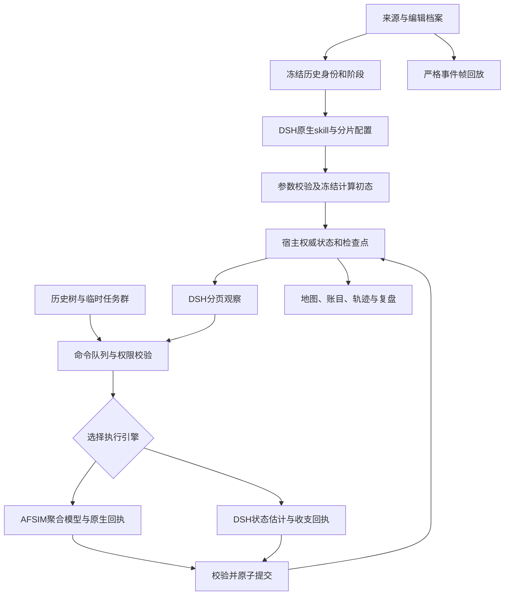

# 会战级架构与资料深度审计

> **长征多军转移分项（2026-11-03）**：[实现、实测与勘误](长征多军转移窗口与原生会话续推验收-2026-11-03.md)。已有局部单边转移被前次累计入口失败误判，现补会战窗口／目标图与原生空阻援脚本；右路军四军新窗口、3个非物理指挥参考，不虚构敌军。19项新回归通过，完整164组／1945项通过；末轮仅校正新目标说明后7组120项复测通过，不相加、不称一次最终同快照全绿。真实AFSIM对照5次、前端四轮至6目标结算、原两个SDK会话冷恢复续推及账目通过。原默认与旧局不改；270完整历史格仍未验。下一项为真实从零配置、纯DSH执行及环境／资源历史标定。下方为此前时点。

> **原生单位输入与T4失败终态（2026-11-03）**：[实现、验收与失败](原生单位态势索引与上下文减负验收-2026-11-03.md)：完整身份索引保留到场状态，名单减少92.47%；157组／1829项离线通过，真实DSH核对79身份中的一项延后到场通过。**完整前端T4未通过**：24次效果预览全拒收、10次压缩，45分钟后步骤预算耗尽，世界仍精确T3。最终6份完整存档冷恢复、40源码／73保护核对通过；最高优先级转候选原生参数合同、具体字段反馈和受限修订，270完整历史窗口不变。未安装上传；下方为前期时点。

> **库存、Native候选分页与真实22单位T3（2026-11-03）**：[证据与范围](库存否定句与Native候选分页验收-2026-11-03.md)：正库存否定句误判已修，原生分页实际核对16＋6单位；正常前端T3提交、账目／来源／时钟及五局完整冷恢复通过。9任务20成员保留，14交付／6合法待命；具体原因覆盖缺陷追加TDD修复，49项相关检查通过。**最终v2完整离线156／156组、1820项、0失败／0跳过通过**，1108.63秒；38源码与73保护文件不变。实际回合仍约16分45秒，270完整历史窗口及补给／地形／标定不关闭；未安装上传。下方保留前期时点。

> **人员投影与JS凭证最终分项（2026-11-03）**：[最终证据与限制](人员保有率与战报疲劳一致性验收-2026-11-02.md)：新增比例跨JS哈希P0已修，最终154组／1798项、0失败／0跳过。完整22单位真实前端T2提交（HTTP967.720秒），人员装备账、来源、Native凭证及1小时推进核对，1440／900界面、四局完整冷恢复通过；首轮一小时失败及QA失败保留。新发现“均未耗尽”库存误判优先TDD；16条预览分页、补给策略、时延与刷新／取消提示仍开。仅本分项通过，战役仍active，270完整历史窗口不变；未安装上传。下方为前期时点。

> **真实JS传输P0后续（2026-11-03）**：[最新根因与复测](人员保有率与战报疲劳一致性验收-2026-11-02.md)：一小时22单位T2失败，新增比例100.0经JS变100使3份有效预览摘要哈希失配，8次战报候选全部拒收。真实Node往返先红、一行摘要规范化后76项通过；旧错误凭证不修补。正常取消保留完整T1，修复版三局精确冷恢复通过，新完整门禁与新正常分支T2复测中，不提前验收。270完整历史格及旧配置／史料不变，未安装上传。下方154／1796为修复前时点。

> **人员保有率与疲劳战报后续（2026-11-02）**：[修复、证据及后续检测](人员保有率与战报疲劳一致性验收-2026-11-02.md)完成只读人员账投影、指定疲劳断言拒收及v3摘要／v2旧凭证兼容；154组／1796项、0失败／0跳过，真实22单位界面和独立Native只读工具核验通过。正常分支T2仍运行，不能提前验收；19单位补给策略、16条预览截断、等待／刷新计时与完整历史标定仍开。原配置／两份原对局未变，未上传或替换安装版；270完整历史窗口不变。下方保留前次时点。

> **运动反馈与新增真实差异（2026-11-02）**：[本次修复及证据](版本化运动反馈与渡运一致性验收-2026-11-02.md)以显式规则／新窗口约束机动疲劳，不重写旧史料或存档。完整153组／1783项通过；实际13帧通路及3帧零燃油乘艇、22单位真实DSH一小时及同命令AFSIM对照、完整冷恢复有证据。疲劳一致仍不能证明全后端等价：被动补给、HP投影与公开叙述仍有已量测差异；长窗口资源、地形及历史效能未通过，270完整历史窗口不变。下方保留原审计时点。

> **Native单位候选后续（2026-11-02）**：[原生候选与真实问题](Native单位结构化候选与运动反馈核查-2026-11-02.md)完成候选／轨迹凭证及整数往返修复；最终152组／1763项、0失败／0跳过。原22单位DSH第6轮真实前端重试提交，原会话、来源、账目及最终代码冷恢复通过；耗时约29分钟，不能称提速。程序蓝方目标完成建立在原运动疲劳P0之上，不通过物理／历史或公平后端对照；解释及刷新耗时P1仍开，270完整窗口不变。下方保留旧时点。

> **22单位连续会战后续（2026-11-02）**：[阶段验收](万家岭22单位连续会战与决策差异验收-2026-11-02.md)接通正常DSH阶段配置，修复合法接近回执及零距离循环。150组／1739项离线通过；完整22单位真实主线截至核查为AFSIM／DSH各3轮，继续运行但整场未结算。另有22单位双分支各8小时实际干预差异，不能据此关闭完整历史验收；公开单位说明出现已留证的敌距矛盾。270完整历史格不变，下方保留前次时点。

> **阶段数值资料与全目录复核（2026-11-02）**：[资料与验收](万家岭阶段数值口径与全目录资料复核-2026-11-02.md)增加分口径数值合同及万家岭1.4.0／新窗口和目标绑定。9项新增回归、150组／1734项完整离线检查通过；真实DSH5次问答／6次检索正确读全部6条，未改世界。新取27张原图尚未逐字转录或标定；[45场当前复核CSV](会战级资料逐场复核-2026-11-02.csv)仍显示大部分默认局部模板很小、单位开局实力缺载。270完整历史窗口不变，不能宣称整体会战完成；下方保留前次时点。

> **正式实体分合兵前端后续（2026-11-02）**：[实现与分项验收](实体分合兵前端与原生单位恢复验收-2026-11-02.md)接通真实预览、提交、原请求重试和当前身份选择；新增6项Native最终JSON恢复回归。两后端各实际推进至T3，中间冷恢复沿原会话，原任务交付1→2→3。最终构建主流程50项、后续重试／响应式18项、32分队只读22项及真实保存／合并25项、历史下级及余部27项通过。完整离线149组／1725项通过；原失败保留。45场／56版本结构可读，但本盘点的默认13组父子阶段候选均未证明下级覆盖完整，不能代替逐场历史标定；270完整历史窗口保持未验。下方保留前次时点。

> **装填计时与Native纠错后续（2026-11-02）**：[修复与验收](装填倒计时与Native纠错验收-2026-11-02.md)补齐被动秒级流逝、末发装填关系和明确字段反馈；新增6项回归，148组／1719项离线检查通过。最终源码真实复测3轮，装填连续且原任务取得2／3／4次交付并完成，完整冷恢复通过。前端秒级显示、构建及22项浏览器检查通过；原计时错误和QA人工接管失败保留。正式实体分合兵前端仍缺失，270完整历史窗口仍未验；下方保留前次时点。

> **分合兵跨阶段／真实状态审计（2026-11-02）**：[组合验收与新增缺口](分合兵跨阶段与当前身份映射验收-2026-11-02.md)补齐重试的当前身份映射及Native阶段投影；7项新回归，AFSIM7轮／DSH9轮完成三阶段、三次转换、原任务和双方向目标，最终冷恢复一致。离线148组／1713项通过；追加真实审计发现8处DSH被动冷却未递减，全功能未通过，优先修复。270完整历史窗口不变；下方为前次时点。

> **分合兵开放分支／Native身份继承（2026-11-02）**：[分支验收](分合兵开放分支与Native身份继承验收-2026-11-02.md)接通原语义身份、命令／任务与公开轨迹继承，独立创建运行会话；补齐来源批次隔离、重开局清理及普通Native上下文。新增10项回归通过；两后端机动及会话恢复、嵌套分支持续任务实际交付和三局完整冷恢复通过。最终147组／1706项离线检查通过，原失败和中止另存；转换后跨阶段、正式分合兵前端及270完整历史窗口仍待验。下方为前次分项时点。

> **正式编组事务／SDK恢复分项（2026-11-02）**：[正式编组事务与双后端恢复验收-2026-11-02](正式编组事务与双后端恢复验收-2026-11-02.md)接通正常API的原子提交、幂等重试与完整恢复。16项新增回归通过；有损合成副本两后端完成分兵T1／推进T2／合并T2／推进T3，最终源码完整冷恢复通过。另经Native Registry完成父级／两个新子单位及原会话恢复的5次真实决策；首次恢复的ID复制错误拒收并保留，改为宿主绑定本单位身份后通过。最终146组／1696项离线检查通过，原失败另存。正式前端、转换后跨阶段、开放分支及270完整历史窗口仍待验；下方保留前次时点记录。

> **旧保障与航空反馈后续（2026-11-02）**：[旧保障减员与航空资源反馈验收-2026-11-02](旧保障减员与航空资源反馈验收-2026-11-02.md)补齐旧模式非战斗减员必要上限、显式余量及实际提示调用，改进航空逐字段反馈并清除过期后端标识。17项新回归；已有损失后拆分、DSH／AFSIM交替及同地合并续推8帧、固定航空／受降和独立只读查询通过。旧预算仍按回合，未作历史标定；正式保存事务、转换后跨阶段、新单位会话、前端及270完整历史窗口继续未验。最终145组／1680项离线检查通过，完整日志及原失败见链接。

> **DSH必要效能约束分项（2026-11-02）**：[DSH火力效能上界与混合损失验收-2026-11-02](DSH火力效能上界与混合损失验收-2026-11-02.md)拒收原24发／239人候选，共享原生公式，区分地面／航空／受降。12项新回归、104项相关检查及真实12单位推进通过；最终143组／1663项门禁与两次真实只读复核通过。另确认旧模型非战斗减员P0和航空反馈P1，不能宣称所有损耗已受约束。270完整窗口及正式转换仍未关闭。

> **K05／K09实态执行分项（2026-11-02）**：[编组实态执行与火力粒度对照验收-2026-11-02](编组实态执行与火力粒度对照验收-2026-11-02.md)新增隔离的真实AFSIM／DSH执行路径，复用Native工具、编译和结果提交；修复拆分重复齐射额度及同足迹面积密度偏差，明确旧回执不代表当前编组。13项新回归和47项相关检查已通过；真实DSH炮击虽通过过程账却出现24发／239人效能偏差，已列P0、效果验收失败；最终142组／1651项离线门禁通过。正式原子提交、转换后跨阶段和前端仍未准入，270完整窗口保持未验。

> **K05会话候选增量（2026-11-02）**：[命令与持续任务接续](编组命令与持续任务身份接续验收-2026-11-02.md)补齐命令／叶子映射、原意图和任务承担者，保留旧回执与原生会话，不克隆SDK会话。重复回执、冲突角色／指挥及外部资源预约的复制明确拒收；活动观察器复用原检查点过滤。当前仅候选及命令合法性检查通过，实际平台与运行会话事务尚未接通，不把已有T1复核当成新回合或完整历史验收。

> **K05过程增量（2026-11-02）**：[身份与过程接续](编组转换的身份与过程接续验收-2026-11-02.md)已解决候选新实体与三个冻结身份校验、参与／战役记录及等价目标观察的接续。19项过程和1项预览新回归、三个已有执行检查点及真实Native两页查询有证据；原定义、损耗、时钟与目标进度保持。命令／任务／平台执行事务和有代价重组仍未完成，45场资料与270窗口不据此通过。

> **K05归属基础增量（2026-11-02）**：[当前实现与限制](运行中编组唯一归属与身份候选验收-2026-11-02.md)已补互斥根账、候选身份参考及旧宿主未核对运行中分配元数据的缺口。重验事件和份额，不以摘要代替所有权检查；历史父级测试复用窗口的选择祖先／覆盖下级规则。三份既有执行检查点及真实Native只读查询通过，中央冻结名单及任务、目标、平台接续仍未完成。没有新历史人数／装备事实，也未关闭完整会战。

> **K05当前实态增量（2026-11-02）**：[分配预览与后续准入契约](有损实态分合兵预览与准入契约-2026-11-02.md)已验证当前伤损、非零装备、库存及余量的守恒分配，DSH沿原Native桥只读核账。实际发现并修正Native操作快照遗漏用途／重置代次；原失败保留。唯一根账、活动实体替换、命令／持续任务／目标迁移和两后端执行尚未接通；这不改变45场资料及270完整历史窗口未验结论。

> **最新增量（2026-11-01）**：[万家岭6—10日窗口准入](万家岭会战窗口准入与验收-2026-11-01.md)将累计名单与固定窗口分开，补来源版本、身份处理、未知余部及候选范围；默认45场／56份初态和缺载事实未变。22候选入口、只读Native及原生一步不等于五日历史过程通过。本文下方各次审计只代表其原时点。

> **2026-11-01复核入口**：最新本地全版本盘点、架构边界、当前优先级及执行证据见[会战级改造复核与执行基线](会战级改造复核与执行基线-2026-11-01.md)。[主规划](会战级多层编制与分合兵改造规划-2026-10-31.md)已重整为当前工作包，不再把各轮“最新”混作同一次成绩。以下各轮原始失败、分析和修复过程保留，不据早期文字重新认定已修复问题仍存在。

> 2026-11-01：X18情报180→1830、漏老化、旧版固定+30及原生置信值截断已有分项修复，115组/1244项、真实原生/DSH、前端和冷恢复证据见[情报时间修复](情报时间计量与刷新回执修复-2026-11-01.md)。无新历史人数/装备事实；45场资料盘点不变。讲解分类收支/目标结算、通信原点和完整C2、退场重入仍未过，下方旧问题按当时记录保留。

> 最新E03-C/E04-A已加入可选单世界阶段链，10阶段、90分钟间隙及原任务保持有实际证据；114组/1231项、前端类型/构建与5局冷恢复通过。DSH第8轮拒收后从原局恢复完成12轮，无中断长稳未过；人工仍发现战报分类收支/目标结算和情报时效量纲异常。新增链不含单位退场重入、增援与重编，45场默认没有迁移。见[完整分项证据及失败](单世界阶段与跨阶段任务验收-2026-10-31.md)。下方初次“当前源码复核”是当时资料/架构快照，旧分支限制仍保留，不能用于否定后续可选同世界链。

> X13后续已补已见回合/同帧目标冲突检查并独立复测，修正实际发现的零弹耗用误报。人工首轮新漏网另存原件后补TDD及新模型首轮；通用语义和历史完整过程仍未验收，见[战报对齐证据](战报回合与目标结算对齐验证-2026-10-31.md)。下方“X13未关闭”为该轮发现时状态。

> 最新E03-B2同世界持续任务首版已有两后端与前端证据，冻结承担者、依赖/预备队、回执、取消和同世界恢复可用；完整生命周期与跨阶段迁移仍未完成，后者明确拒绝。只读重审仍为45场55版、默认49/57局部模板不超过4单位，单位人数/装备事实仍全缺载。自由战报新发现回合和同帧目标误述，列X13未关闭。见[最新实施证据与限制](持续兵团任务执行与真实验收-2026-10-31.md)；以下各轮审计保留为历史记录。

> 后续X11/X12已统一补给派生指数，并修已见投入部/目标枚举讲解模式；真实DSH3轮、AFSIM1轮、前端14项和冷恢复通过。人工发现首轮pending漏网后补失败回归与独立真实首轮，不把筛查全绿等同语义准确。新增情报时效连续性缺口留在E05，见[资源/讲解复核](会战资源指标与讲解一致性复核-2026-10-31.md)。

> 最新E03-B1已实现可选多方向双边目标评分与有界Native读取，111组/1172项回归通过；真实两后端、前端和冷恢复见[本轮证据](会战多方向目标图与双后端验证-2026-10-31.md)。目标图不自动下令，45场默认未迁移；持续任务与完整会战仍未验收。实际新增问题为补给旧百分比滞后及讲解遗漏“投入部”限定，已列X11/X12优先TDD。

> 后续E03-A补核万家岭118—120页，新增1.2.0与17条事件；已发现并修正工具空筛选说明、跨帧分页阶段绑定。最新109组/1144项回归通过；19帧资料前端和限定模型查询通过，讲解质量、布局及完整物理会战仍分项未过。见[本轮资料与准入](万家岭资料勘误与持续会战准入-2026-10-31.md)。

> 后续E02已修复当前指挥成员及统计口径，加入具名路径、等待状态和会话内短任务引用；108组/1133项回归及真实DSH、原生、前端分层检查通过。原自由提问/长ID失败保留，见[指挥观察验收](指挥观察契约与原生分层验收-2026-10-31.md)。

> 后续E01已修复下述合成增删/更名失败，最终107组/1123项回归、真实前端、两种后端推进及冷恢复通过；原失败记录不改。F09模型解读与完整会战缺口仍在，见[会战合成编辑验收](会战合成编组编辑与连续过程验收-2026-10-31.md)。

## 当前源码复核：替代下方首轮记录的“当前”口径

2026-10-31再次遍历全部45场、55份版本，记录见[当前结构摘要](会战级结构复核摘要-2026-10-31.json)和[逐场资料清单](会战级资料逐场清单-2026-10-31.csv)。下文首轮53版本统计及原缺陷保留用于追溯，不能当作最新状态；后续执行以[更新规划](会战级多层编制与分合兵改造规划-2026-10-31.md)为准。

### 当前能够确认的结论

- **全部45场需要覆盖与能力复审，不需要全部史料文章重写。** 默认559参考节点，最新601；最新110阶段、59个可参数化局部模板，48个不超过4单位。累计序列可以筛选43场双方叶子，只证明筛选，不是43场完整可执行。
- 人员、装备的单位事实字段仍全部null；唯一非空位置是粗区域参考。已有文献会战总数不能按平均值灌入各师团。三项完整覆盖声明全部为真仍为0场，这是资料声明而非实际测试通过率。
- 武汉最新127参考节点、79累计地面候选；万家岭最新1.2.0有32参考、6局部执行、17事件和4阶段关系；旧1.1.0仍为31参考/7事件。仅万家岭新版登记下级覆盖元数据，其他档案需要按新契约增量补齐。
- 已修复首轮旧长沙意外异常、成员不可辨、阶段任务群丢失；多层临时组织和一次任务分工已实现。来源阶段开局关系现可显式绑定，行政树与当前指挥分开；临时组织优先，不随历史钟点自动转隶。不能继续将这些列为“尚未实现”。

### 本次新失败与优先级

**F01 / P0：会战初态派生合成演习新增单位失败。** 本次11模块82项回归中81通过、1错误；`verify_initial_command`新增演习单位后进入`missions.from_definition()`，`campaign.validate_state()`报告`campaign.actors`缺少该单位。失败发生在创建校验，未证实已运行对局丢兵。需要沿正常编辑入口复现，并修复单位/过程状态/身份引用同步；不能只删除用例或跳过校验。之前106组1114项全绿早于新增用例，不代表现在全绿。

**F09 / P1：真实模型的指挥链解释未通过。** 已有真实DSH四次工具返回正确成员及祖先链，但最终回答将两个成员ID写进`chain`。工具、宿主权限与模型解读应分别检查；先澄清提问与字段契约并做独立真实复测，不能据一次失败断言内核链错误，也不能据API正确宣布模型已理解。

**会战主要缺口仍在W2/W4–W6。** 相邻阶段继承只支持同版、相接时钟和有限链长；空档、退出重入、改编、在途转换仍拒绝或受限。默认过程仍用有限据点/阻援目标，新增目标图只分项解决多方向评分；补给原生代码按阵营首节点取值，部分通信距离仍连向仓库。地形是有限障碍/走廊与点状部队，没有完整展开、道路寻径和地形视线。粒度/长窗口同范围历史标定、全45场全用途与安装版长稳都没有完整证据。

### 本次检查范围及证据

模板健康门禁与抗日、长征、万家岭三个生成一致性检查通过；定向回归失败如上，日志在`.cache/qa/campaign-review-2026-10-31/`。本次没有更改业务代码，没有新运行模型/AFSIM全程，没有核读所有外部原始史料，没有覆盖本机安装或同步GitHub。

既有真实浏览器开局指挥12项通过，说明来源66军的两个投入部实际收令移动、转隶后旧权限移除。既有DSH独立10帧讲解13项通过且AFSIM调用为0，说明此前JSON包裹讲解的流程问题已改善；讲解逐条事实审查和完整物理回溯仍单独待验。证据路径在当前摘要登记，不将它们重复计作本次新实测。

---

## 首轮审计记录（以下为原基线）

> 本文记录改造前的审计证据，正文“当前”均指该基线。后续已修复目标引用未处理异常、成员观察歧义和阶段任务群丢失，并加入覆盖/余部声明；见[基础契约修复与验证](会战基础契约修复与验证-2026-10-31.md)。随后已实现多层临时指挥及一轮兵种分工/确认，最新103组回归和真实链路结果见[兵团任务验收](兵团任务分解与真实验收-2026-10-31.md)。完整会战资料和过程目标仍继续实施。

## 结论与审计范围

当前系统已具备**局部聚合推演内核，以及会战编制的第一层指挥界面**，尚未形成完整的会战级系统。问题同时存在于资料、编制语义、生命周期、指挥、空间与保障计算、历史回放和验收口径。增加单位数或上下文上限不能独立解决。

**全部45个场景需要重新登记能力与数据覆盖，但不需要把全部文章推倒重写，也不应把所有战斗强行扩为大会战。** 保留已核来源、异文、未知值和旧版本；新增可计算的时段编制、部署、任务、资源和转换约束。大会战恢复多方向多梯队；战术节点保留适当粒度；战略转移、敌后活动和受降采用各自过程。

本次读取当前源码、53份版本化初态、目录与资料生成链；逐版本调用本地验证和参数模板；复查指挥、阶段、观察、裁决、回放、UI接口。没有重新查验所有历史原件，没有运行新的完整真实模型会战，不把结构审计当作史实认证。配置、对局、安装程序与GitHub均未修改。

关联文件：

- [主实施规划](会战级多层编制与分合兵改造规划-2026-10-31.md)：首轮记录及本次细化后的执行顺序。
- [验收矩阵](会战级改造验收矩阵-2026-10-31.md)：必须提交的检测证据和通过条件。
- [45场逐项清单](会战级资料逐场清单-2026-10-31.csv)：默认/最新版本、阶段、单位数与原始缺项说明。
- [机器可读审计摘要](会战级结构审计摘要-2026-10-31.json)：计数、异常、83项回归状态及输入文件SHA256。
- 可复核命令：`PYTHONDONTWRITEBYTECODE=1 PYTHONPATH=. python tools/qa/campaign_readiness_audit.py`。输出到`.cache/qa/campaign-architecture-2026-10-31/`，不读取用户存档或模型配置。

## 一、数据盘点：资料量与可计算程度并不相等

| 指标 | 当前默认版本集合 | 每场最新版本集合 |
|---|---:|---:|
| 场景数 | 45 | 45 |
| 编制参考节点 | 559 | 578 |
| 阶段记录（含累计参考阶段） | 103 | 106 |
| 可以产生局部参数模板的阶段 | 57 | 59 |
| 至少有一个局部模板的场景 | 43 | 43 |
| 累计地面序列可完成双方叶子筛选的场景 | 42 | 43 |
| 三项资料完整标志全部为真的场景 | 0 | 0 |
| 单位级`facts.personnel`非空 | 0 | 0 |
| 单位级`facts.equipment`非空 | 0 | 0 |
| 单位级`facts.position`非空 | 1 | 1 |

非空位置是平型关的**粗部署区域参考**，不是精确阵地。人数和装备的0表示这些单位事实字段全部未知，不是军队无人、无装备；文献表中已有会战投入和损失数据，但统计范围不同，不能直接灌入单位初态。

默认57个局部模板中，6个只有1单位、19个2单位、15个3单位、9个4单位：**49/57约86%不超过4单位**；最大12单位。最新车桥1.3.0增加两个15单位阶段。武汉1.1.0的79单位来自累计会战序列的显式估计部署入口，不在“已核阶段模板”统计中；冀中也主要是累计参考，不能当作某日全部到场。

最新578节点中有136指挥节点、422作战编制、17支援节点、3航空节点、0海军节点。这里的角色不等于真实战场兵种比例：地面编制内部可含装备，且不少支援过程尚未独立编列。尤其不能把大兵团内所有炮兵、工兵、运输和航空都默认为步兵附加系数。

编辑源方面，抗日战争包有45项来源、48条部队叙述、109条事件、60条数量、55条缺口；长征包有37项来源、45条部队叙述、116条事件、52条数量、49条缺口。**叙述行、参考节点、实际执行实体是三个计量单位，不相加。** 一条“某军若干师等部”并非完整名册。

特别注意：`historical_initial.readiness()`按职责固定返回`ready_for_process_simulation=False`。所以旧文档中的“0/45过程通过”不能单凭这个字段作为真实验收成绩；必须另建按版本、用途、引擎、范围绑定的验收证据。表中的“完整标志0”是数据声明，本次也没有发现足以证明全会战完成的证据。

## 二、当前架构能复用什么

| 层 | 现有代码 | 当前可用内容 | 会战化边界 |
|---|---|---|---|
| 资料 | `data/*/scenarios.json`、`historical_initial`、`corpus` | 来源、异文、未知值、稳定番号、阶段到场 | 单一`parent_id`不表达随时间变化的隶属；编辑故事与执行阶段不一一映射 |
| 参数化 | `historical_operations`、`scenario_builder/assembly` | 事实与估计分开、版本冻结、分片校验、两种执行后端 | 缺少会战方向、预备队、阶段图与整套保障计划 |
| 编制 | `force_organization`、`formation_parts` | 历史树、叶子去重汇总、已有下级任务群分合、开局守恒划分 | 任务群扁平；不是完整多级作战指挥体系；不能任意运行时创设新团 |
| 命令 | `commands`、`unit_planning`、`force_routes` | 人工优先、版本锁、现有叶子批量命令、按需单位Agent | 群命令仍广播相同动作，未表达主攻、支援、预备队之间的任务依赖 |
| 状态 | `session_store`、`phase_continuity` | 连续账、冻结恢复、有限相邻阶段继承 | 阶段续接与新任务群生命周期尚未贯通 |
| 计算 | `afsim_world/combined`、`dsh_simulation` | 聚合火力、有限地形、库存、工程、航空、回执与程序目标 | 不是已标定的全兵种物理模型；仍存在局部占点和单后方节点假设 |
| 展示分析 | Vue工作台、`causal`、`extensions` | 军标、折叠面板、编组操作、过程账和受控对照 | 缺兵团态势总图、任务链复盘及完整会战过程验收 |

现有DSH已使用Native插件、注册工具、原生角色会话/父子工作单元、事件、取消和fork。**不要新建第二套聊天记忆、工具分发或Agent调度协议。** 历史组织和任务账是项目领域模型，应由宿主持有；DSH按版本读取和提出候选，AFSIM或DSH后端按既有契约执行。当前不是PTC，也不需要为了会战规模切换成任意代码执行模式。

## 三、按影响排序的问题

### P0：先修数据与状态契约，阻止规模扩展放大错误

**P0-1：目标资料与初态版本未共同冻结。** `objective_guidance()`按场景/阶段读取全局`historical_objectives.json`。本次遍历53版本，第二次长沙`1.0.0/dayun_sep7`实际抛出`KeyError: DAYUN_PUBLISHER`，因为新版目标引用的来源不存在于旧初态。并非所有旧局都会崩溃；已冻结计算定义和新建旧版本的路径需分别测。先改为版本化绑定或明确兼容映射，禁止默换最新来源。

**P0-2：叶子去重没有证明下级完整覆盖父级。** `campaign_scope.select()`发现候选下级即剔除祖先。能防双计，却不能证明剩余叶子代表整军。例如史料只列某军一师/一团，未列余部不能因父级被剔除就当成不存在。当前缺少逐节点下级覆盖和残余兵力表达。这是结构风险，不是已证实某局实有人数丢失；人数本身多数尚未核定。应先拒绝“全军完整”宣称，或使用有边界的“未细分余部”计算实体，并用互斥分配账保证不增兵。

**P0-3：阶段续接没有继承临时任务群。** `force_organization`在会话顶层；`phase_routes.continue_phase()`新建会话时未复制/转换它。物理账部分继承，而新的任务组织会丢失。不能直接复制含已退出成员的群；须按稳定执行身份映射，保留撤出记录、解释不可续接命令，并在同一事务提交。该判断来自代码路径，本轮未新增真实浏览器续接实测。

### P1：决定“会战是否成立”的能力缺口

**P1-1：DSH无法可靠辨认某些任务群的具体成员。** 编制工具返回时删去成员ID，单位观察没有运行任务群字段。本次以96叶子隔离QA验证：同一历史父单位两个等量计算分队，换作任务群成员后，`nodes`、`groups`及单位详情观察均相同。应增加带组织修订号的成员分页，返回历史ID、执行ID、当前命令ID及状态，不能仅依赖名称猜测。

**P1-2：会战模式只是累计地面名单扩容。** 各阶段候选取并集，仍套用所选阶段的地域、航空和部分过程规则；累计参战没有自动形成入场、离场、调动和指挥变化。单方转移不能通过双方序列筛选，也不应为此捏造敌军。需改为声明会战范围及适用过程，而不是对所有条目统一开启大名单。

**P1-3：历史回溯目前主要是事件阅读。** `history_replay.frame_pinned()`明确将每帧坐标与人员数置空，保留参战参考。这是防造假的保护，不能删除保护后用地名中心补点。应建立有证据的事件—单位—地域状态约束及批准的重建初态；不足时继续标注“资料回放”，不能称完整战场重现。三用途共享同一事实来源和选定基线，教学改编另存差异。

**P1-4：历史建制和有效指挥权仍混在选择语义中。** 历史父节点永远汇总其后代，即使下级已经临时配属任务群；当前可操作的任务群又只有一层。需要行政隶属、当前作战指挥、支援关系分开；同一时刻只有一个互斥主指挥归属，支援关系可多条。命令重叠须显示覆盖顺序和原因，不能把“历史上属于某军”自动解释为“此时仍受其行动指挥”。

**P1-5：目标模型不能覆盖各类会战。** 新会战入口复用一个据点、1—6阻援区域、兵力保留阈值及攻点/迟滞目标。它不足以表达多轴突破、梯次后撤、跨河吞吐、铁路网瘫痪恢复、根据地组织存续、受降接收。旧模板已有铁路/隐蔽/接收等简化量，不能当成有历史部队绑定的完整过程。须有分方向目标图、依赖和双边结果，开放推演按完成条件结算。

**P1-6：补给和通信仍有局部结构假设。** 历史模板每方一个后方节点；原生聚合代码多处按阵营取第一个节点，库存池也按阵营汇总。不能只向UI增加仓库就称多级后勤。通信延迟当前部分以到补给节点距离估算，不是真正上级指挥链。须补仓库—运输—部队的容量与时间、支援配属、维修后送、C2节点和中断恢复。

**P1-7：点状部署不能完整表达战线和接触。** `local-terrain-1`是最多各64条有限障碍/直路走廊，未实现DEM视线、道路寻径、桥梁拥堵及大单位正面/纵深。现有“跟随同一目的地”是集结命令，不是自动部署。需要区域占用、梯队、道路与接触事件；间瞄/航空的目标情报与直射视线分开。

**P1-8：历史效能与粒度一致性未验收。** 共同火力先验包含射手比例、射速、概率、展开面积、固定死伤比例等；现有史料对照主要是范围参照。守恒正确不代表分为1/4/16/32单位后的接触、火力、补给、目标判定等价。必须先做粒度变化对照，再做同一单位、同一时段、同一指标的标定，禁止用全会战伤亡强制扣兵。

### P2：长期运行、解释与交付

- 79单位配置以4单位分片，至少需要20个单位工作单元加公共/终检，共22段；当前依次调用。把全部单位启用独立Agent也会顺序调用。应先测生成/模型/工具/引擎/落盘分项时延，再用原生父子工作单元、增量读取、已验证模板复用优化；不靠降低思考或取消校验。
- 四个多月按30分钟外层回合会产生数千次决策。会战指挥周期、物理计算周期、历史事件精度必须分离，允许事件触发与受控快进，不能跳过持续损耗和运输。
- 组织调整事件保存在会话中，但现有因果轨迹未完整冻结每轮组织版本与命令展开映射。分兵/转隶反事实须携带同一组织前态；公开依据与回执是证据，生成的文字不等于因果证明。
- 前端尚需层级缩放、方向与正面、下级位置保留、未到场/失能/场外/参考状态、群任务进度及冲突预览；军标美观不能替代状态真实性。
- 旧目录说明、默认/最新版本和“就绪”用词存在漂移。新版本不自动等于已验收，旧版本也不能在选择器里悄悄失效。安装包能力须与源码版本分别标明。

## 四、资料更新策略

| 资料层 | 是否重写 | 实施要求 |
|---|---|---|
| 已核来源、原文异文、统计口径 | 原则上保留 | 发现错误新增勘误和来源，不直接覆盖旧冻结事实 |
| 战役叙述、教学介绍 | 定向补充 | 补决策节点、阶段并行性、实际任务；无需为每场虚构逐小时细节 |
| `historical_initial` | 逐场新增版本 | 下级覆盖、时段隶属、参战范围、到离场；数值缺载仍未知 |
| 作战参数/初态 | 全部纳入新契约审核 | 可核值与估计分层；估计必须有单位、范围、依据、适用日期和敏感性 |
| 目标、地理、资源与战损参照 | 按模型类型补齐 | 明确影响哪些计算；画在地图上不等于已进入裁决 |
| 回放事件、部队引用与转换 | 系统补映射 | 用稳定ID关联，保留时间区间和次序；无证据不生成确定时刻 |
| 军标/DSH技能/说明 | 随能力更新 | 显示完整度与估计标志；技能只调用现有领域工具，不能直接改账 |

优先形成“最小充分资料包”：双方有效序列及其覆盖边界、起点部署范围、人员装备口径、支援与补给关系、关键通路、任务与结束条件、后续增援/撤出、可用的同范围损耗参照。找不到精确值并不等于不能开放推演；允许显式估计，但不得因此获得“精确史实复原”认证。

资料生成保持单向：长征/抗日`scenarios.json`等编辑源 → CSV/语料卡/索引；冻结初态另行版本化并通过稳定ID映射。不要同时手改源JSON、生成CSV和语料卡制造三份真值。抗美援朝目前资料分散，优先增加统一映射和校验，再决定是否迁到共同编辑schema。

## 五、逐场细化重点

下表数量为**最新版本的可生成局部模板单位数**，斜线表示不同阶段；“累计”仅指候选筛选，非全场可执行。所有行均需完成新契约审核，不代表全部需要同样的模型。

| ID／场景 | 当前局部规模 | 优先补充的资料与过程 |
|---|---|---|
| AJ01 淞沪 | 3 | 多集团军—军—师、分批登陆、罗店/大场/金山卫、海空火力与撤退通路 |
| AJ02 太原 | 3 | 忻口与娘子关并行、防区接替、八路军侧后行动、后方撤收 |
| AJ03 平型关 | 6 | 伏击与外围阻援分工、运输队长度、道路和实际到场；保留战术粒度 |
| AJ04 徐州 | 2/3 | 滕县—临沂—台儿庄—徐州并行关联，避免与AJ05重复兵力和战果 |
| AJ05 台儿庄 | 2 | 守城、外围机动、援军、巷战与撤离；不得把整个师塞进一个点 |
| AJ06 武汉 | 无已核局部；累计79 | 第五战区缺编、第九战区下级覆盖、双方时段隶属、长江/大别山多轴、海空和后勤 |
| AJ07 万家岭 | 4；累计6 | 围攻军的实际投入师团、阻援军、援军与残余部队；作为会战化首个资料试点 |
| AJ08 第一次长沙 | 3 | 新墙河—汨罗江—长沙梯次、各方向参战与撤退；不能复用第三次会战名单 |
| AJ09 第二次长沙 | 2 | 先修旧版本目标引用，再补大云山以外各轴、截击和双方补给窗口 |
| AJ10 第三次长沙 | 2 | 城防与外围“炉壁”分别列编，阶段调动、返程阻击与补给 |
| AJ11 桂南/昆仑关 | 2 | 第5军各师、装甲炮兵与日方增援、周边高地、关口交通和撤换 |
| AJ12 豫湘桂 | 3 | 河南/长衡/桂柳拆并行子场景及铁路轴，不继续用衡阳片段代表全线 |
| AJ13 衡阳 | 2 | 第10军下级、多轮进攻、援军受阻、伤员和防御设施；与AJ12共享身份 |
| AJ14 百团大战 | 3 | 铁路/桥隧/据点网络、部队任务、修复与反扫荡，不用一个网络百分比替代全部 |
| AJ15 冀中 | 无已核局部；累计34 | 军分区/地区队逐时活动、隐蔽与组织存续、扫荡分区；不能全放同点决战 |
| AJ16 敌后局部反攻1944 | 2 | 明确高沟子场景与总览边界，补多个独立行动窗口和各自部队 |
| AJ17 车桥 | 15/15/4 | 1.3.0作攻坚—打援回归基准，补下级配属、任务继承及统计异文处理 |
| AJ18 湘西 | 2 | 多军多轴、山地补给和阻击、航空任务池与对地效果 |
| AJ19 缅北滇西 | 2 | 驻印军/滇西远征军两线、松山以外节点、航空运输与跨境补给 |
| AJ20 全面反攻与受降 | 4 | 分区受降授权、停火、接收/缴械/登记分离；不能全用占点胜利 |
| KW01 第一次战役 | 2/9 | 四军及下级、温井/云山/东线并行、通信管制、接替和撤收 |
| KW02 第二次战役 | 2/3 | 西线与长津湖分区、集团军/兵团/军师、非战斗减员、海空撤离 |
| KW03 第三次战役 | 3 | 六军及人民军多方向、突破追击、城市与桥梁、后续补给伸长 |
| KW04 第四次战役 | 6 | 汉江/横城/砥平里多阶段，空间换时间、轮换和补充；不只砥平里一夜 |
| KW05 第五次战役 | 3 | 两进攻阶段及退却阻击、兵团内各军师、空中遮断、失联与重组 |
| KW06 1951夏秋防御 | 2 | 各防区与换防、马良山/文登里等不同窗口、运输和工事 |
| KW07 1952秋季反击 | 2 | 多个连排目标的分散攻击、炮兵配属、撤出/固守两种任务 |
| KW08 上甘岭 | 3 | 两高地、各批连营轮换、坑道/表面状态、补水弹与炮兵支援 |
| KW09 1953夏季反击 | 3 | 多军突破、金城各轴与侧翼策应、炮兵准备、政治结束约束 |
| LM01 湘江 | 4/2 | 三个主要阻击方向、纵队渡江梯队、行军道路、架桥与辎重减负 |
| LM02 乌江 | 5 | 先遣强渡至后续渡运、各渡口及工兵，不能仅用桥成后的阶段 |
| LM03 四渡赤水 | 4/1/1/1/1 | 时段指挥与渡口网、遵义及追堵变化、侦察判断和多次路线选择 |
| LM04 金沙江1935 | 1 | 各军团渡运梯队、渡口容量、后卫/追兵、船只周转 |
| LM05 大渡河/泸定桥 | 2 | 安顺场与两岸纵队、行军与夺桥/修桥分工、后续渡运 |
| LM06 懋功/雪山草地 | 4 | 多方面军与左右路时段序列、会师/分途、非接敌转移和环境损耗 |
| LM07 包座 | 12 | 已有攻点/打援阶段的任务群、分批援军、求吉寺收束与阶段继承 |
| LM08 腊子口 | 2 | 正面牵制与迂回分队、崖道可行性、通路开启；保留小尺度 |
| LM09 红25军 | 3/5/3 | 中间缺失阶段、追堵/转移/会师身份变化；不可三个窗口等同全程 |
| LM10 嘉陵江 | 4/2/2/4 | 三路渡江、后续梯队、剑门关、跨阶段身份/设施和补给连续 |
| LM11 百丈关 | 9 | 分方向兵团投入、预备队、伤亡承受与撤出，保留日期口径分歧 |
| LM12 乌蒙山 | 4 | 多路追堵、山道与反复回旋、情报和行军疲劳 |
| LM13 金沙江1936 | 1 | 红二六军团各梯队、运输和会合，禁止混入1935年部队/时点 |
| LM14 直罗镇 | 3 | 红一/十五军团下级、109师增援、围点打援和退出通路 |
| LM15 三大主力会师 | 2/3 | 甘孜整编至会宁/将台堡的身份与时段衔接，不捏造接敌方 |
| CP01 长平 | 5 | 古代兵种与保障尺度、相对时间、封锁/断粮/投降，不套用1930年代武器参数 |

## 六、本次检测证据与限制

1. 新增只读审计脚本，完成45场、53版本的结构遍历；实际记录旧长沙模板异常，未隐藏失败。
2. 现有9个相关测试模块共**83项通过**，耗时约8.8秒。它们覆盖已有功能契约，仍未覆盖本次发现的跨版本目标引用和编制观察歧义；测试通过不抵消缺陷。
3. 96叶子内存对照证实任务群成员不可辨识问题，证据为`group-observation-probe.json`。
4. 之前的100组/1067项、79单位AFSIM与浏览器证据保留为首轮基线，本次没有把它们重新计为新通过；未重跑完整历史或真实大模型验收。
5. 两个资料生成器`--check`通过，说明当前生成文件与编辑源一致，不证明来源内容已经全面考证。新增`--require-template-health`门禁因旧长沙引用问题实际返回1。

完整日志在`.cache/qa/campaign-architecture-2026-10-31/`。本次修改仅增加审计工具、报告和规划，不调整战役事实、裁决结果、模型参数或现有用户对局。
