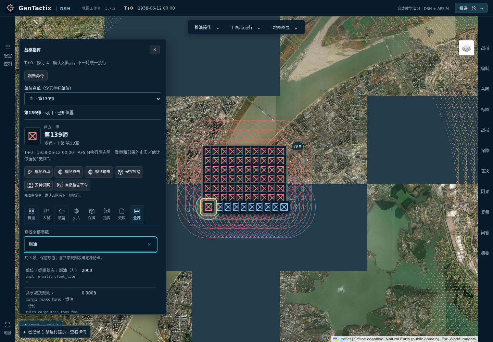
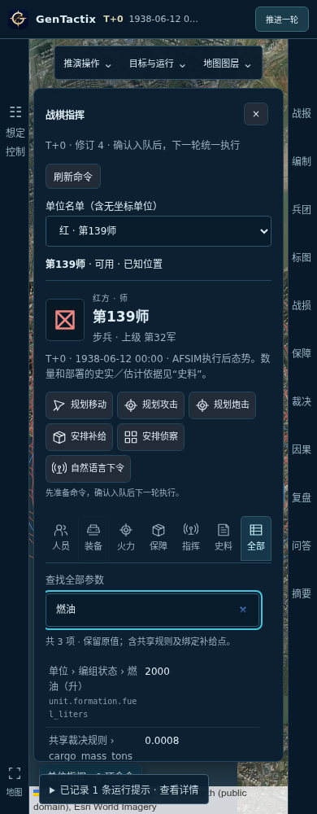

# 单位参数面板与交互验收

本次修改位于未发布源码，未替换本机安装版。前端复用当前快照、指挥权限、军标库和命令编辑器，查看参数不调用模型，也不重新计算战果。

## 信息结构

点击军标、重叠单位名单或地图定位名单后，显示当前单位的名称、阵营、层级、上级与观察时刻。八个带文字的图标标签分别为：

| 标签 | 内容 |
|---|---|
| 概览 | 现有人数、人员保有率、疲劳与压制、粮弹、炮弹、联络与情报、位置及机动上限 |
| 人员 | 累计投入、现有、战斗及非战斗减员、阵亡、负伤、失踪、被俘和未分类减员 |
| 装备 | 分类投入、可用、受损、损毁及累计不可用率 |
| 火力 | 直射、间瞄、防空范围，工事、防护、展开面积、装填和最近执行回执 |
| 保障 | 随队粮弹、燃油、备件、工程耗材与绑定补给节点 |
| 指挥 | 单位Agent状态、控制权限、机动依据与不支持的行动 |
| 史料 | 当前参数来源、证据定位及历史参考；档案合计不当作当前人数 |
| 全部 | 单位全部原始叶子字段、共享规则、火力参照、补给节点和指挥观测 |

“全部”支持中文名称、原字段路径和值搜索；每页50项，继续展开可读取所有项目。长文本可展开，新增字段自动进入列表，保留原始精度。0、否、空文本和未知分别显示，不以0填补缺载。

人员保有率为现有／累计投入，不标为核定编制满员率。装备不可用率为（受损＋损毁）／累计投入；无有效分母、缺载或不平衡时不计算。归一化粮弹工作量不标为吨或发，炮弹、燃油等分类实物保留自身单位。

## 操作与可用性

快捷操作在参数区上方，按当前权限和可用动作显示；移动进入现有地图选点，攻击、补给等进入现有编辑器，自然语言入口展开单位输入框。准备和选点均不入队，仍需明确确认。敌方不可指挥时禁用动作，严格历史回溯不提供下令入口。

标签支持左右方向键、Home和End，以及可见焦点；窄屏可横向浏览标签，参数区独立滚动。单位切换重置搜索与标签；切换战局清除旧单位选择；面板使用与地图一致的军标覆盖配置。

## 复现问题与修复

1. 已验证的历史配置切换到合成演习时，原结束方式被自动改写，父配置失效并中断派生。现保留已确认配置的显式结束方式。
2. 首次指挥观察仍在请求中时，地图单位选择被直接丢弃。现显示读取状态，复用在途请求，等待返回后打开最后选择；关闭面板会取消待显示的选择意图。
3. 快捷切换动作遵循原编辑器的持续方式重置规则，不携带其他动作遗留的持续回合或退出意图。

## 验证范围

证据在 `.cache/qa/native-evidence-scale-2026-11-04/`，测试使用隔离API与编译后的完整前端，没有替换接口响应数据。

- 6项参数回归：原值、未知与0、新增字段、数组、搜索、无修改、组件模板编译及装备比率边界。
- 36项开放界面检查：79单位战局（人数、配发、部署为QA假设，非历史标定），双边切换、八类参数、完整翻页、键盘、敌方权限、选点、自然语言焦点、显式入队与撤销；1440／900／390宽度无页面横向溢出。
- 13项只读界面检查：从正常向导创建并以真实DSH讲解初始化的武汉史料回溯；未定位单位可从名单选择，未知人员不填0，来源可读，无命令入口。不是动态历史会战验收。
- 首次选择延迟反例：对真实GET请求延迟2200毫秒，响应内容不变；修复前漏选，修复后显示状态、复用请求并打开单位。

最终全量离线回归191/191组、2265项通过，0失败/跳过；602项冻结输入一致，前端类型检查与生产构建通过。上述交互通过不代表全会战历史效能、大规模组合和长期稳定性已通过；128单位完整多兵种移动失败另列P0，未通过的数据不会提交为战局。

