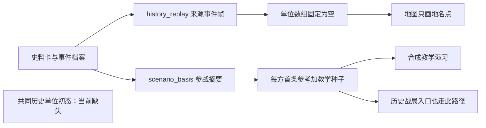

# 历史初态全场景审计

核查时间：2026-10-27。范围：当前3.7.0对应源码、本机6份安装版存档、45个战役目录及三种用途的两种执行引擎。按用户最新要求：回溯分析与历史战局推演使用真实历史部队；只有合成教学可以派生局部代表编组。

后续源码整改见[进度记录](历史初态整改进度-2026-10-27.md)：已修复回溯的独立渲染阻断，并将三场部分番号档案接入新建回溯局的只读编制与固定来源帧。历史开放推演、合成演习和历史部队AFSIM交战模型尚未接入。下文保留初次审计证据，不能将后续档案条目数解释为已导入的作战实体。

## 结论

**当前45个目录条目均未建立符合上述要求的统一历史初态。** 回溯的空单位是程序固定生成的；历史战局入口错误复用了教学派生流程；合成演习虽可计算局部编组，但尚未从同一份完整历史初态派生。不是切换模型、提高token预算、开启AFSIM或更换军标就能解决的问题。

此前的443项回归和入口检查证明了接口、状态守卫与部分执行流程，却没有证明历史战斗序列、初始部署和参战阶段完整。把装载、回执和推进通过作为历史功能验收，标准不足。本报告不把程序能启动表述为历史战局已经有效。

## 1. 全目录及真实AFSIM复核

| 检查项 | 实测结果 |
| --- | --- |
| 战役目录 | 45项全部检查 |
| 用途与引擎路径 | 45×3×2个组合的共用工厂与分支逻辑检查；没有声称进行了270次真实模型调用 |
| 来源事件初帧 | 45/45的`red_units`与`blue_units`固定为空 |
| 原始CA教学底表 | 45/45各有6个教学编组 |
| 新入口派生种子 | 45/45均缩为1红+1蓝，双方各3000人 |
| 种子保障配额 | 每个种子统一6个工兵作业组、12个运输单元；这是演习配置 |
| 历史参考 | 共99条参战参考行；逐单位实际人数、装备量和战术位置三个字段均未结构化录入 |
| 真实AFSIM来源帧装载 | 45/45完成；累计107个实体恰好对应107个地名参考点，作战单位总数仍为0；长平之战甚至0实体也可完成来源帧回执 |
| 史实初态验收 | 0/45达到“有时点、有真实单位序列、有部署依据、可区分未知与估计”的标准 |

“双方各3000人”指默认种子，不代表模型或用户后来不能改数量。可修改数量并不能证明修改后符合史实。

## 2. 本机6份存档逐份检查

| 存档 | 战役／用途 | 实际状态 | 判断 |
| --- | --- | --- | --- |
| `25b9dd98f20d` | 武汉／回溯／AFSIM | 已推进1次来源事件，0单位、0军标 | 来源事件在推进，军队没有进入态势 |
| `ab37bbbcf93c` | 徐州／回溯／AFSIM | 初帧0单位、0军标 | 同上，固定空名单 |
| `da22573149ba` | 徐州／回溯／DSH | 初帧0单位、0军标 | 换用DSH也不能改变空帧契约 |
| `d5504aa32755` | 武汉／历史战局／AFSIM | 两个汇总编组，实际可显示2个军标 | 能显示标记，但没有真实历史战斗序列 |
| `363ca17808ab` | 冀中五一反扫荡／旧开放入口 | `war_state=null`，初始化未提交 | 失败审计记录为“AFSIM实体身份重复” |
| `f9011ef0540e` | 冀中五一反扫荡／旧开放入口 | `war_state=null`，初始化未提交 | 失败审计记录为冻结运行目录中的`base_library.zip`不存在 |

因此，5份没有单位还需细分：3份按空名单实现、2份没有成功初始化。后两份的模型运行均记录`finish_reason=completed`，失败发生在后续业务处理；不能归因于模型没回答。

`base_library.zip`缺失证明当时运行目录失效；是否由并行AppImage实例退出清理导致，还需要独立复现，不能仅凭该错误断言。启动器没有单实例保护，是需要排查的相关风险。当前审计未改写这6份文件，逐份摘要校验一致。

## 3. 武汉会战暴露的初态问题

该历史战局从`1938-10-24 08:00`开始，实际挂载`CA-80ab93b4f0db-v1`教学定义，而资料目录为1938年6—10月，未在界面明确选择10月24日的子阶段。

红方名称是“武汉外围中国陆军与中苏航空力量”，被做成3000人的一个步兵对象；蓝方“沿长江及大别山方向进攻部队”被做成3000人的一个装甲对象，并配置12辆装甲车辆等演习装备。这些名称是史料概括，不是单个可操纵的军、师或团。陆军、航空、舰艇、不同方向和不同参战时段被压入两个对象，丢失了历史作战结构。

[国家档案局公开档案导言](https://www.saac.gov.cn/zt/2014-09/03/content_65304_2.htm)明确区分中国第五、第九战区和日军第2、第11军，并列出不同日期的部署电报。资料中存在进一步整理的依据，当前工程并未把这些材料转成同一时点的单位序列与部署。累计参战规模也不能全部同时摆进开局。

徐州同样只有“第五战区／南北两线日军”两条参考。档案导言中已有孙连仲第二集团军、汤恩伯部及日军第5、第10师团等记载，但必须继续核定参战阶段，不能把3月台儿庄名单直接当作1月开局部署。[国家档案局公开档案导言](https://www.saac.gov.cn/zt/2014-09/03/content_65289.htm)

## 4. 根因与代码位置

来源事件可以生成文字战报，时钟和回执也可以继续推进，但空单位不会形成真实的单位Agent、命令、人员装备与补给账。两条汇总对象也只能产生两个对象的决策记录，不能代表各历史军、师、团的行动。问题会从初态一直传递到后续展示和分析。

### P0：回溯的数据与渲染两层同时排除了单位

`gentactix/history_replay.py:64`的`frame()`直接返回双方空数组，`validate()`又要求与该帧完全一致。向候选帧添加部队会被拒收。`backend/afsim_history.py`把地名参考送入AFSIM作为静态对象，回执证明事件身份，不提供部队态势。

`frontend/src/components/MapView.vue:281`遇到`history_replay`只绘制地名点，随后立即`return`，不会运行`drawUnits()`。浏览器只读探针人为给测试响应增加1个有坐标单位，仍绘出0个单位军标，证实独立的渲染阻断。探针不是史实数据，没有保存到用户战局。

### P0：历史入口复用了局部教学构建器

`LaunchScreen.vue`的`needsConfiguration`把有战役名称的历史战局和合成演习接到同一个`ScenarioComposer`。`scenario_basis.exercise_seed()`每方只选一条参战参考，把教学底表的3000人、固定配额与模板坐标作为种子。DSH可合法调用skill并返回合法配置，但这只能证明配置契约合格。

`combined_arms.configure()`还会按演习装备配额决定显示兵种。于是宏观参战力量可以被改成一个步兵或装甲编组，且仍通过程序验证。这条流程只能用于用户允许的合成演习，不能继续作为历史初态入口。

### P0：存在史料库，缺少历史初态数据库

现有`corpus`、事件JSON和99条`basis.units`是检索资料、事件与参战参考。没有统一的历史单位ID、上下级关系、同一时点部署、分批到达、预备队、支援配属和数量口径绑定。史料总兵力、后续参战部队、某天局部守军不能互相替代。

特别是抗美援朝与长平，`scenario_basis.CURATED`用每方一个名称兜底；其他系列也有“相关部队”“等”“各地驻军”等汇总行。把这些行直接变成战斗单位，无法完成历史战局初始化。

### P1：时间、空间和任务范围仍属于教学模板

45份CA底表共用局部编组、规则与有限回合结构。历史开局却可能横跨数省、数月和多个阶段。武汉示例的起始日就是局部教学场景的日期，并非全会战开局。现代城市坐标只能定位地名，不能证明某军某日在该处部署。

### P1：失败初始化与空态势缺少清楚的界面分型

初始化未提交、来源事件没有部队、有效单位缺少位置、教学代表编组这几类状态需要分别显示。军标应只绘制有合法位置的单位，但没有位置的真实单位仍应出现在编制树和待定位清单。不能把失败存档表现为正常开始的空白战场。

### P1：测试缺少历史业务验收门槛

现有回溯回归明确断言双方单位数组为空；部分测试统计的是地名实体或固定教学编组。没有断言“历史部队非空且有依据”“两种历史用途初态一致”“历史用途禁止CA代表编组”“参战阶段与初始时点一致”。通过这些测试不能代表通过用户要求的历史推演验收。

## 5. 正确修复结构与顺序

1. **建立版本化历史初态。** 每场选择明确起始阶段，登记真实单位ID、历史番号、层级、隶属、参战时段、位置/区域依据和来源。人数、装备、地点分别记录史实、区间、未知；计算估计另存，不把未知填成零或3000。
2. **两种历史用途共享同一初态。** 相同战役与阶段的初始单位ID、数量口径、部署和初态摘要应一致。回溯受关键事件约束，历史战局允许改决策；用途与DSH/AFSIM引擎选择都不应改变初态单位。
3. **合成演习单独派生。** 先展示同一历史基础，再明确创建局部代表编组或改变数量、装备。保留原单位关系、派生说明及参数来源，不能返回污染历史初态。
4. **同时修正历史校验与地图。** 撤掉空数组契约和回溯渲染提前返回；支持已定位部队、部署区域、待定位编制树及分阶段增援。AFSIM只有参考点或0个作战实体时，必须报告能力范围，不能提示战场初始化完整成功。
5. **修复独立启动故障。** 对单位身份做初始化前校验并反馈DSH；核对AppImage运行目录所有权和多实例行为。失败保留审计原因，并展示可恢复入口。
6. **逐场进行业务验收。** 先以武汉、徐州、冀中三个实际失败/错误案例建立回归，再覆盖45场、三用途、两引擎。检查历史名单、父子重复计数、分期到达、空间位置、人员装备账、命令影响与程序目标；不能以填上几个军标收尾。

数据升级还需要保持旧局可读：当前回溯恢复会按最新数据重算来源摘要，直接改史料可能令旧帧失效。应固定初态/来源版本并提供显式迁移，不能静默覆盖原战局。

## 6. 证据与复现

- `tools/qa/historical_initial_audit.py`：全部45项工厂与本机存档只读审计；`--native-port`仅允许隔离端口，实际装载来源帧，不调用语言模型。
- `tools/qa/historical_initial_browser.js`：本机存档的隔离副本显示检查，以及回溯提前返回探针。
- 本地证据：`.cache/qa/historical-initial-audit/audit.json`、`browser-result.json`及截图；45场原生装载日志在`.cache/qa/historical-launch-fix/full-initial-audit.log`。
- 下表及配套JSON记录全部45项。**本报告完成诊断，未声称历史初态已经修复；未修改用户存档，未上传GitHub。**

## 7. 全部45项初态对照

下表是程序工厂默认值审计。教学种子经DSH或用户修改后的个数可变；表中的“未达标”针对历史初态要求，不否定其局部教学计算用途。

| 战役 | 回溯单位 | 教学底表／派生种子 | 来源首事件 | 教学模板起点 | 历史初态 |
| --- | ---: | ---: | --- | --- | --- |
| 抗日战争-万家岭战役-1938.09下旬至1938.10 | 0 | 6／2 | 1938年9月下旬 · 旬 | 1938-10-07 08:00 | 未达标 |
| 抗日战争-全面反攻与受降总览-1945.08至1945.09 | 0 | 6／2 | 1945-08-09 · 当日 | 1945-08-09 08:00 | 未达标 |
| 抗日战争-冀中五一反扫荡-1942.05.01至1942.06.20 | 0 | 6／2 | 1942-05-01 · 当日 | 1942-05-01 08:00 | 未达标 |
| 抗日战争-台儿庄战役-1938.03.23至1938.04.07 | 0 | 6／2 | 1938-03-23 · 当日 | 1938-03-23 08:00 | 未达标 |
| 抗日战争-太原会战-1937.09至1937.11 | 0 | 6／2 | 1937-09-25 · 当日 | 1937-09-25 08:00 | 未达标 |
| 抗日战争-平型关伏击战-1937.09.25 | 0 | 6／2 | 1937年9月 · 战前 | 1937-09-25 08:00 | 未达标 |
| 抗日战争-徐州会战总览-1938.01至1938.05 | 0 | 6／2 | 1938年初 · 阶段 | 1938-03-23 08:00 | 未达标 |
| 抗日战争-敌后局部反攻总览-1944 | 0 | 6／2 | 1944年1—2月 · 阶段 | 1944-04-12 08:00 | 未达标 |
| 抗日战争-桂南会战与昆仑关攻坚-1939.11至1940.01 | 0 | 6／2 | 1939年11月 · 月内 | 1939-12-04 08:00 | 未达标 |
| 抗日战争-武汉会战-1938.06至1938.10 | 0 | 6／2 | 1938年6月 · 月内 | 1938-10-24 08:00 | 未达标 |
| 抗日战争-淞沪会战-1937.08.13至1937.11.12 | 0 | 6／2 | 1937-08-13 · 9时30分 | 1937-08-13 08:00 | 未达标 |
| 抗日战争-湘西会战-1945.04.09至1945.06.07 | 0 | 6／2 | 1945-04-09 · 当日 | 1945-04-09 08:00 | 未达标 |
| 抗日战争-百团大战-1940.08.20至1941.01.24 | 0 | 6／2 | 1940-07-22 · 当日 | 1940-07-22 08:00 | 未达标 |
| 抗日战争-第一次长沙会战-1939.09.14至1939.10 | 0 | 6／2 | 1939-09-14 · 当日 | 1939-09-14 08:00 | 未达标 |
| 抗日战争-第三次长沙会战-1941.12.24至1942.01.16 | 0 | 6／2 | 1941-12-24 · 当日 | 1941-12-24 08:00 | 未达标 |
| 抗日战争-第二次长沙会战-1941.09.07至1941.10.09 | 0 | 6／2 | 1941-09-07 · 当日 | 1941-09-07 08:00 | 未达标 |
| 抗日战争-缅北滇西反攻总览-1943.10至1945.03 | 0 | 6／2 | 1943年10月 · 月内 | 1945-01-27 08:00 | 未达标 |
| 抗日战争-衡阳保卫战-1944.06至1944.08.08 | 0 | 6／2 | 1944-06-22 · 当日 | 1944-06-22 08:00 | 未达标 |
| 抗日战争-豫湘桂战役总览-1944.04至1944.12 | 0 | 6／2 | 1944年4月中旬 · 旬 | 1944-01-01 08:00 | 未达标 |
| 抗日战争-车桥战役-1944.03.05至1944.03.06 | 0 | 6／2 | 1944-03-05 · 1时50分 | 1944-03-05 08:00 | 未达标 |
| 抗美援朝-上甘岭战役-1952.10.14至1952.11.25 | 0 | 6／2 | 1952-10-14 | 1952-10-14 08:00 | 未达标 |
| 抗美援朝-夏季反击战役含金城战役-1953.05.13至1953.07.27 | 0 | 6／2 | 1953年5月起 | 1953-05-13 08:00 | 未达标 |
| 抗美援朝-夏秋季防御战役-1951.08.18至1951.10.22 | 0 | 6／2 | 1951年8月起 | 1951-08-18 08:00 | 未达标 |
| 抗美援朝-秋季战术反击作战-1952.09.18至1952.10.31 | 0 | 6／2 | 1952-09-18起 | 1952-09-18 08:00 | 未达标 |
| 抗美援朝-第一次战役-1950.10.25至1950.11.05 | 0 | 6／2 | 1950-10-19起 | 1950-10-25 08:00 | 未达标 |
| 抗美援朝-第三次战役-1950.12.31至1951.01.08 | 0 | 6／2 | 1950-12-31晚 | 1950-12-31 08:00 | 未达标 |
| 抗美援朝-第二次战役-1950.11.07至1950.12.24 | 0 | 6／2 | 1950年11月上中旬 | 1950-11-07 08:00 | 未达标 |
| 抗美援朝-第五次战役-1951.04.22至1951.06.10 | 0 | 6／2 | 1951-04-22 | 1951-04-22 08:00 | 未达标 |
| 抗美援朝-第四次战役-1951.01.25至1951.04.21 | 0 | 6／2 | 1951-01-25起 | 1951-01-25 08:00 | 未达标 |
| 红军长征-中央红军巧渡金沙江-1935.05.03至1935.05.09 | 0 | 6／2 | 1935-04-29 · 前置；未载钟点 | 1935-05-03 08:00 | 未达标 |
| 红军长征-乌蒙山回旋战-1936.02.27至1936.03.28 | 0 | 6／2 | 1936-02-27 · 未载钟点 | 1936-02-27 08:00 | 未达标 |
| 红军长征-包座战役-1935.08.29至1935.09.01 | 0 | 6／2 | 1935-08-25 · 前置；未载钟点 | 1935-08-29 08:00 | 未达标 |
| 红军长征-嘉陵江战役-1935.03.28至1935.04.21 | 0 | 6／2 | 1935-03-28 · 晚间 | 1935-03-28 08:00 | 未达标 |
| 红军长征-四渡赤水-1935.01.19至1935.03.22 | 0 | 6／2 | 1935-01-15至1935-01-17 · 前置；会议期间 | 1935-01-19 08:00 | 未达标 |
| 红军长征-强渡乌江-1935.01.01至1935.01.06 | 0 | 6／2 | 1934-12-31至1935-01-01 · 前置；晚间至凌晨 | 1935-01-01 08:00 | 未达标 |
| 红军长征-强渡大渡河与飞夺泸定桥-1935.05.24至1935.05.29 | 0 | 6／2 | 1935-05-24 · 未核钟点 | 1935-05-24 08:00 | 未达标 |
| 红军长征-懋功会师与雪山草地转移-1935.06.12至1935.09.12 | 0 | 6／2 | 1935-06-12 · 未载钟点 | 1935-06-12 08:00 | 未达标 |
| 红军长征-湘江战役-1934.11.25至1934.12.01 | 0 | 6／2 | 1934-11-25 · 未载钟点 | 1934-11-25 08:00 | 未达标 |
| 红军长征-甘孜会师至三大主力会师-1936.07.01至1936.10.22 | 0 | 6／2 | 1936-07-01 · 未载钟点 | 1936-07-01 08:00 | 未达标 |
| 红军长征-百丈关战役-1935.11 | 0 | 6／2 | 1935-11-13 · 未载钟点；S18时间线 | 1935-11-01 08:00 | 未达标 |
| 红军长征-直罗镇战役-1935.11.20至1935.11.24 | 0 | 6／2 | 1935-11-20 · 未载钟点 | 1935-11-20 08:00 | 未达标 |
| 红军长征-红二六军团抢渡金沙江-1936.04.25至1936.04.28 | 0 | 6／2 | 1936-04-25 · 日内；凌晨、中午、下午有异文 | 1936-04-25 08:00 | 未达标 |
| 红军长征-红二十五军长征-1934.11.16至1935.09.16 | 0 | 6／2 | 1934-11-16 · 未载钟点 | 1934-11-16 08:00 | 未达标 |
| 红军长征-腊子口战斗-1935.09.16至1935.09.17 | 0 | 6／2 | 1935-09-16 · 晚间 | 1935-09-16 08:00 | 未达标 |
| 长平之战 | 0 | 6／2 | 公元前260年决战阶段 · 相对顺序1 | 公元前260年 08:00 | 未达标 |
