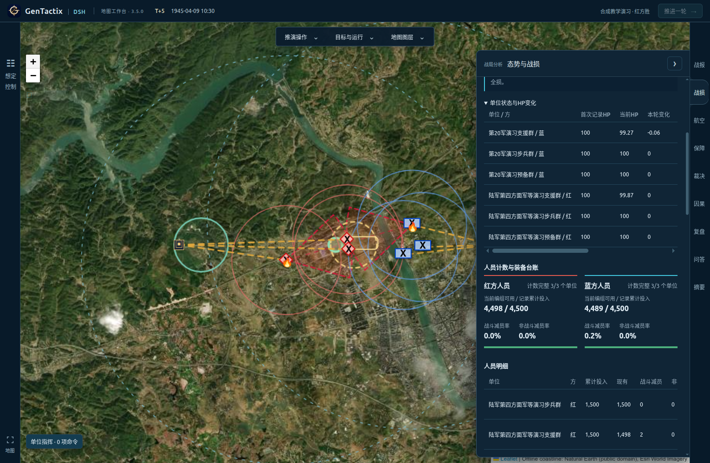

# 历史条件可控推演实测：湘西会战局部演习

## 结论与范围

本机3.5.0完成一次真实DSH与AFSIM联合运行。配置生成、可视化下令、自然语言、单位Agent、双方执行、状态账、局部目标、保存恢复和只读命令对照均可运行；不能据此认定全部历史推演功能已经完备。主要缺口是历史初态、地形/射界数据、自动转折识别，以及分析文本的因果与能力表述。

本轮没有修改产品代码、模型配置或安装包，没有上传GitHub。原有8份会话、模型密文与密钥均经摘要比对确认未变。

| 项目 | 实际配置 |
| --- | --- |
| 安装版 | Linux AppImage 3.5.0；冻结后端修订6e47f582b9184db1，与磁盘一致 |
| 外部引擎 | AFSIM 2.9.0，Linux/Wine，经DSH原生MCP调度 |
| 对局 | `e5dc3577c1a2`，`CA-AJ18-v1`，湘西会战资料派生 |
| 来源参考 | 红方“陆军第四方面军等”；蓝方“第20军”，保留来源ID及上下文 |
| 编组 | 双方各步兵群、支援群、预备群，每群1500人；各方累计投入4500人 |
| 装备 | 双方支援群各4门火炮、2个防空装备；各群6个工兵作业组、12个运输单元；装甲配额0 |
| 时间 | 演习起点1945-04-09 08:00，每轮30分钟，共5轮；08:00不是考证出的交战钟点 |
| 目标 | 桥东目标区连续控制两轮；桥梁、目标、局部数量及部署均为演习估计 |

DSH实际读取skill、读取史实基础并校验配置，生成耗时24.525秒。地图修改部署后旧验证失效，重新真实装载后才创建。本局属于“合成教学演习”，不等于湘西会战历史部署与战果复原；受控动作验证也不用于比较双方自主指挥水平。

## 五轮实际过程

| 回合/时刻 | 主要执行 | 桥梁施工 | 地面交战/航空任务 | 目标进度 |
| --- | --- | --- | --- | --- |
| T+1 08:30 | 人工地图移动与炮击；红方独立Agent侦察；蓝方规划完成构筑、炮击及侦察 | 0% | 2 / 0 | 0 |
| T+2 09:00 | 全局自然语言确认双方6项命令；架桥、空袭、构筑、补给和休整 | 50% | 0 / 1 | 0 |
| T+3 09:30 | 继续架桥、双方炮击、补给及恢复联络 | 100% | 2 / 0 | 0 |
| T+4 10:00 | 两支红方编组实际过桥，通行2/2批次 | 100% | 0 / 0 | 1 |
| T+5 10:30 | 保持控制并继续火力与补给，程序判红方达成目标 | 100% | 2 / 0 | 2，完成 |

累计红方战斗减员2人、现有4498人；蓝方减员11人、现有4489人；双方非战斗减员均为0。蓝方永久损失2门火炮，另有运输装备待修。这些均为教学模型输出。

T+2航空任务经历起飞、防空响应、打击、返场：2架出动、飞机损失0，目标当轮空袭减员5人及装备损失2件，蓝方防空消耗10发。后续航空面板保留T+2近期记录，并明确不是本轮新增战果。

## 功能验证

| 功能 | 实测结果 |
| --- | --- |
| 地图及菜单 | 军标选择、地图选点、命令入队通过；下令不提前改变世界 |
| 自然语言与权限 | 单位炮击及全局6单位草稿真实调用DSH，确认后执行，保留已有命令；导演模式控制双方 |
| Agent及决策 | 30条明确回执：人工26、批量规划3、原生单位Agent1，无`default_hold`；完整人工命令优先于已启用Agent |
| 行动约束 | 过期修订、未授权蓝方命令、禁止射击、炮兵冷却均拒收；完成后拒绝续推；无待修装备不提供维修动作 |
| 状态和时间 | 六份快照名单连续；人员及分类装备守恒；每轮精确推进1800秒，战报一致，无无据“满编”描述 |
| 补给与消耗 | 逐单位粮弹账、仓库扣减、总炮弹及防空弹药均与到货/发射记录对齐；净增加不等于没有消耗 |
| 原生反事实 | 未建成桥梁阻止过河；T+4两支红方改为待命时目标进度由1降为0；其余命令固定，主战局不变 |
| 在途取消 | 真实收到`native-agent-cancel`；取消的T+2候选不提交，回合与世界摘要未变 |
| 分析与日志 | 6帧轨迹；T+1两次DSH运行各核对28/28个持久事件；归因返回5项假说，语义仍需复核 |
| 问答与复盘 | 真实调用分别约16.0秒、29.8秒；问答日志确认调用`get_afsim_observation`和`get_afsim_changes`；世界不变 |
| 保存与恢复 | 导出含结果和轨迹，同ID导入拒绝覆盖；隔离副本独立恢复5轮、30回执、Agent绑定、复盘与问答 |
| 界面 | 9个分析标签有内容；10个射程图层可开关；390与1530像素宽检查通过；可读64K配置且不回显密钥 |

补充5组真实AFSIM对照通过：防护/展开与损耗、发射/冷却；运输、燃油与维修备件；桥梁施工及共享容量；疲劳、压制、通信延迟与情报时效；防空弹药与航空损失。其中维修2件消耗2件备件，无运输或无燃油时到货为0。这些隔离测试条件不是主对局战果。

重跑`python verify_all.py`：42/42组、420个unittest、0跳过；前端`npm run typecheck`通过。T+1模型40.640秒，AFSIM约1.48秒；T+2至T+5人工完整命令跳过模型，每轮界面总耗时约2.5–3.1秒，AFSIM约1.0–1.5秒。角色请求保留high与65,536输出预算。

## 问题与缺口

1. **历史初态及过程未完成。** 来源番号不等于历史局部实到量和部署。占点过桥目标不能表达湘西会战全部山地防御、航空遮断与反击过程，也不能由本局推广至其他44场。
2. **自动转折漏检。** 桥梁开放、首次过桥和目标达成都发生，但`turning_points`为空。当前算法只比较几何接触、补给截断和包围，缺少AFSIM桥梁、航空毁伤、目标进度与终局事件。
3. **模型解释存在语义错误。** 问答把蓝方炮兵损失直接关联失去目标控制权，但蓝方从初态就在目标区外；胜负实际由占点触发。归因还泛称“系统无运输吞吐算法”，实际AFSIM已有运输容量计算，应限定为“本页几何归因没有重算该效应”。证据ID有效不代表因果解释正确。
4. **取消提示遮挡指挥入口。** 取消后错误提示覆盖左下“单位指挥”按钮，普通点击被拦截；刷新并恢复本局后可继续。需要可关闭提示或调整布局。
5. **默认缩放下标签重叠。** 相邻单位坐标不同，但支援群标签拦截步兵军标；放大两级后成功。当前重叠名单只检查几乎同坐标，未解决屏幕像素命中范围。
6. **地面/航空统计口径混淆。** T+2空袭有战损，但`engagements=0`且战报称“本轮记录交战0次”。航空面板正确；总览应明确显示地面交战0次、航空打击1次。
7. **部分展示数据仍为空。** 本局6条直接火力范围、2个补给节点、6条补给连线有数据；地形几何0项、射界方向0项、士气未记录。卫星底图不是DEM、道路网或视线解算。保持未知是正确行为，但历史地形与射界功能尚不完备。

建议先用TDD修复取消遮挡、军标命中和交战统计；再补执行器能力清单及领域转折事件；历史初态和阶段目标按[逐场审计](历史过程逐场审计-2026-10-27.md)另行实现。此次不验收Windows、Cloudflare、其他战役全程或真实武器效能标定。

## 证据与查看

应用保留在`e5dc3577c1a2`的人员台账页面。证据位于`.cache/qa/controlled-history-20261027/`，包括逐轮快照、账目审计、两次AFSIM对照、持久日志、分项测试、分析文本、导出及恢复结果。自动化定位与等待修正的中间日志保留，不作为产品缺陷计数；上文交互缺陷均有实际元素拦截或状态证据。

